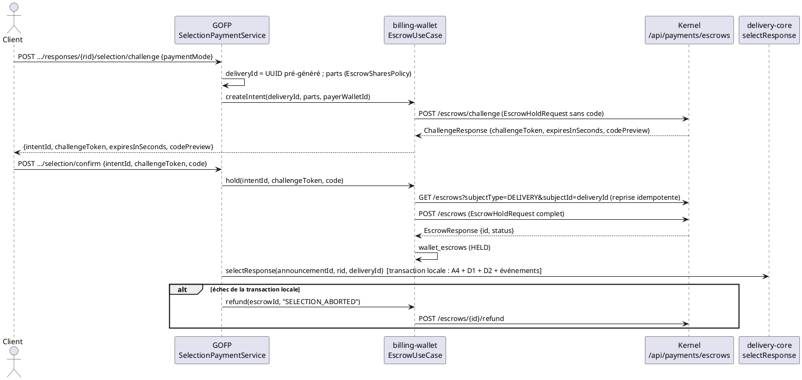

# Cible — cycle du colis, livraison, incidents, litiges, paiement séquestre, Kafka par agrégat

> **Statut :** spécification exécutable, rédigée par l'architecte le 2026-11-26 sur la branche
> `wt/architecture-evenements` (base `feat/single-system-tenant` = `a31fec25`), en tenant compte des lots
> Go-Freelancer en cours de fusion (`wt/gofp-annonces-besoins` GOFP-L2 (déjà fusionné dans `feat` en `77900803`), `wt/gofp-acteurs-profils` GOFP-L3,
> `wt/gofp-paiement-relais-adresses` GOFP-L4 ; GOFP-L1 `wt/gofp-livraison-colis` déjà fusionné).
>
> **Sources qui priment, dans l'ordre :** (1) `docs/architecture/chantiers/decisions-evenements-colis-livraison.md` (décisions de
> l'utilisateur, notées **[A]…[I]** ci-dessous, ex. **[B.7]**) ; (2) ce document ; (3) le `CLAUDE.md` du dépôt.
>
> **Règle pour les agents d'implémentation :** vous n'avez **pas** le droit de décider. Tout ce qui est marqué
> **« À TRANCHER PAR L'UTILISATEUR »** (§8) est implémenté **selon la valeur provisoire indiquée**, isolé derrière un
> point unique (constante, méthode ou réglage nommé dans le §8) pour être changé sans refonte, et rien d'autre n'est
> inventé. Toute divergence trouvée entre ce document et le code est remontée à l'architecte, pas corrigée en silence.
>
> Les références `fichier:ligne` portent sur `a31fec25` sauf mention « (GOFP-L2) » / « (GOFP-L4) » = branche du lot Go-Freelancer correspondant ; les lots de CE chantier sont notés « lot L0 … L9 » (§6) et les transitions de litige « LT1 … LT12 ».
> Chemins abrégés : `delivery/` = `logistics/tnt-delivery-core/src/main/java/com/yowyob/tiibntick/core/delivery/`,
> `incident/` = `logistics/tnt-incident-core/src/main/java/com/yowyob/tiibntick/core/incident/`,
> `dispute/` = `logistics/tnt-dispute-core/src/main/java/com/yowyob/tiibntick/core/dispute/`,
> `wallet/` = `billing/tnt-billing-wallet/src/main/java/com/yowyob/tiibntick/core/billing/wallet/`,
> `gofp/` = `coreBackend/tnt-go-freelancer-point-back-core/src/main/java/com/yowyob/tiibntick/core/gofreelancer/`.

## Sommaire

0. Constat vérifié dans le code (ce qui change et pourquoi)
1. Machines d'états (tables qui font foi) : livraison, colis, incident, litige, annonce, séquestre/encaissement
2. Correspondance livraison ↔ colis, vocabulaire unique, `isTerminal`/`isActive`
3. Catalogue Kafka (topics, enveloppe, en-têtes, clés, masquage, schémas, inventaire exhaustif, ancien → nouveau,
   consommateurs à corriger)
4. Paiement (séquestre, espèces, indemnisation, coût du retour) et comptabilité par propriétaire dans le Kernel
5. Seuils (3 tentatives, garde relais, rappel J-1) : stockage, API d'administration, surcharge par organisation
6. Lots parallélisables (worktrees, périmètres, ordre de fusion, Liquibase, tests exigés)
7. Impacts contrats (Mobile + BFF, Agency, Link, Market, Point Relais, plateforme d'administration)
8. Questions ouvertes — À TRANCHER PAR L'UTILISATEUR
9. Annexes (inventaire exhaustif des topics, inventaire des listeners)

---

## 0. Constat vérifié dans le code

| # | Constat | Preuve |
|---|---|---|
| C1 | `Parcel` n'a ni état ni événement. | `delivery/domain/model/aggregate/Parcel.java:19-53` (champs `id`, `specification`, `photoUrl`, dates, `version`) |
| C2 | `FAILED` est déclaré terminal mais a une sortie `FAILED → IN_TRANSIT` ; `TIMED_OUT`/`SLA_BREACHED` ont des transitions mais ne sont jamais posés. | `delivery/domain/model/enums/DeliveryStatus.java:89-91` ; `delivery/domain/policy/DeliveryStateTransitionPolicy.java:69-70` (FAILED→IN_TRANSIT), `:75-83` |
| C3 | La javadoc de l'enum diffère de la table (`CREATED → PAUSED_BY_INCIDENT` absent de la javadoc, etc.). | `DeliveryStatus.java:6-18` vs `DeliveryStateTransitionPolicy.java:42-84` |
| C4 | trust a son propre `ParcelLifecycleState` (10 états), déduit de la chaîne de garde, jamais lu du cœur. | `trust/tnt-trust-core/.../domain/model/enums/ParcelLifecycleState.java:12-33` ; `.../application/service/LogisticProofResolverService.java:209-218` |
| C5 | Le statut de livraison est publié sur 2 à 3 topics à la fois (fan-out), dont un alias `gofp.*` qui fait tourner le matching **deux fois** (l'anti-doublon est clé par topic). | `delivery/adapter/out/messaging/KafkaDeliveryEventPublisher.java:114-147` ; `gofp/application/usecase/MatchingUseCase.java:99-104` ; `kafka-async-wiring.md` §8.3 |
| C6 | Tout incident déclaré met la livraison en pause (aucune notion de non bloquant) ; un incident naît `DETECTED` puis est aussitôt `ACKNOWLEDGED`. | `incident/application/service/IncidentReportingService.java:74-80, 105-111` ; `incident/domain/model/Incident.java:139` |
| C7 | L'incident n'a pas de table de transitions : seule la sortie d'un état terminal est refusée ; `TRANSFERRING_TO_HUB` et `PENDING_CONFIRMATION` ne sont jamais atteints. | `Incident.java:345-355` ; `startTransferringToHub` n'est appelé nulle part ; `PENDING_CONFIRMATION` n'apparaît que dans l'enum |
| C8 | Les détections automatiques (SLA, GPS, géofence) **créent des incidents** et lancent leur traitement sans l'attendre. | `incident/adapter/kafka/IncidentEventConsumer.java:34-60, 91-110, 143-162` |
| C9 | `RETURN_TO_SENDER_ORDERED` existe déjà dans `ResolutionType` mais n'est utilisé nulle part ; aucune issue de litige ne modifie le colis autrement que par deux topics sans consommateur. | `dispute/domain/enums/ResolutionType.java:14` ; `dispute/infrastructure/adapter/out/delivery/DeliveryStatusAdapter.java:36-37, 52-71` |
| C10 | `close()` d'un litige permet `COMPENSATED` sans paiement (`RESOLVED_WITH_COMPENSATION`). | `dispute/domain/model/Dispute.java:362-372` |
| C11 | Le gel de paiement passe par la table locale `wallet_holds` ; l'indemnisation est désactivée (`COMPENSATION_NOT_SUPPORTED`). | `wallet/adapter/out/incident/IncidentPaymentFreezeAdapter.java:36-44` ; `wallet/adapter/in/kafka/WalletBillingEventConsumer.java:86, 108` |
| C12 | Le paiement d'une livraison est un transfert direct client → livreur, commission 5 % seulement « due ». | `gofp/application/service/DeliveryPaymentApplicationService.java:45, 114-160` (GOFP-L4) ; `docs/audits/remediation/kernel-wallet-migration.md` |
| C13 | Le Kernel expose séquestre, encaissement espèces et fonds d'indemnisation avec parts `MERCHANT/COURIER/PLATFORM`. | `docs/kernel-api/endpoints.md:14954-15090` ; schémas `EscrowHoldRequest`, `ShareDto`, `CashCollectionRequest`, `CompensationRequest` dans `docs/kernel-api/openapi.json` |
| C14 | 39 méthodes `@KafkaListener` sur 52 (21 classes) lancent leur traitement par `.subscribe()` sans l'attendre ; seuls sync et link ont une file de messages morts. | §9.2 ; `logistics/tnt-sync-core/.../config/SyncKafkaConfig.java:78-85` ; `coreBackend/tnt-link-back-core/.../config/LinkKafkaConsumerConfig.java:80-87` |
| C15 | `DisputeEventConsumer` avale les erreurs (`onErrorResume(e -> Mono.empty())`) : un échec n'est jamais retenté. | `dispute/infrastructure/adapter/in/messaging/DisputeEventConsumer.java:105-110` |
| C16 | La durée de garde relais n'existe nulle part comme réglage : 3 jours codés en dur (ou `requestedStorageDays` du besoin) ; `relay_point_max_storage_hours` (72 h) est réglable par tenant mais lu par personne. | `gofp/application/service/DeliveryStatusApplicationService.java:384-388` (GOFP-L4) ; `identity/tnt-administration-core/.../entity/TntPlatformOptionsEntity.java:26` |
| C17 | Les réglages plateforme existants sont **par tenant** (`/api/v1/admin/settings/tnt-platform-options`), alors que [B.5] veut un réglage plateforme. | `identity/tnt-administration-core/.../adapter/in/web/TntAdministrationController.java:169-215` |
| C18 | L'outbox publie avec la clé = `aggregateId` par défaut et les en-têtes `X-Yow-*` ; `X-Yow-Event-Id` n'est émis par personne. | `foundation/yow-event-kernel/.../domain/model/DomainEventEnvelope.java:128` ; `.../adapter/kafka/KafkaEventPublisher.java:106-133` ; `kafka-async-wiring.md` §8.3 |
| C19 | Couches : `delivery → incident` (delivery implémente `IMissionStatusPort`), `dispute → delivery`, `billing-wallet → incident`. Aucun cycle ne doit être créé. | `pom.xml` des modules ; `delivery/adapter/out/incident/MissionStatusPortAdapter.java:36` |

---

## 1. Machines d'états — tables qui font foi

### 1.0 Règles communes (toutes entités)

1. **Une seule table par entité**, codée dans **une** classe `…StateMachine` (domaine, sans Spring) sous la forme
   `Map<Status, Set<Status>>` + gardes nommées. La javadoc de l'enum, `isTerminal()`, `isActive()`, la doc et les
   tests sont **dérivés** de cette table (les tests vérifient : chaque état terminal a un ensemble de sorties vide ;
   chaque état non initial est atteignable depuis l'état initial ; chaque état non terminal a au moins une sortie).
2. **Chaque transition émet exactement un événement** dont le type est **mécanique** :
   `eventType = <Agrégat> + PascalCase(<état cible>)` (ex. `DELIVERY_ATTEMPT_FAILED` → `DeliveryAttemptFailed` :
   le mot d'agrégat n'est pas répété ; `PICKED_UP` → `DeliveryPickedUp`, `ParcelPickedUp`). Un test vérifie la règle
   sur tous les états. Le **déclencheur** est porté par le champ `trigger` de l'enveloppe (§3.3), l'état de départ par
   `previousStatus`.
3. **Changements sans transition** (attributs) : liste fermée par agrégat (§3.5), `eventType = <Agrégat> +
   PascalCase(<changeKind>)`, `previousStatus = status`.
4. **Retour à l'état d'avant** : l'agrégat mémorise l'état quitté dans un champ dédié ; la table liste l'ensemble des
   cibles possibles, la garde impose `cible == état mémorisé`.
5. **Persistance et événement dans la même transaction** (outbox) ; un changement d'état de livraison qui touche le
   colis met à jour le colis **dans la même transaction** et émet les deux événements [B.1].

### 1.1 Livraison — `DeliveryStatus` (delivery-core)

**États (13).** `CREATED`, `ASSIGNED`, `PICKED_UP`, `IN_TRANSIT`, `AT_RELAY_HUB`, `OUT_FOR_DELIVERY`,
`DELIVERY_ATTEMPT_FAILED`, `DELIVERED`, `FAILED`, `CANCELLED`, `INCIDENT_REPORTED`, `PAUSED_BY_INCIDENT`,
`INCIDENT_HANDOVER`. **Supprimés :** `TIMED_OUT`, `SLA_BREACHED` [C.3]. **Renommé :** `AT_RELAY_POINT` →
`AT_RELAY_HUB` (vocabulaire unique avec le colis, dont les noms sont reconduits « sans débat » [B.2] ; voir §2.3).

**`ASSIGNED` et `OUT_FOR_DELIVERY` existent côté livraison** (réponse à la question posée) :
- `ASSIGNED` : sans lui, « colis `ASSIGNED` » n'aurait pas de pendant (aujourd'hui une livraison `CREATED` peut avoir ou
  non un livreur, cf. `Delivery.assignDeliveryPerson`, `Delivery.java:265-281`, qui émet un faux « CREATED→CREATED »
  `:280`). `CREATED` = pas de livreur ; `ASSIGNED` = livreur désigné, colis pas encore enlevé.
- `OUT_FOR_DELIVERY` : dernier tronçon vers le destinataire pour **une tentative de remise** (depuis le relais ou après
  une tentative échouée). Il donne un sens au compteur de tentatives et remplace la « reprise » `AT_RELAY_POINT →
  IN_TRANSIT` quand la reprise mène au destinataire.

**Nature (`DeliveryKind`, nouveau champ, non modifiable)** : `OUTBOUND` (aller), `RETURN` (retour à l'expéditeur
[B.3]), `REDELIVERY` (nouvelle livraison ordonnée par un litige [B.7]). `parentDeliveryId` relie RETURN/REDELIVERY à la
livraison d'origine ; `parcelId` est le même [B.3].

**Motif d'échec (`DeliveryFailureReason`, nouveau)** — vocabulaire repris de `IncidentType` pour les faits client
(un nom par notion, §2.3) : `CLIENT_ABSENT_AT_DELIVERY`, `CLIENT_PHONE_UNREACHABLE`, `CLIENT_REFUSED_RECEPTION`,
`CLIENT_REFUSED_OTP_VALIDATION`, `CLIENT_WRONG_ADDRESS`, `CLIENT_INCOMPLETE_ADDRESS`, `CLIENT_BUILDING_ACCESS_BLOCKED`
(tentative) ; `MAX_ATTEMPTS_REACHED`, `NOT_COLLECTED_AT_RELAY`, `INCIDENT_UNRESOLVED`, `PARCEL_LOST`,
`PARCEL_DAMAGED` (échec final). Valeur provisoire QO-3 : une tentative échouée est une opération de livraison, pas un
incident.

**Partie responsable (`ResponsibleParty`, nouveau, delivery-core, réutilisé par incident et litige)** : `SENDER`,
`RECIPIENT`, `COURIER`, `PLATFORM`, `RELAY`, `AGENCY`, `NONE`. Sert au coût du retour [B.6].

**Table des transitions (fait foi).** Acteurs : `COURIER` = livreur assigné (acteur du JWT = `deliveryPersonId`
résolu), `SENDER` = expéditeur (`senderId`), `RELAY_OP` = opérateur du relais du colis, `AGENCY` = gestionnaire de
l'agence de la livraison, `SUPPORT` = support/admin TiiBnTick, `SYSTEM` = traitement interne (planificateur, port
d'un autre module). « prev » = état mémorisé `previousStatusBeforeIncident` (colonne existante
`previous_status_before_pause`, renommée côté code).

| # | De | Vers | Déclencheur (cas d'usage) | Acteur | Garde | Événement | Effets sur les autres agrégats |
|---|---|---|---|---|---|---|---|
| D1 | — | CREATED | `createDelivery` (annonce sélectionnée, création directe agence, retour, nouvelle livraison) | SYSTEM, SENDER, AGENCY | colis existant ; pour RETURN/REDELIVERY : colis `RETURN_REQUESTED` / `CREATED` | `DeliveryCreated` | colis : voir §2.1 (OUTBOUND : `ParcelCreated` si nouveau colis) |
| D2 | CREATED | ASSIGNED | `assignCourier` | SYSTEM (sélection d'annonce), AGENCY, RELAY_OP (retour d'un colis non retiré [F]) | livreur `APPROVED` (`DeliveryPersonStatus`) | `DeliveryAssigned` | colis → `ASSIGNED` (OUTBOUND/REDELIVERY) ; annonce → `ASSIGNED` si issue d'une annonce (déjà fait par la sélection, pas de 2e événement) |
| D3 | CREATED, ASSIGNED, PICKED_UP, PAUSED_BY_INCIDENT | CANCELLED | `cancelDelivery` | SENDER, AGENCY, SUPPORT | **provisoire QO-6** : seuls ces états ; motif obligatoire | `DeliveryCancelled` | colis : avant enlèvement → `CREATED` (ou reste `RETURN_REQUESTED` pour un RETURN) ; après enlèvement → `RETURN_REQUESTED` [B.4] (cause `SENDER_CANCELLED_AFTER_PICKUP`, payeur SENDER) ; annonce → `CANCELLED` ; séquestre → §4.2 |
| D4 | ASSIGNED | PICKED_UP | `confirmPickup` (code de remise expéditeur → livreur, ou relais → livreur pour un RETURN) | COURIER | code de remise valide (module GOFP `HandoverCodeService`) | `DeliveryPickedUp` | colis → `PICKED_UP` (OUTBOUND/REDELIVERY) ou `RETURN_IN_TRANSIT` (RETURN) ; trust : ancrage garde |
| D5 | PICKED_UP | IN_TRANSIT | `startTransit` | COURIER | — | `DeliveryInTransit` | colis → `IN_TRANSIT` (RETURN : reste `RETURN_IN_TRANSIT`, pas d'événement colis) |
| D6 | AT_RELAY_HUB | IN_TRANSIT | `resumeFromRelayHub` vers un **autre** relais | COURIER | prochain arrêt ≠ adresse du destinataire | `DeliveryInTransit` | colis → `IN_TRANSIT` ; inventaire : sortie du relais |
| D7 | IN_TRANSIT | AT_RELAY_HUB | `depositAtRelayHub` | COURIER (+ RELAY_OP qui scanne) | relais actif ; capacité (GOFP-L4) | `DeliveryAtRelayHub` | colis → `AT_RELAY_HUB` (`custody` = relais, `hubPackageEntryId`) ; inventaire : `HubPackageEntry` créée **avant** par l'orchestrateur GOFP `RelayDepositService` (inventory-core est en couche L4, delivery-core L3 ne peut pas l'appeler), qui passe son id à la commande ; si relais = destination : départ du délai de garde §5 |
| D8 | AT_RELAY_HUB, DELIVERY_ATTEMPT_FAILED | OUT_FOR_DELIVERY | `startFinalLeg` (nouvelle tentative de remise) | COURIER | depuis DELIVERY_ATTEMPT_FAILED : `attemptCount < maxAttempts` | `DeliveryOutForDelivery` | colis → `OUT_FOR_DELIVERY` (RETURN : pas d'événement colis) |
| D9 | IN_TRANSIT, OUT_FOR_DELIVERY | DELIVERY_ATTEMPT_FAILED | `recordFailedAttempt(reason)` | COURIER | `reason` ∈ motifs de tentative, ≠ `CLIENT_REFUSED_RECEPTION` ; après incrément `attemptCount < maxAttempts` | `DeliveryAttemptFailed` | colis → `DELIVERY_FAILED` (RETURN : reste `RETURN_IN_TRANSIT`) ; notification expéditeur |
| D10 | IN_TRANSIT, OUT_FOR_DELIVERY | FAILED | `recordFailedAttempt(reason)` | COURIER | `reason = CLIENT_REFUSED_RECEPTION` [B.4] **ou** après incrément `attemptCount ≥ maxAttempts` (alors `failureReason = MAX_ATTEMPTS_REACHED`, motif de la dernière tentative gardé dans `lastAttemptReason`) | `DeliveryFailed` | colis → `RETURN_REQUESTED` (payeur SENDER) [B.4][B.6] ; création automatique de la livraison retour (QO-4) ; annonce → `COMPLETED` (QO-9) ; séquestre §4.2 |
| D11 | IN_TRANSIT, OUT_FOR_DELIVERY, AT_RELAY_HUB | DELIVERED | `completeDelivery` (OTP destinataire ; au relais : retrait au guichet avec code) | COURIER ; RELAY_OP pour le retrait | OTP / code de retrait valide ; colis non `UNDER_DISPUTE` | `DeliveryDelivered` | colis → `DELIVERED` (RETURN : `RETURNED`) ; annonce → `COMPLETED` ; séquestre → libération §4.2 ; inventaire : sortie (retrait) ; trust : preuve de livraison |
| D12 | AT_RELAY_HUB | FAILED | planificateur de garde (§5) | SYSTEM | relais = destination ; `now ≥ depositedAt + storageDays` ; non retiré | `DeliveryFailed` (`NOT_COLLECTED_AT_RELAY`) | colis → `RETURN_REQUESTED` (payeur SENDER) ; le relais peut créer l'annonce de retour [F] |
| D13 | ASSIGNED, PICKED_UP, IN_TRANSIT, OUT_FOR_DELIVERY, DELIVERY_ATTEMPT_FAILED | INCIDENT_REPORTED | `IMissionStatusPort.markIncidentReported` appelé par `ReportIncident` | SYSTEM (déclaration par COURIER) | aucun incident bloquant ouvert ; enregistre `prev` | `DeliveryIncidentReported` | aucun effet colis (§2.1) |
| D14 | INCIDENT_REPORTED | prev (ASSIGNED, PICKED_UP, IN_TRANSIT, OUT_FOR_DELIVERY, DELIVERY_ATTEMPT_FAILED) | `IMissionStatusPort.resumeMission` (triage non bloquant, incident annulé, incident résolu) | SYSTEM | cible = `prev` | `Delivery<prev>` (`trigger` = `INCIDENT_NOT_BLOCKING` / `INCIDENT_CANCELLED` / `INCIDENT_RESOLVED`) | aucun effet colis |
| D15 | INCIDENT_REPORTED, ASSIGNED, PICKED_UP, IN_TRANSIT, OUT_FOR_DELIVERY, DELIVERY_ATTEMPT_FAILED | PAUSED_BY_INCIDENT | `IMissionStatusPort.pauseMission` (triage bloquant) | SYSTEM | incident bloquant ; `prev` = état opérationnel (gardé si déjà posé en D13) | `DeliveryPausedByIncident` | aucun effet colis ; séquestre : rien (gel seulement à l'escalade, §4.2) |
| D16 | PAUSED_BY_INCIDENT | prev | `resumeMission` (incident résolu sans remise de colis ; ou remplaçant avant enlèvement → `ASSIGNED` avec le nouveau livreur) | SYSTEM | cible = `prev` | `Delivery<prev>` (`trigger` = `INCIDENT_RESOLVED`) | colis : aucun ; si nouveau livreur : changement de livreur dans l'instantané |
| D17 | PAUSED_BY_INCIDENT | INCIDENT_HANDOVER | `IMissionStatusPort.startHandover` (remplaçant retenu : premier qui accepte, ou choisi par l'agence [D.4]) | SYSTEM | `prev` ∈ {PICKED_UP, IN_TRANSIT, OUT_FOR_DELIVERY, DELIVERY_ATTEMPT_FAILED} (colis entre les mains du livreur) | `DeliveryIncidentHandover` | aucun effet colis ; client notifié [D.4] |
| D18 | INCIDENT_HANDOVER | prev | `resumeMission` après double confirmation (`HandoverStatus.BOTH_CONFIRMED`) | SYSTEM | `newDeliveryPersonId` non nul | `Delivery<prev>` (`trigger` = `HANDOVER_COMPLETED`) | livreur remplacé ; trust : transfert de garde ; séquestre : QO-11 |
| D19 | INCIDENT_HANDOVER | PAUSED_BY_INCIDENT | `IMissionStatusPort.abortHandover` (remise expirée ou annulée : `HandoverStatus.TIMED_OUT/CANCELLED`) | SYSTEM | — | `DeliveryPausedByIncident` (`trigger` = `HANDOVER_ABORTED`) | — |
| D20 | PAUSED_BY_INCIDENT, INCIDENT_HANDOVER | FAILED | `IMissionStatusPort.failMission` (incident résolu « sans issue » : `IncidentDeliveryOutcome.FAILED`) [C.1] | SYSTEM | — | `DeliveryFailed` (`INCIDENT_UNRESOLVED`) | colis : enlevé → `RETURN_REQUESTED` (payeur selon `ResponsibleParty` de l'incident [B.6]) ; non enlevé → `CREATED` ; **provisoire QO-5** |
| D21 | toute livraison non terminale dont le colis passe `LOST`/`DAMAGED` | FAILED | `ParcelDisputeUseCase.applyDisputeOutcome` (§1.5) | SYSTEM | — | `DeliveryFailed` (`PARCEL_LOST` / `PARCEL_DAMAGED`) | colis déjà terminal ; pas de retour |

Toute paire `(de, vers)` absente de cette table est **refusée** par `InvalidDeliveryStateTransitionException` (HTTP 409).
Les états `DELIVERED`, `FAILED`, `CANCELLED` n'ont **aucune** sortie.

**Gel par litige (provisoire QO-7).** Tant que le colis est `UNDER_DISPUTE`, toute transition de sa livraison active
autre que D20/D21 est refusée (`DeliveryFrozenByDisputeException`, 409). Ce n'est pas un état de livraison : c'est une
garde transverse vérifiée par la machine.

**Compteur de tentatives.** Colonne existante `delivery_attempt_number` (`007-add-freelancer-context-to-deliveries.yaml`)
renommée côté domaine `attemptCount`, **initialisée à 0** (aujourd'hui 1, `Delivery.java:194`) ; incrémentée par D9/D10
seulement. `incrementDeliveryAttempt()` (`Delivery.java:480-483`) est supprimée. `maxAttempts` est lu au moment de la
transition (§5), pas copié à la création.

**Indicateur de retard [C.3].** Champs `late` (booléen), `lateSince`, `lastAlertType` posés par le surveillant (§3.5,
`DeliveryAlertRaised`), remis à faux sur `DELIVERED/FAILED/CANCELLED`. Ce ne sont pas des états.

**Dérivés (générés depuis la table, testés) :**
- `isTerminal()` = {DELIVERED, FAILED, CANCELLED} ;
- `isActive()` = tous les états non terminaux sauf `CREATED` (= une mission engagée avec un livreur) ;
- `isIncidentState()` = {INCIDENT_REPORTED, PAUSED_BY_INCIDENT, INCIDENT_HANDOVER} ;
- `courierHoldsParcel()` = {PICKED_UP, IN_TRANSIT, OUT_FOR_DELIVERY, DELIVERY_ATTEMPT_FAILED} ∪ (état d'incident dont
  `prev` est dans cet ensemble) ;
- `isPausedByIncident()` devient `isIncidentState()` (appelants à migrer).

`updateEta` reste permis si `isActive()` (`Delivery.java:341-348`). Les requêtes SQL qui listent des statuts en dur
(`R2dbcDeliveryRepository.java:37`) sont réécrites à partir de ces dérivés.

### 1.2 Colis — `ParcelStatus` (delivery-core, réutilisé tel quel par trust)

**États (14)** [B.2] : `CREATED`, `ASSIGNED`, `PICKED_UP`, `IN_TRANSIT`, `AT_RELAY_HUB`, `OUT_FOR_DELIVERY`,
`DELIVERED`, `DELIVERY_FAILED`, `UNDER_DISPUTE`, `RETURNED`, `RETURN_REQUESTED`, `RETURN_IN_TRANSIT`, `LOST`,
`DAMAGED`. L'enum vit dans `delivery/domain/model/enums/ParcelStatus.java`. trust supprime `ParcelLifecycleState`
et lit l'état réel via `ParcelUseCase.findParcelById` au lieu de l'inférer (`LogisticProofResolverService.java:209-218`
devient une simple lecture) : trust ne fait qu'ancrer [B.1].

**Nouveaux champs du colis :** `status`, `statusChangedAt`, `previousStatusBeforeDispute`, `openDisputeId`,
`currentDeliveryId` (livraison non terminale en cours, au plus une), `custody` (`holderType` ∈ {SENDER, COURIER,
RELAY, RECIPIENT, NONE}, `holderId`, `hubId`, `hubPackageEntryId`), `returnCause`, `returnCostPayer`
(`ResponsibleParty`), `closedReason`. `CREATED` signifie « enregistré, aucun livreur responsable » (le lieu réel est
dans `custody`).

**Table des transitions du colis (fait foi).** Le colis ne change **jamais** seul : chaque transition est provoquée par
une transition de livraison (colonne « via ») ou par le cas d'usage litige/retour.

| # | De | Vers | Via (cause unique) | Garde | Événement |
|---|---|---|---|---|---|
| P1 | — | CREATED | création du colis (enregistrement, ou D1 d'un OUTBOUND avec nouveau colis) | — | `ParcelCreated` |
| P2 | CREATED | ASSIGNED | D2 (OUTBOUND, REDELIVERY) | — | `ParcelAssigned` |
| P3 | ASSIGNED | CREATED | D3 avant enlèvement ; D20 avant enlèvement | — | `ParcelCreated` (`trigger` = `DELIVERY_CANCELLED`/`DELIVERY_FAILED`) |
| P4 | ASSIGNED | PICKED_UP | D4 (OUTBOUND, REDELIVERY) | — | `ParcelPickedUp` |
| P5 | PICKED_UP | IN_TRANSIT | D5 | — | `ParcelInTransit` |
| P6 | AT_RELAY_HUB | IN_TRANSIT | D6 | — | `ParcelInTransit` |
| P7 | IN_TRANSIT | AT_RELAY_HUB | D7 | — | `ParcelAtRelayHub` |
| P8 | AT_RELAY_HUB, DELIVERY_FAILED | OUT_FOR_DELIVERY | D8 | — | `ParcelOutForDelivery` |
| P9 | IN_TRANSIT, OUT_FOR_DELIVERY | DELIVERY_FAILED | D9 | — | `ParcelDeliveryFailed` |
| P10 | IN_TRANSIT, OUT_FOR_DELIVERY, AT_RELAY_HUB | DELIVERED | D11 (OUTBOUND, REDELIVERY) | — | `ParcelDelivered` |
| P11 | PICKED_UP, IN_TRANSIT, AT_RELAY_HUB, OUT_FOR_DELIVERY, DELIVERY_FAILED | RETURN_REQUESTED | D3 après enlèvement ; D10 ; D12 ; D20 après enlèvement | — | `ParcelReturnRequested` (`returnCause`, `returnCostPayer`) |
| P12 | tout état sauf UNDER_DISPUTE, LOST, DAMAGED | UNDER_DISPUTE | `ParcelDisputeUseCase.openDispute` (litige ouvert avec `packageId`) | aucun litige ouvert sur le colis ; pour DELIVERED/RETURNED : dans la fenêtre `disputeFilingWindowDays` | `ParcelUnderDispute` |
| P13 | UNDER_DISPUTE | `previousStatusBeforeDispute` | issue `RESTORE_PREVIOUS` (plainte rejetée, accord amiable, indemnisation sans perte ni dommage, retrait, expiration, clôture administrative) [B.7] | cible = état mémorisé | `Parcel<état rétabli>` (`trigger` = `DISPUTE_<issue>`) |
| P14 | UNDER_DISPUTE | LOST | issue `TOTAL_LOSS_COMPENSATED` [B.7] | — | `ParcelLost` |
| P15 | UNDER_DISPUTE | DAMAGED | issue `DAMAGE_COMPENSATED` [B.7] | — | `ParcelDamaged` |
| P16 | UNDER_DISPUTE | RETURN_REQUESTED | issue `RETURN_TO_SENDER_ORDERED` [B.7] | — | `ParcelReturnRequested` |
| P17 | UNDER_DISPUTE | CREATED | issue `REDELIVERY_ORDERED` : création d'une livraison REDELIVERY [B.7] | — | `ParcelCreated` (`trigger` = `DISPUTE_REDELIVERY_ORDERED`) |
| P18 | RETURN_REQUESTED | RETURN_IN_TRANSIT | D4 d'une livraison RETURN | — | `ParcelReturnInTransit` |
| P19 | RETURN_IN_TRANSIT | RETURN_REQUESTED | D3 ou D10/D12/D20 d'une livraison RETURN (retour annulé ou échoué) | — | `ParcelReturnRequested` (`trigger` = `RETURN_DELIVERY_CANCELLED`/`RETURN_DELIVERY_FAILED`) ; **provisoire QO-8** |
| P20 | RETURN_IN_TRANSIT | RETURNED | D11 d'une livraison RETURN | — | `ParcelReturned` |

- `LOST` et `DAMAGED` sont **terminaux** (aucune sortie) [B.2].
- `DELIVERED` et `RETURNED` sont **clos** : leur seule sortie est P12, gardée par la fenêtre de litige (réglage existant
  `dispute_filing_window_days`, `TntPlatformOptionsEntity.java`). `isClosed()` = {DELIVERED, RETURNED} ;
  `isTerminal()` = {LOST, DAMAGED}.
- Tous les états sont atteignables (test) ; aucun état non terminal n'est sans sortie.
- Une livraison RETURN ou REDELIVERY ne peut être créée que si `currentDeliveryId` est nul (au plus une livraison non
  terminale par colis).

### 1.3 Incident — `IncidentStatus` (incident-core)

**États (18)** : `DETECTED` est **supprimé** [D.2] ; un incident naît `REPORTED`. Restent : `REPORTED`,
`ACKNOWLEDGED`, `TRIAGED`, `AUTO_RESOLVING`, `REASSIGNING_DRIVER`, `AWAITING_HANDOVER`, `REROUTING`,
`TRANSFERRING_TO_HUB`, `AUTO_RESOLUTION_FAILED`, `PENDING_AGENCY_ASSIGNMENT`, `AGENCY_HANDLING`,
`WAITING_INTERAGENCY`, `INTERAGENCY_IN_PROGRESS`, `ESCALATED`, `PENDING_CONFIRMATION`, `RESOLVED`, `CLOSED`,
`CANCELLED`. Terminaux : `CLOSED`, `CANCELLED`. `PENDING_AGENCY_ASSIGNMENT`/`AGENCY_HANDLING` désignent « le
gestionnaire » : l'agence de la livraison, ou le support TiiBnTick quand `agencyId` est nul (Go/Freelancer).

**Déclaration [D.1][D.3].** Seul le livreur assigné à la livraison (`Delivery.deliveryPersonId` résolu vers son
acteur) peut appeler `ReportIncident` ; `reportedByRole` est déduit du jeton, jamais lu du corps. `ReportDriverWithdrawal`
suit la même garde. Types déclarables : préfixes `DRIVER_`, `VEHICLE_`, `CLIENT_`, `PARCEL_`, `GEO_`, `RELAY_`,
`REGULATORY_`, `HUMAN_` (lui-même, véhicule, client, colis, route/zone, point relais, réglementaire, humain). Interdits
au livreur : `SYSTEM_*`, `AUTOMATION_*` (réservés aux alertes et au support [D.3]) ; `SLA_*`, `AGENCY_*`, `GO_*`,
`FREELANCER_*` (hors des catégories décidées). La liste est calculée par `IncidentType.isDeclarableByCourier()`
(un test énumère les 150 valeurs). Exclusion provisoire de certains types « de détection » à l'intérieur des
préfixes autorisés : **QO-12**. `IncidentTriageService.deriveCategory` (`IncidentTriageService.java:76-91`) reste la
source de la catégorie.

**Bloquant / non bloquant.** Nouveau champ `blocking` (booléen) fixé au triage par `IncidentBlockingPolicy`
(provisoire **QO-2** : `blocking = requiresDriverReplacement() || severity ≥ HIGH` ; le livreur peut forcer « je ne
peux pas continuer » = `blocking=true` à la déclaration). `isBlockingMission()` (`Incident.java:306-308`) devient
`!status.isTerminal() && blocking`.

**Table des transitions (fait foi).** Acteurs : `COURIER` = déclarant ; `REPLACEMENT` = livreur remplaçant ;
`MANAGER` = gestionnaire (agence ou support, permission `incident:manage`) ; `SYSTEM`.

| # | De | Vers | Déclencheur | Acteur | Garde | Événement | Effet livraison / paiement |
|---|---|---|---|---|---|---|---|
| I1 | — | REPORTED | `ReportIncident` / `ReportDriverWithdrawal` | COURIER | type déclarable ; livraison non terminale ; déclarant = livreur assigné | `IncidentReported` | D13 si la livraison est dans un état déclarable (sinon incident rattaché sans transition) |
| I2 | REPORTED | ACKNOWLEDGED | accusé automatique (comportement actuel, `IncidentReportingService.java:105-111`) | SYSTEM | — | `IncidentAcknowledged` | — |
| I3 | ACKNOWLEDGED | TRIAGED | `IncidentClassificationService` (sévérité, géo, SLA, `blocking`) | SYSTEM | — | `IncidentTriaged` | `blocking` → D15 ; sinon D14 (`INCIDENT_NOT_BLOCKING`) |
| I4 | TRIAGED | AUTO_RESOLVING | `StartAutoResolution` | SYSTEM | `blocking` ; livraison sans agence (`agencyId` nul) | `IncidentAutoResolving` | — |
| I5 | TRIAGED | PENDING_AGENCY_ASSIGNMENT | `StartAutoResolution` | SYSTEM | `blocking` ; livraison d'agence [D.4] | `IncidentPendingAgencyAssignment` | — |
| I6 | TRIAGED | RESOLVED | `ResolveIncident` (non bloquant traité) | MANAGER, COURIER (auto-clôture d'un non bloquant) | `!blocking` | `IncidentResolved` | livraison déjà sortie de INCIDENT_REPORTED (D14) |
| I7 | AUTO_RESOLVING | REASSIGNING_DRIVER | moteur : `requiresDriverReplacement()` (`Incident.java:315-324`) | SYSTEM | — | `IncidentReassigningDriver` | appel au matching de remplaçants [D.4] |
| I8 | AUTO_RESOLVING | REROUTING | moteur : type `GEO_*` | SYSTEM | — | `IncidentRerouting` | — |
| I9 | AUTO_RESOLVING | TRANSFERRING_TO_HUB | moteur : **provisoire QO-13** (aucun remplaçant possible et relais à portée) | SYSTEM | — | `IncidentTransferringToHub` | — |
| I10 | AUTO_RESOLVING, REASSIGNING_DRIVER, REROUTING, TRANSFERRING_TO_HUB | AUTO_RESOLUTION_FAILED | moteur : échec (aucun livreur, reroutage impossible…) | SYSTEM | — | `IncidentAutoResolutionFailed` | — |
| I11 | AUTO_RESOLUTION_FAILED | PENDING_AGENCY_ASSIGNMENT | enchaînement automatique (`IncidentAutoResolutionService.java:132`) | SYSTEM | — | `IncidentPendingAgencyAssignment` | — |
| I12 | REASSIGNING_DRIVER | AWAITING_HANDOVER | un remplaçant accepte (le premier) [D.4] | REPLACEMENT | livraison `courierHoldsParcel` | `IncidentAwaitingHandover` | D17 ; client notifié |
| I13 | AGENCY_HANDLING | AWAITING_HANDOVER | l'agence désigne un de ses livreurs [D.4] (`IAssignReplacementDriverUseCase`) | MANAGER | idem I12 | `IncidentAwaitingHandover` | D17 |
| I14 | AWAITING_HANDOVER | RESOLVED | double confirmation `BOTH_CONFIRMED` (`IncidentHandoverService.java:100-125`) | COURIER + REPLACEMENT | codes valides | `IncidentResolved` (`trigger` = `HANDOVER_COMPLETED`) | D18 ; dégel si gelé |
| I15 | AWAITING_HANDOVER | REASSIGNING_DRIVER | remise `TIMED_OUT`/`CANCELLED` | SYSTEM | — | `IncidentReassigningDriver` (`trigger` = `HANDOVER_ABORTED`) | D19 |
| I16 | REASSIGNING_DRIVER | RESOLVED | remplaçant retenu **avant enlèvement** (pas de colis à remettre) | REPLACEMENT | livraison `prev = ASSIGNED` | `IncidentResolved` | D16 vers ASSIGNED avec le nouveau livreur |
| I17 | REROUTING, TRANSFERRING_TO_HUB | RESOLVED | reroutage appliqué / colis déposé au relais | SYSTEM | — | `IncidentResolved` | D16 (TRANSFERRING_TO_HUB : voir QO-13) |
| I18 | PENDING_AGENCY_ASSIGNMENT | AGENCY_HANDLING | `StartAgencyHandling` | MANAGER | — | `IncidentAgencyHandling` | — |
| I19 | AGENCY_HANDLING | WAITING_INTERAGENCY | `RequestCooperation` | MANAGER | livraison d'agence | `IncidentWaitingInteragency` | — |
| I20 | WAITING_INTERAGENCY | INTERAGENCY_IN_PROGRESS | coopération acceptée | MANAGER (autre agence) | — | `IncidentInteragencyInProgress` | — |
| I21 | WAITING_INTERAGENCY, INTERAGENCY_IN_PROGRESS | AGENCY_HANDLING | coopération refusée / échouée | MANAGER | — | `IncidentAgencyHandling` | — |
| I22 | INTERAGENCY_IN_PROGRESS | RESOLVED | `RecordCooperationCompletion` réussie | MANAGER | — | `IncidentResolved` | D16/D18 selon le cas |
| I23 | AGENCY_HANDLING, ESCALATED | PENDING_CONFIRMATION | `ProposeResolution` (nouveau) — **provisoire QO-14** | MANAGER | — | `IncidentPendingConfirmation` | — |
| I24 | PENDING_CONFIRMATION | RESOLVED | `ConfirmResolution` (nouveau) | COURIER (déclarant) ou SYSTEM après délai | — | `IncidentResolved` | selon `deliveryOutcome` |
| I25 | PENDING_CONFIRMATION | AGENCY_HANDLING | `ContestResolution` (nouveau) | COURIER | — | `IncidentAgencyHandling` | — |
| I26 | AGENCY_HANDLING | RESOLVED | `ResolveIncident` (comportement actuel, `IncidentAgencyManagementService.java:81-86`) | MANAGER | — | `IncidentResolved` | selon `deliveryOutcome` |
| I27 | ACKNOWLEDGED, TRIAGED, AUTO_RESOLVING, REASSIGNING_DRIVER, AWAITING_HANDOVER, REROUTING, TRANSFERRING_TO_HUB, AUTO_RESOLUTION_FAILED, PENDING_AGENCY_ASSIGNMENT, AGENCY_HANDLING, WAITING_INTERAGENCY, INTERAGENCY_IN_PROGRESS, ESCALATED | ESCALATED | `EscalateIncident` (niveau +1) ou `IncidentAutoEscalationScheduler` / `IncidentSlaMonitorScheduler` | MANAGER, SYSTEM | — | `IncidentEscalated` (`details.level`) | **gel du séquestre** si non gelé [H.1] |
| I28 | ESCALATED | AGENCY_HANDLING | reprise par l'autorité supérieure | MANAGER | — | `IncidentAgencyHandling` | — |
| I29 | ESCALATED | RESOLVED | `ResolveIncident` | MANAGER | — | `IncidentResolved` | selon `deliveryOutcome` ; dégel si pas de litige ouvert |
| I30 | RESOLVED | CLOSED | `CloseIncident` (`IncidentEscalationService.java:101-114`) | MANAGER, SYSTEM | — | `IncidentClosed` | compteur d'incidents du livreur (actor) |
| I31 | tout non terminal sauf RESOLVED | CANCELLED | `CancelIncident` (déclaration erronée) | COURIER tant que REPORTED/ACKNOWLEDGED/TRIAGED ; MANAGER sinon | — | `IncidentCancelled` | D14 / D16 vers `prev` ; dégel si gelé |

**`deliveryOutcome` (nouveau, obligatoire sur toute transition vers RESOLVED)** : `RESUMED` (D14/D16/D18) ou `FAILED`
(D20, « incident sans issue » [C.1]) ; avec `responsibleParty` (`ResponsibleParty`) qui fixe le payeur du retour [B.6].

**Escalade en litige.** `EscalateIncident` avec `triggerDispute=true` (`IncidentEscalationService.java:88-93, 135-153`)
reste une transition I27 + **un** changement sans transition `IncidentEscalatedToDispute` (§3.5). dispute-core ouvre le
litige en consommant `tnt.incident.events` (§3.7) ; l'incident reste `ESCALATED` jusqu'à sa résolution par le
gestionnaire (provisoire **QO-15**).

**Remise (`HandoverStatus`)** : `PENDING → ORIGINAL_CONFIRMED | REPLACEMENT_CONFIRMED → BOTH_CONFIRMED` ; `PENDING,
ORIGINAL_CONFIRMED, REPLACEMENT_CONFIRMED → TIMED_OUT | CANCELLED`. Sous-entité de l'incident : chaque confirmation
partielle émet le changement sans transition `IncidentHandoverConfirmed` ; `BOTH_CONFIRMED` déclenche I14,
`TIMED_OUT/CANCELLED` déclenche I15.

**Supprimé :** création d'incidents par détection (C8) : les trois listeners de `incident/adapter/kafka/IncidentEventConsumer.java`
sont supprimés ; la détection devient des **alertes de livraison** (§3.5, lot L3) [D.1].

**Livré par le lot L3 (2026-11-26), relevé dans le code.** La table I1–I31 est `IncidentStatus.TRANSITIONS`
(`IncidentLifecycleL3Test` la compare ligne à ligne à ce paragraphe). Écarts et précisions :

- QO-15 appliquée telle que décidée (décisions §QO-15), pas la version provisoire ci-dessus : l'escalade en litige
  résout l'incident (`RESOLVED`, `deliveryOutcome = DISPUTE`, motif « transféré en litige ») et émet
  `IncidentEscalatedToDispute`. dispute-core lit encore `tnt.incident.escalated.to.dispute` (double écriture, bascule
  sur `tnt.incident.events` au lot L8).
- `deliveryOutcome` (`RESUMED`, `FAILED`, `DISPUTE`) est obligatoire pour résoudre un incident bloquant ; `RESUMED`
  par défaut pour un incident non bloquant.
- I17 depuis `TRANSFERRING_TO_HUB` : pas encore de signal « colis déposé au relais » ; le gestionnaire résout à la main.
- I18 par le support TiiBnTick : `agency/handle` sans `agencyId` (incident d'une livraison sans agence).
- Un livreur n'annule son incident que dans `REPORTED`, `ACKNOWLEDGED` ou `TRIAGED` ; ensuite seul le gestionnaire
  annule (I31).
- Les délais (`confirmationDelay` 24 h, `handoverTimeout` 2 h, `hubTransferMaxKm` 5 km) sont des propriétés
  `tnt.incident.lifecycle.*`, appliquées par `IncidentLifecycleScheduler` (ShedLock, toutes les 5 min).

### 1.4 Litige — `DisputeStatus` + `ResolutionType` (dispute-core)

**États (10, inchangés)** : `OPEN`, `UNDER_INVESTIGATION`, `AWAITING_EVIDENCE`, `MEDIATION_IN_PROGRESS`,
`PENDING_ARBITRATION`, `PENDING_COMPENSATION`, `COMPENSATED`, `CLOSED_RESOLVED`, `CLOSED_WITHDRAWN`,
`CLOSED_EXPIRED`. Terminaux (`DisputeStatus.java:87-91`) : `COMPENSATED`, `CLOSED_RESOLVED`, `CLOSED_WITHDRAWN`,
`CLOSED_EXPIRED`.

**`ResolutionType` (cible, 8 valeurs)** : `COMPENSATION_GRANTED`, `PARTIAL_COMPENSATION` (indemnisation sans perte ni
dommage du colis, ex. retard), `TOTAL_LOSS_COMPENSATED` (**nouveau**, perte totale indemnisée → `LOST`),
`DAMAGE_COMPENSATED` (**nouveau**, dommage indemnisé → `DAMAGED`), `COMPLAINT_DISMISSED`, `MUTUAL_AGREEMENT`,
`REDELIVERY_ORDERED`, `RETURN_TO_SENDER_ORDERED` (existe déjà, `ResolutionType.java:14` ; [B.7] demande
« RETURN_TO_SENDER » : le nom existant est gardé, homogène avec `REDELIVERY_ORDERED` — confirmation **QO-16**). La règle
`RuleDispute` porte en plus `responsibleParty` (payeur du retour/de la nouvelle livraison [B.6]).

**Qui ouvre [E]** : `ClaimantType` ∈ {`CLIENT` (expéditeur), `RECIPIENT`, `FREELANCER`/`PERMANENT_DELIVERER` (le
livreur), `HUB_OPERATOR` (relais), `SYSTEM` (support, et ouverture automatique depuis un incident)}. `AGENCY_MANAGER`
garde son droit actuel. La garde vérifie que le demandeur est bien partie à la livraison/au colis (expéditeur,
destinataire = `recipientActorId` quand il est connu, livreur assigné, opérateur du relais détenteur) ou support.

**Table des transitions (fait foi)** — `MEDIATOR` = permission `dispute:resolve`.

| # | De | Vers | Déclencheur | Acteur | Garde | Événement | Effets |
|---|---|---|---|---|---|---|---|
| LT1 | — | OPEN | `OpenDispute` / ouverture auto sur `IncidentEscalatedToDispute` | parties [E], SYSTEM | colis : P12 possible ; un seul litige ouvert par colis | `DisputeOpen` | colis → `UNDER_DISPUTE` (P12, même transaction) ; séquestre gelé (§4.2) |
| LT2 | OPEN | UNDER_INVESTIGATION | `AssignMediator` (`Dispute.java:201-206`) | MEDIATOR | — | `DisputeUnderInvestigation` | — |
| LT3 | UNDER_INVESTIGATION | AWAITING_EVIDENCE | `RequestEvidence` (`:250-255`) | MEDIATOR | échéance fournie | `DisputeAwaitingEvidence` | — |
| LT4 | AWAITING_EVIDENCE | UNDER_INVESTIGATION | `AddEvidence` (`:223-229`) | parties | — | `DisputeUnderInvestigation` (`trigger` = `EVIDENCE_SUBMITTED`) | — |
| LT5 | UNDER_INVESTIGATION | MEDIATION_IN_PROGRESS | `StartMediation` (`:269-271`) | MEDIATOR | — | `DisputeMediationInProgress` | — |
| LT6 | UNDER_INVESTIGATION, MEDIATION_IN_PROGRESS | PENDING_ARBITRATION | `EscalateDispute` (`:312-320`) | MEDIATOR | — | `DisputePendingArbitration` | — |
| LT7 | MEDIATION_IN_PROGRESS, PENDING_ARBITRATION | PENDING_COMPENSATION | `RuleDispute` avec indemnisation (`:283-292`) | MEDIATOR | `resolutionType` ∈ {COMPENSATION_GRANTED, PARTIAL_COMPENSATION, TOTAL_LOSS_COMPENSATED, DAMAGE_COMPENSATED} et montant > 0 | `DisputePendingCompensation` | colis : issue appliquée **à l'indemnisation** (LT9), pas avant ; paiement de l'indemnité lancé (§4.3) |
| LT8 | MEDIATION_IN_PROGRESS, PENDING_ARBITRATION | CLOSED_RESOLVED | `RuleDispute` sans indemnisation | MEDIATOR | `resolutionType` ∈ {COMPLAINT_DISMISSED, MUTUAL_AGREEMENT, REDELIVERY_ORDERED, RETURN_TO_SENDER_ORDERED} | `DisputeClosedResolved` | colis : P13 / P17 / P16 ; séquestre §4.2 |
| LT9 | PENDING_COMPENSATION | COMPENSATED | `ProcessCompensation` : indemnité versée par le fonds Kernel (synchrone, §4.3) | SYSTEM | référence de paiement Kernel | `DisputeCompensated` | colis : P14 (TOTAL_LOSS) / P15 (DAMAGE) / P13 (autres) ; livraison active → D21 si LOST/DAMAGED |
| LT10 | OPEN, UNDER_INVESTIGATION, AWAITING_EVIDENCE, MEDIATION_IN_PROGRESS, PENDING_ARBITRATION | CLOSED_WITHDRAWN | `WithdrawDispute` (`:387-395`) | demandeur | `allowsWithdrawal()` | `DisputeClosedWithdrawn` | colis P13 ; dégel |
| LT11 | OPEN, UNDER_INVESTIGATION, AWAITING_EVIDENCE | CLOSED_EXPIRED | `DisputeSLAScheduler` (`DisputeSLAScheduler.java:55, 75`) | SYSTEM | échéance dépassée | `DisputeClosedExpired` | colis P13 ; dégel |
| LT12 | tout non terminal sauf PENDING_COMPENSATION | CLOSED_RESOLVED | `CloseDispute` type `ADMINISTRATIVE_CLOSURE` | SUPPORT (admin) | motif obligatoire | `DisputeClosedResolved` (`trigger` = `ADMINISTRATIVE_CLOSURE`) | colis P13 ; dégel |

`CloseDispute` n'accepte plus `RESOLVED_WITH_COMPENSATION` ni `RESOLVED_WITHOUT_COMPENSATION` (correction de C10) :
`COMPENSATED` n'est atteint que par LT9, `CLOSED_RESOLVED` par LT8/LT12, `CLOSED_EXPIRED` par LT11. `ClosureType` garde ses
valeurs pour l'historique mais `close()` refuse les trois autres (409).

**Issue → colis (`DisputeParcelOutcome`, delivery-core)** : `RESTORE_PREVIOUS` ← {COMPLAINT_DISMISSED,
MUTUAL_AGREEMENT, COMPENSATION_GRANTED, PARTIAL_COMPENSATION, retrait, expiration, clôture administrative} ;
`LOST` ← TOTAL_LOSS_COMPENSATED ; `DAMAGED` ← DAMAGE_COMPENSATED ; `RETURN_TO_SENDER` ← RETURN_TO_SENDER_ORDERED ;
`REDELIVERY` ← REDELIVERY_ORDERED. Appliqué **dans la même transaction** que la transition du litige, par appel direct
`ParcelDisputeUseCase` (dispute dépend déjà de delivery, C19) ; `IDeliveryStatusPort` et ses deux topics disparaissent.

**Livré par le lot L4 (2026-11-26), relevé dans le code.** La table LT1–LT12 est `DisputeStateMachine.ROWS`
(dispute-core, `DisputeStateMachineL4Test`) ; chaque changement passe par `Dispute.moveTo` et laisse une
`DisputeTransition` publiée sur `tnt.dispute.events` dans la transaction de la sauvegarde (outbox, versions
consécutives depuis `event_sequence`, payload masqué : ni description ni résumé). Écarts et précisions :

- L'effet sur le colis passe par `IDisputeParcelPort` (adapter `CoreParcelDisputeAdapter` → `ParcelDisputeUseCase`) :
  P12 à LT1 (gel de la livraison sauf `DELIVERY_DELAYED`, QO-7), l'issue (`ResolutionType.parcelOutcome()`) à LT8 et
  LT9, `RESTORE_PREVIOUS` à LT10, LT11 et LT12. Une issue n'est appliquée que si le colis porte encore ce litige
  (`openDisputeId`). Un refus du colis (409) annule le litige et ses événements (même transaction).
- `OpenDispute` résout le colis à partir de `packageId` ou de la livraison (`missionId`) et le recopie dans
  `packageId` ; un litige hors colis du Core (mission d'agence sans colis du cœur) reste possible sans effet P12.
- Délai de dépôt d'un litige sur un colis clos (`DELIVERED`, `RETURNED`…) : option d'administration
  `disputeFilingWindowDays` du tenant, sinon du tenant système, sinon 7 jours ; mesuré depuis `statusChangedAt`.
- Garde « partie au colis » (`DisputeController.ifClaimantMayOpen`) : expéditeur (livraisons du colis), livreur
  (acteur Kernel du livreur affecté ou organisation freelance), opérateur du relais détenteur ou de destination ;
  `AGENCY_MANAGER` et les litiges hors colis du Core gardent la vérification par mission. `RECIPIENT` est refusé tant
  que `recipientActorId` n'est pas stocké (le support ouvre au nom du destinataire).
- LT7 puis paiement synchrone `IDisputeCompensationPort.pay` (§4.3) ; succès → LT9 dans la même requête. Échec :
  le litige reste `PENDING_COMPENSATION`, le colis `UNDER_DISPUTE` ; nouvel essai `POST /api/v1/disputes/{id}/compensation/pay`.
  Tant que le lot L5 n'a pas branché le fonds Kernel, l'adapter par défaut répond 503 `COMPENSATION_UNAVAILABLE`.
- LT9 avec issue `LOST`/`DAMAGED` met en échec la livraison encore active (D21), relevé en base dans le test
  d'intégration.
- Ouverture automatique (incident escaladé) idempotente par `incidentId` ; chemins système (consommateur Kafka,
  expiration) par `IDisputeSystemUseCase`, sans `@RequirePermission`.
- LT11 ne touche plus `MEDIATION_IN_PROGRESS` (l'ancienne requête d'expiration l'incluait).
- Anciens topics par type de litige toujours écrits (`TODO(L8)`) ; le consommateur lit encore
  `tnt.incident.escalated.to.dispute` (bascule sur `tnt.incident.events` au lot L8).

### 1.5 Annonce — `AnnouncementStatus` + `ResponseStatus` (delivery-core)

**États (6, inchangés)** : `DRAFT`, `PUBLISHED`, `IN_NEGOTIATION`, `ASSIGNED`, `COMPLETED`, `CANCELLED`. Terminaux :
`COMPLETED`, `CANCELLED`. **Candidature** (`ResponseStatus`, sous-entité) : `SENT → ACCEPTED | REJECTED | CANCELLED`.

**Nouveaux champs :** `kind` (`OUTBOUND`, `RETURN`), `parcelId` (obligatoire pour RETURN), `creatorRole`
(`CLIENT`, `RELAY`), `outcome` (`DELIVERED`, `FAILED`, nul).

| # | De | Vers | Déclencheur | Acteur | Garde | Événement | Effets |
|---|---|---|---|---|---|---|---|
| A1 | — | DRAFT | `createDraft` (`DeliveryAnnouncement.java:84-123` (GOFP-L2)) | CLIENT ; RELAY_OP [F] | relais : `kind=OUTBOUND` (envoi propre, le relais est l'expéditeur et payeur) **ou** `kind=RETURN` sur un colis qu'il détient avec `returnCause = NOT_COLLECTED_AT_RELAY` [F] | `AnnouncementDraft` | — |
| A2 | DRAFT | PUBLISHED | `publish` (`:166-176`) | créateur | `validateForPublication` | `AnnouncementPublished` | matching (consommateur `tnt.announcement.events`) |
| A3 | PUBLISHED | IN_NEGOTIATION | 1re candidature (`addResponse`, `:183-193`) | COURIER | prix valide | `AnnouncementInNegotiation` (`trigger` = `RESPONSE_RECEIVED`) | — |
| A4 | PUBLISHED, IN_NEGOTIATION | ASSIGNED | `selectResponse` (`:203-231`) **après** constitution du séquestre ou de l'encaissement (§4.1) | créateur | candidature `SENT` ; séquestre `HELD` ou encaissement `OPEN` | `AnnouncementAssigned` | autres candidatures `REJECTED` ; livraison D1+D2 dans la même transaction |
| A5 | DRAFT, PUBLISHED, IN_NEGOTIATION | CANCELLED | `cancel` (`:315-322`) | créateur | — (correction : interdit depuis CANCELLED, aujourd'hui permis) | `AnnouncementCancelled` | candidatures `SENT` → `REJECTED` |
| A6 | ASSIGNED | CANCELLED | livraison `CANCELLED` (D3) | SYSTEM | — | `AnnouncementCancelled` (`trigger` = `DELIVERY_CANCELLED`) | — |
| A7 | ASSIGNED | COMPLETED | livraison `DELIVERED` (D11) ou `FAILED` (D10/D12/D20/D21) — **provisoire QO-9** | SYSTEM | — | `AnnouncementCompleted` (`outcome`) | — |

Changements sans transition (§3.5) : `AnnouncementUpdated` (termes, détails : `updateTerms`/`updateDetails`,
`:275-312`), `AnnouncementResponseReceived` (candidatures suivantes en IN_NEGOTIATION), `AnnouncementResponseWithdrawn`
(`AnnouncementResponse.cancel`, `SENT → CANCELLED`). Les refus en masse de A4/A5 sont portés par l'instantané (statut
de chaque candidature), pas par des événements séparés. `AnnouncementStatus.isTerminal()` est ajouté (dérivé).

### 1.6 Séquestre et encaissement — miroir local (billing-wallet)

Le Kernel est la source de vérité de l'argent ; le Core garde un **miroir** pour la correspondance objet métier ↔ objet
Kernel et pour garder ses propres transitions (les statuts Kernel ne sont pas documentés, §4.6).

**`EscrowStatus` (table `billing.wallet_escrows`)** : `HELD`, `FROZEN`, `RELEASED`, `REFUNDED`, `DECIDED`.

| # | De | Vers | Déclencheur | Appel Kernel | Garde |
|---|---|---|---|---|---|
| E1 | — | HELD | sélection d'une candidature (A4) après code du client | `POST /api/payments/escrows/challenge` puis `POST /api/payments/escrows` (`EscrowHoldRequest` : `subjectType=DELIVERY`, `subjectId=deliveryId` pré-généré, `payerWalletId`, `currency`, `shares[]`, `challengeToken`, `code`) | parts dont la somme = prix |
| E2 | HELD | FROZEN | `IncidentEscalated` (I27) ou `DisputeOpen` (LT1) | `POST /escrows/{id}/freeze` (`reason`) | — |
| E3 | FROZEN | HELD | incident résolu/annulé sans litige ouvert ; litige clos avec `RESTORE_PREVIOUS` | `POST /escrows/{id}/unfreeze` | plus aucun incident escaladé ni litige ouvert sur la livraison |
| E4 | HELD | RELEASED | `DeliveryDelivered` (D11) ; relais de destination : `DeliveryAtRelayHub` (D7), provisoire QO-10 | `POST /escrows/{id}/release` | non gelé |
| E5 | HELD, FROZEN | REFUNDED | annulation avant enlèvement (D3) ; issue de litige en faveur du client (§4.2) | `POST /escrows/{id}/refund` | — |
| E6 | FROZEN | DECIDED | issue de litige tranchée par `POST /escrows/{id}/decision` — **sémantique inconnue, K3 (§4.7)** | `DecisionRequest.decision` | — |

Terminaux : `RELEASED`, `REFUNDED`, `DECIDED`. Pas d'événement Kafka propre : ces transitions alimentent
`tnt.billing.wallet.payment.confirmed`/`commission.calculated` (§4.5) et l'instantané de la livraison (`payment`).

**`CashCollectionStatus` (table `billing.wallet_cash_collections`)** : `OPEN`, `COLLECTED`, `REMITTED`, `CANCELLED`.

| # | De | Vers | Déclencheur | Appel Kernel |
|---|---|---|---|---|
| K1 | — | OPEN | sélection (A4) en mode espèces | `POST /api/payments/cash-collections` (`subjectType=DELIVERY`, `subjectId`, `courierWalletId`, `currency`, `shares[]`) |
| K2 | OPEN | COLLECTED | remise (D11) : le livreur déclare le montant reçu | `POST /cash-collections/{id}/collected` (`AmountRequest`) |
| K3 | COLLECTED | COLLECTED | correction du montant (changement sans transition) | `POST /cash-collections/{id}/correction` |
| K4 | COLLECTED | REMITTED | le livreur reverse les parts depuis son wallet | `POST /cash-collections/{id}/remit/challenge` puis `/remit` (`challengeToken`, `code`) |
| K5 | OPEN | CANCELLED | livraison annulée/échouée avant remise | `POST /cash-collections/{id}/cancel` |

Impayés : `GET /cash-collections/outstanding?courierWalletId=` ; exposé au livreur, à l'agence et à l'administrateur.
Blocage d'un livreur trop débiteur : décision d'administrateur (§5.4, [H.2]) — aucun blocage automatique.

### 1.7 Tables livrées par le lot L2 (relevées dans le code)

Les tables ci-dessous sont **imprimées depuis les classes qui font foi** (`logistics/tnt-delivery-core/.../domain/statemachine/`),
pas recopiées à la main : `DeliveryStateMachine.TABLE`, `ParcelStateMachine.TABLE`, `AnnouncementStateMachine.TABLE` et
`RESPONSE_TABLE`, `DeliveryParcelCorrespondence.effectOf`. Une seule table par entité ; les aides (`isTerminal`,
`INTERRUPTIBLE`, `HANDOVER_SOURCES`, `isIncidentState`) en sont dérivées. Elles sont identiques aux
§1.1, §1.2, §1.5 et §2.1 : `TransitionTablesTest` (422 cas) compare chaque table à un oracle transcrit de ces
paragraphes sur tout le produit états × états, et vérifie l'atteignabilité, l'absence d'état sans issue, les helpers
dérivés et le nom de l'événement de chaque ligne ; `DeliveryParcelCorrespondenceTest` vérifie la correspondance sans trou
(chaque effet est une paire de la table du colis, chaque ligne P2–P11, P18–P20 a une cause côté livraison). Le nom
d'un événement est `<Agrégat><ÉtatCible>` en PascalCase (`TntAggregateType.eventTypeFor`) ; un changement sans
transition porte `<Agrégat><Changement>` (`DeliveryAlertRaised`, `ParcelCustodyChanged`, …).

#### Livraison — `DeliveryStateMachine.TABLE`

| Ligne | Depuis | Vers | Déclencheur | Garde | Événement |
|---|---|---|---|---|---|
| D1 | (création) | `CREATED` | CREATE_DELIVERY | — | `DeliveryCreated` |
| D2 | `CREATED` | `ASSIGNED` | ASSIGN_COURIER | courier APPROVED | `DeliveryAssigned` |
| D3 | `CREATED`, `ASSIGNED`, `PICKED_UP`, `PAUSED_BY_INCIDENT` | `CANCELLED` | CANCEL_DELIVERY | reason required (QO-6) | `DeliveryCancelled` |
| D4 | `ASSIGNED` | `PICKED_UP` | CONFIRM_PICKUP | valid hand-over code | `DeliveryPickedUp` |
| D5 | `PICKED_UP` | `IN_TRANSIT` | START_TRANSIT | — | `DeliveryInTransit` |
| D6 | `AT_RELAY_HUB` | `IN_TRANSIT` | RESUME_FROM_RELAY_HUB | next stop is another relay | `DeliveryInTransit` |
| D7 | `IN_TRANSIT` | `AT_RELAY_HUB` | DEPOSIT_AT_RELAY_HUB | relay active | `DeliveryAtRelayHub` |
| D8 | `AT_RELAY_HUB`, `DELIVERY_ATTEMPT_FAILED` | `OUT_FOR_DELIVERY` | START_FINAL_LEG | from DELIVERY_ATTEMPT_FAILED: attemptCount < maxAttempts | `DeliveryOutForDelivery` |
| D9 | `IN_TRANSIT`, `OUT_FOR_DELIVERY` | `DELIVERY_ATTEMPT_FAILED` | RECORD_FAILED_ATTEMPT | attempt reason other than refusal and attemptCount < maxAttempts after increment | `DeliveryAttemptFailed` |
| D10 | `IN_TRANSIT`, `OUT_FOR_DELIVERY` | `FAILED` | RECORD_FAILED_ATTEMPT | refusal by the recipient, or attemptCount >= maxAttempts after increment | `DeliveryFailed` |
| D11 | `IN_TRANSIT`, `AT_RELAY_HUB`, `OUT_FOR_DELIVERY` | `DELIVERED` | COMPLETE_DELIVERY | valid OTP / collection code; delivery not frozen by a dispute | `DeliveryDelivered` |
| D12 | `AT_RELAY_HUB` | `FAILED` | RELAY_STORAGE_EXPIRED | relay is the destination and storage expired | `DeliveryFailed` |
| D13 | `ASSIGNED`, `PICKED_UP`, `IN_TRANSIT`, `OUT_FOR_DELIVERY`, `DELIVERY_ATTEMPT_FAILED` | `INCIDENT_REPORTED` | INCIDENT_REPORTED | memorise the operational state | `DeliveryIncidentReported` |
| D14 | `INCIDENT_REPORTED` | état mémorisé (`ASSIGNED`, `PICKED_UP`, `IN_TRANSIT`, `OUT_FOR_DELIVERY`, `DELIVERY_ATTEMPT_FAILED`) | INCIDENT_NOT_BLOCKING | target = memorised state | `DeliveryAssigned`, `DeliveryPickedUp`, `DeliveryInTransit`, `DeliveryOutForDelivery`, `DeliveryAttemptFailed` |
| D15 | `ASSIGNED`, `PICKED_UP`, `IN_TRANSIT`, `OUT_FOR_DELIVERY`, `DELIVERY_ATTEMPT_FAILED`, `INCIDENT_REPORTED` | `PAUSED_BY_INCIDENT` | INCIDENT_BLOCKING | blocking incident; memorise the operational state | `DeliveryPausedByIncident` |
| D16 | `PAUSED_BY_INCIDENT` | état mémorisé (`ASSIGNED`, `PICKED_UP`, `IN_TRANSIT`, `OUT_FOR_DELIVERY`, `DELIVERY_ATTEMPT_FAILED`) | INCIDENT_RESOLVED | target = memorised state | `DeliveryAssigned`, `DeliveryPickedUp`, `DeliveryInTransit`, `DeliveryOutForDelivery`, `DeliveryAttemptFailed` |
| D17 | `PAUSED_BY_INCIDENT` | `INCIDENT_HANDOVER` | START_HANDOVER | memorised state in HANDOVER_SOURCES (the courier holds the parcel) | `DeliveryIncidentHandover` |
| D18 | `INCIDENT_HANDOVER` | état mémorisé (`ASSIGNED`, `PICKED_UP`, `IN_TRANSIT`, `OUT_FOR_DELIVERY`, `DELIVERY_ATTEMPT_FAILED`) | HANDOVER_COMPLETED | target = memorised state | `DeliveryAssigned`, `DeliveryPickedUp`, `DeliveryInTransit`, `DeliveryOutForDelivery`, `DeliveryAttemptFailed` |
| D19 | `INCIDENT_HANDOVER` | `PAUSED_BY_INCIDENT` | HANDOVER_ABORTED | — | `DeliveryPausedByIncident` |
| D20 | `PAUSED_BY_INCIDENT`, `INCIDENT_HANDOVER` | `FAILED` | INCIDENT_UNRESOLVED | — | `DeliveryFailed` |
| D21 | `CREATED`, `ASSIGNED`, `PICKED_UP`, `IN_TRANSIT`, `AT_RELAY_HUB`, `OUT_FOR_DELIVERY`, `DELIVERY_ATTEMPT_FAILED`, `INCIDENT_REPORTED`, `PAUSED_BY_INCIDENT`, `INCIDENT_HANDOVER` | `FAILED` | PARCEL_LOST_OR_DAMAGED | parcel LOST or DAMAGED | `DeliveryFailed` |

États terminaux : `DELIVERED`, `FAILED`, `CANCELLED`.

#### Colis — `ParcelStateMachine.TABLE`

| Ligne | Depuis | Vers | Déclencheur | Garde | Événement |
|---|---|---|---|---|---|
| P1 | (création) | `CREATED` | PARCEL_REGISTERED | — | `ParcelCreated` |
| P2 | `CREATED` | `ASSIGNED` | D2 | OUTBOUND or REDELIVERY delivery | `ParcelAssigned` |
| P3 | `ASSIGNED` | `CREATED` | D3_D20_BEFORE_PICKUP | — | `ParcelCreated` |
| P4 | `ASSIGNED` | `PICKED_UP` | D4 | OUTBOUND or REDELIVERY delivery | `ParcelPickedUp` |
| P5 | `PICKED_UP` | `IN_TRANSIT` | D5 | — | `ParcelInTransit` |
| P6 | `AT_RELAY_HUB` | `IN_TRANSIT` | D6 | — | `ParcelInTransit` |
| P7 | `IN_TRANSIT` | `AT_RELAY_HUB` | D7 | — | `ParcelAtRelayHub` |
| P8 | `AT_RELAY_HUB`, `DELIVERY_FAILED` | `OUT_FOR_DELIVERY` | D8 | — | `ParcelOutForDelivery` |
| P9 | `IN_TRANSIT`, `OUT_FOR_DELIVERY` | `DELIVERY_FAILED` | D9 | — | `ParcelDeliveryFailed` |
| P10 | `IN_TRANSIT`, `AT_RELAY_HUB`, `OUT_FOR_DELIVERY` | `DELIVERED` | D11 | OUTBOUND or REDELIVERY delivery | `ParcelDelivered` |
| P11 | `PICKED_UP`, `IN_TRANSIT`, `AT_RELAY_HUB`, `OUT_FOR_DELIVERY`, `DELIVERY_FAILED` | `RETURN_REQUESTED` | D3_D10_D12_D20_AFTER_PICKUP | — | `ParcelReturnRequested` |
| P12 | `CREATED`, `ASSIGNED`, `PICKED_UP`, `IN_TRANSIT`, `AT_RELAY_HUB`, `OUT_FOR_DELIVERY`, `DELIVERED`, `DELIVERY_FAILED`, `RETURNED`, `RETURN_REQUESTED`, `RETURN_IN_TRANSIT` | `UNDER_DISPUTE` | DISPUTE_OPENED | no open dispute; DELIVERED/RETURNED: within the filing window | `ParcelUnderDispute` |
| P13 | `UNDER_DISPUTE` | état mémorisé (`CREATED`, `ASSIGNED`, `PICKED_UP`, `IN_TRANSIT`, `AT_RELAY_HUB`, `OUT_FOR_DELIVERY`, `DELIVERED`, `DELIVERY_FAILED`, `RETURNED`, `RETURN_REQUESTED`, `RETURN_IN_TRANSIT`) | DISPUTE_RESTORE_PREVIOUS | target = memorised state | `ParcelCreated`, `ParcelAssigned`, `ParcelPickedUp`, `ParcelInTransit`, `ParcelAtRelayHub`, `ParcelOutForDelivery`, `ParcelDelivered`, `ParcelDeliveryFailed`, `ParcelReturned`, `ParcelReturnRequested`, `ParcelReturnInTransit` |
| P14 | `UNDER_DISPUTE` | `LOST` | DISPUTE_TOTAL_LOSS_COMPENSATED | — | `ParcelLost` |
| P15 | `UNDER_DISPUTE` | `DAMAGED` | DISPUTE_DAMAGE_COMPENSATED | — | `ParcelDamaged` |
| P16 | `UNDER_DISPUTE` | `RETURN_REQUESTED` | DISPUTE_RETURN_TO_SENDER_ORDERED | — | `ParcelReturnRequested` |
| P17 | `UNDER_DISPUTE` | `CREATED` | DISPUTE_REDELIVERY_ORDERED | — | `ParcelCreated` |
| P18 | `RETURN_REQUESTED` | `RETURN_IN_TRANSIT` | D4_RETURN | RETURN delivery | `ParcelReturnInTransit` |
| P19 | `RETURN_IN_TRANSIT` | `RETURN_REQUESTED` | RETURN_DELIVERY_CANCELLED_OR_FAILED | RETURN delivery (QO-8) | `ParcelReturnRequested` |
| P20 | `RETURN_IN_TRANSIT` | `RETURNED` | D11_RETURN | RETURN delivery | `ParcelReturned` |

États terminaux : `LOST`, `DAMAGED`.

#### Annonce — `AnnouncementStateMachine.TABLE`

| Ligne | Depuis | Vers | Déclencheur | Garde | Événement |
|---|---|---|---|---|---|
| A1 | (création) | `DRAFT` | CREATE_DRAFT | — | `AnnouncementDraft` |
| A2 | `DRAFT` | `PUBLISHED` | PUBLISH | validateForPublication | `AnnouncementPublished` |
| A3 | `PUBLISHED` | `IN_NEGOTIATION` | RESPONSE_RECEIVED | valid price | `AnnouncementInNegotiation` |
| A4 | `PUBLISHED`, `IN_NEGOTIATION` | `ASSIGNED` | SELECT_RESPONSE | response SENT | `AnnouncementAssigned` |
| A5 | `DRAFT`, `PUBLISHED`, `IN_NEGOTIATION` | `CANCELLED` | CANCEL_ANNOUNCEMENT | — | `AnnouncementCancelled` |
| A6 | `ASSIGNED` | `CANCELLED` | DELIVERY_CANCELLED | — | `AnnouncementCancelled` |
| A7 | `ASSIGNED` | `COMPLETED` | DELIVERY_ENDED | outcome DELIVERED or FAILED (QO-9) | `AnnouncementCompleted` |

États terminaux : `COMPLETED`, `CANCELLED`.

#### Candidature — `AnnouncementStateMachine.RESPONSE_TABLE` (pas d'événement propre : portée par l'annonce)

| Ligne | Depuis | Vers | Déclencheur | Garde | Événement |
|---|---|---|---|---|---|
| R1 | (création) | `SENT` | RESPOND | — | — |
| R2 | `SENT` | `ACCEPTED` | SELECT_RESPONSE | — | — |
| R3 | `SENT` | `REJECTED` | OTHER_RESPONSE_SELECTED | — | — |
| R4 | `SENT` | `CANCELLED` | RESPONSE_WITHDRAWN | — | — |

États terminaux : `ACCEPTED`, `REJECTED`, `CANCELLED`.

#### Correspondance livraison → colis — `DeliveryParcelCorrespondence.effectOf`

État opérationnel = état de la livraison, ou état mémorisé quand elle est en incident. Lignes D13 à D19 et D21 : aucun effet sur le colis (D21 suit un colis déjà `LOST`/`DAMAGED`). D1 : le colis est rattaché, son état ne change pas.

| Sorte de livraison | Ligne livraison | État opérationnel avant | Colis avant → après | Ligne colis | Cause de retour |
|---|---|---|---|---|---|
| `OUTBOUND`, `REDELIVERY` | D2 | `CREATED` | `CREATED` → `ASSIGNED` | P2 | — |
| `OUTBOUND`, `REDELIVERY` | D3 | `ASSIGNED` | `ASSIGNED` → `CREATED` | P3 | — |
| `OUTBOUND`, `REDELIVERY` | D3 | `PICKED_UP` | `PICKED_UP` → `RETURN_REQUESTED` | P11 | `SENDER_CANCELLED_AFTER_PICKUP` |
| `OUTBOUND`, `REDELIVERY` | D3 | `IN_TRANSIT` | `IN_TRANSIT` → `RETURN_REQUESTED` | P11 | `SENDER_CANCELLED_AFTER_PICKUP` |
| `OUTBOUND`, `REDELIVERY` | D3 | `OUT_FOR_DELIVERY` | `OUT_FOR_DELIVERY` → `RETURN_REQUESTED` | P11 | `SENDER_CANCELLED_AFTER_PICKUP` |
| `OUTBOUND`, `REDELIVERY` | D3 | `DELIVERY_ATTEMPT_FAILED` | `DELIVERY_FAILED` → `RETURN_REQUESTED` | P11 | `SENDER_CANCELLED_AFTER_PICKUP` |
| `OUTBOUND`, `REDELIVERY` | D4 | `ASSIGNED` | `ASSIGNED` → `PICKED_UP` | P4 | — |
| `OUTBOUND`, `REDELIVERY` | D5 | `PICKED_UP` | `PICKED_UP` → `IN_TRANSIT` | P5 | — |
| `OUTBOUND`, `REDELIVERY` | D6 | `AT_RELAY_HUB` | `AT_RELAY_HUB` → `IN_TRANSIT` | P6 | — |
| `OUTBOUND`, `REDELIVERY` | D7 | `IN_TRANSIT` | `IN_TRANSIT` → `AT_RELAY_HUB` | P7 | — |
| `OUTBOUND`, `REDELIVERY` | D8 | `AT_RELAY_HUB` | `AT_RELAY_HUB` → `OUT_FOR_DELIVERY` | P8 | — |
| `OUTBOUND`, `REDELIVERY` | D8 | `DELIVERY_ATTEMPT_FAILED` | `DELIVERY_FAILED` → `OUT_FOR_DELIVERY` | P8 | — |
| `OUTBOUND`, `REDELIVERY` | D9 | `IN_TRANSIT` | `IN_TRANSIT` → `DELIVERY_FAILED` | P9 | — |
| `OUTBOUND`, `REDELIVERY` | D9 | `OUT_FOR_DELIVERY` | `OUT_FOR_DELIVERY` → `DELIVERY_FAILED` | P9 | — |
| `OUTBOUND`, `REDELIVERY` | D10 | `IN_TRANSIT` | `IN_TRANSIT` → `RETURN_REQUESTED` | P11 | `MAX_ATTEMPTS_REACHED` (dernière tentative) |
| `OUTBOUND`, `REDELIVERY` | D10 | `IN_TRANSIT` | `IN_TRANSIT` → `RETURN_REQUESTED` | P11 | `CLIENT_REFUSED_RECEPTION` (refus) |
| `OUTBOUND`, `REDELIVERY` | D10 | `OUT_FOR_DELIVERY` | `OUT_FOR_DELIVERY` → `RETURN_REQUESTED` | P11 | `MAX_ATTEMPTS_REACHED` (dernière tentative) |
| `OUTBOUND`, `REDELIVERY` | D10 | `OUT_FOR_DELIVERY` | `OUT_FOR_DELIVERY` → `RETURN_REQUESTED` | P11 | `CLIENT_REFUSED_RECEPTION` (refus) |
| `OUTBOUND`, `REDELIVERY` | D11 | `IN_TRANSIT` | `IN_TRANSIT` → `DELIVERED` | P10 | — |
| `OUTBOUND`, `REDELIVERY` | D11 | `AT_RELAY_HUB` | `AT_RELAY_HUB` → `DELIVERED` | P10 | — |
| `OUTBOUND`, `REDELIVERY` | D11 | `OUT_FOR_DELIVERY` | `OUT_FOR_DELIVERY` → `DELIVERED` | P10 | — |
| `OUTBOUND`, `REDELIVERY` | D12 | `AT_RELAY_HUB` | `AT_RELAY_HUB` → `RETURN_REQUESTED` | P11 | `NOT_COLLECTED_AT_RELAY` |
| `OUTBOUND`, `REDELIVERY` | D20 | `ASSIGNED` | `ASSIGNED` → `CREATED` | P3 | — |
| `OUTBOUND`, `REDELIVERY` | D20 | `PICKED_UP` | `PICKED_UP` → `RETURN_REQUESTED` | P11 | `INCIDENT_UNRESOLVED` |
| `OUTBOUND`, `REDELIVERY` | D20 | `IN_TRANSIT` | `IN_TRANSIT` → `RETURN_REQUESTED` | P11 | `INCIDENT_UNRESOLVED` |
| `OUTBOUND`, `REDELIVERY` | D20 | `OUT_FOR_DELIVERY` | `OUT_FOR_DELIVERY` → `RETURN_REQUESTED` | P11 | `INCIDENT_UNRESOLVED` |
| `OUTBOUND`, `REDELIVERY` | D20 | `DELIVERY_ATTEMPT_FAILED` | `DELIVERY_FAILED` → `RETURN_REQUESTED` | P11 | `INCIDENT_UNRESOLVED` |
| `RETURN` | D3 | `PICKED_UP`, `IN_TRANSIT`, `OUT_FOR_DELIVERY`, `DELIVERY_ATTEMPT_FAILED` | `RETURN_IN_TRANSIT` → `RETURN_REQUESTED` | P19 | `RETURN_DELIVERY_CANCELLED` |
| `RETURN` | D4 | `ASSIGNED` | `RETURN_REQUESTED` → `RETURN_IN_TRANSIT` | P18 | — |
| `RETURN` | D10 | `IN_TRANSIT`, `OUT_FOR_DELIVERY` | `RETURN_IN_TRANSIT` → `RETURN_REQUESTED` | P19 | `RETURN_DELIVERY_FAILED` (dernière tentative) |
| `RETURN` | D10 | `IN_TRANSIT`, `OUT_FOR_DELIVERY` | `RETURN_IN_TRANSIT` → `RETURN_REQUESTED` | P19 | `RETURN_DELIVERY_FAILED` (refus) |
| `RETURN` | D11 | `IN_TRANSIT`, `AT_RELAY_HUB`, `OUT_FOR_DELIVERY` | `RETURN_IN_TRANSIT` → `RETURNED` | P20 | — |
| `RETURN` | D12 | `AT_RELAY_HUB` | `RETURN_IN_TRANSIT` → `RETURN_REQUESTED` | P19 | `RETURN_DELIVERY_FAILED` |
| `RETURN` | D20 | `PICKED_UP`, `IN_TRANSIT`, `OUT_FOR_DELIVERY`, `DELIVERY_ATTEMPT_FAILED` | `RETURN_IN_TRANSIT` → `RETURN_REQUESTED` | P19 | `RETURN_DELIVERY_FAILED` |

Remarques de mise en œuvre :

- P3 et P17 ramènent le colis à `CREATED` : leur événement s'appelle `ParcelCreated` comme P1 (nom = état cible) ;
  `previousState.status` (`ASSIGNED`, `UNDER_DISPUTE`) et `trigger` les distinguent d'une création.
- A4 depuis `PUBLISHED` est inatteignable en pratique : la première candidature fait passer l'annonce en
  `IN_NEGOTIATION` (A3) ; la ligne est gardée telle que la spécification la donne.
- Une livraison `RETURN` annulée avant enlèvement (D3 depuis `CREATED`/`ASSIGNED`) laisse le colis `RETURN_REQUESTED`
  (aucune ligne du tableau colis, ce n'est pas une transition) ; le colis enregistre le changement
  `ParcelReturnDeliveryCancelled` (`returnCause = RETURN_DELIVERY_CANCELLED`, `failedReturnCount` + 1, comme P19) et un
  nouveau brouillon de retour est ouvert pour l'expéditeur (D-148).
- Le payeur d'un retour est toujours l'expéditeur, y compris pour un colis non retiré au relais (D-147, D-151) : le
  brouillon `RETURN` est créé au nom de l'expéditeur (`creatorRole = CLIENT`), jamais au nom du relais.
- Un colis sans tenant d'opération appartient au tenant système : aucun événement de colis n'est produit sans tenant
  (D-150).

---

## 2. Correspondance livraison ↔ colis et vocabulaire

### 2.1 Table livraison → colis (sans trou)

Lecture : pour chaque **état cible** de la livraison (colonne 1) et chaque nature, l'état que prend le colis **dans la
même transaction**. « = » : le colis ne change pas (aucun événement colis).

| État de livraison atteint | OUTBOUND / REDELIVERY | RETURN |
|---|---|---|
| CREATED | `CREATED` (P1 si nouveau colis ; P17 déjà posé pour REDELIVERY) | = (`RETURN_REQUESTED`) |
| ASSIGNED | `ASSIGNED` (P2) | = (`RETURN_REQUESTED`) |
| PICKED_UP | `PICKED_UP` (P4) | `RETURN_IN_TRANSIT` (P18) |
| IN_TRANSIT | `IN_TRANSIT` (P5/P6) | = (`RETURN_IN_TRANSIT`) |
| AT_RELAY_HUB | `AT_RELAY_HUB` (P7) | = (`RETURN_IN_TRANSIT`) |
| OUT_FOR_DELIVERY | `OUT_FOR_DELIVERY` (P8) | = |
| DELIVERY_ATTEMPT_FAILED | `DELIVERY_FAILED` (P9) | = |
| DELIVERED | `DELIVERED` (P10) | `RETURNED` (P20) |
| FAILED (D10, D12) | `RETURN_REQUESTED` (P11) | `RETURN_REQUESTED` (P19, QO-8) |
| FAILED (D20) | enlevé : `RETURN_REQUESTED` ; non enlevé : `CREATED` (P3) — QO-5 | `RETURN_REQUESTED` (P19) |
| FAILED (D21) | = (déjà `LOST`/`DAMAGED`) | = |
| CANCELLED | avant enlèvement : `CREATED` (P3) ou = ; après : `RETURN_REQUESTED` (P11) | `RETURN_REQUESTED` (P19) |
| INCIDENT_REPORTED, PAUSED_BY_INCIDENT, INCIDENT_HANDOVER | = | = |

### 2.2 Table colis → cause (inverse)

| État du colis | Atteint par |
|---|---|
| CREATED | P1 (enregistrement / livraison OUTBOUND), P3 (annulation ou échec avant enlèvement), P13 (rétablissement), P17 (nouvelle livraison ordonnée) |
| ASSIGNED | D2 de la livraison OUTBOUND/REDELIVERY courante |
| PICKED_UP | D4 |
| IN_TRANSIT | D5, D6 |
| AT_RELAY_HUB | D7 |
| OUT_FOR_DELIVERY | D8 |
| DELIVERY_FAILED | D9 |
| DELIVERED | D11 (OUTBOUND/REDELIVERY) |
| UNDER_DISPUTE | LT1 (litige ouvert) |
| RETURN_REQUESTED | D3 après enlèvement, D10, D12, D20 ; LT8/LT9 `RETURN_TO_SENDER_ORDERED` ; retour annulé/échoué (P19) |
| RETURN_IN_TRANSIT | D4 d'une livraison RETURN |
| RETURNED | D11 d'une livraison RETURN |
| LOST | LT9 `TOTAL_LOSS_COMPENSATED` |
| DAMAGED | LT9 `DAMAGE_COMPENSATED` |

**Historique** : la requête « livraisons d'un colis » (`DeliveryQueryService.findDeliveriesByParcelIdAnyTenant`,
`DeliveryQueryService.java:47`) renvoie toutes les livraisons (OUTBOUND, RETURN, REDELIVERY) triées par création ;
l'instantané du colis porte `deliveryIds[]` [B.3].

### 2.3 Vocabulaire unique (un nom par notion)

**Livré par le lot L8 (2026-11-27).** Ports renommés (`IDeliveryStatusPort`, `IDeliveryAssignmentPort`, `deliveryId` dans tous les ports et commandes), gabarits `notify.freelancer_org.delivery_assigned`, `notify.sub_deliverer.delivery_assigned`, `notify.gofp.delivery.at_relay_hub` (changeset `i18n-006`), `AT_RELAY_POINT` n'est plus accepté par `DeliveryEventNotifier`. Restent sous l'ancien nom, car contrats externes : champs JSON/paramètres REST `missionId`, colonnes `mission_id`, `NotificationType.MISSION_ASSIGNED` (persisté), topics `tnt.actor.mission.assigned` (QO-27) et `tnt.vehicle.assigned_to_mission` (journal technique, `docs/audits/remediation/evenements/journal-technique.md`, L8 partie 2).


| Notion | Nom unique | Remplace / interdit |
|---|---|---|
| Livraison | `delivery`, `deliveryId` | `mission`, `missionId` dans les **nouveaux** événements et DTO (le code interne peut garder `missionId` jusqu'au lot L8, puis renommage dans les ports) |
| Colis | `parcel`, `parcelId` | `package`, `packageId`, `packetId` dans les événements (dispute garde sa colonne `package_id`) |
| Dépôt au relais | `AT_RELAY_HUB` | `AT_RELAY_POINT`, `hub-deposit`, `deposited` |
| Livreur | `courier`, `courierId` (= `deliveryPersonId`) | `driver`, `deliverer` dans les événements |
| Remise au destinataire | `DELIVERED` | `COMPLETED` (mission.completed), `package.delivered` |
| Échec d'une tentative | livraison `DELIVERY_ATTEMPT_FAILED`, colis `DELIVERY_FAILED` | `mission.failed` pour une tentative |
| Motif d'échec côté client | valeurs `CLIENT_*` d'`IncidentType` | libellés libres |
| Partie responsable | `ResponsibleParty` | `faultParty`, `respondentType` (dispute garde `RespondentType` pour la partie mise en cause, la responsabilité retenue est `responsibleParty`) |
| Retour | livraison `kind=RETURN`, colis `RETURN_*` | `RETURNED` pour une livraison |
| Alertes | `DeliveryAlertType` (§3.5) | états `TIMED_OUT`, `SLA_BREACHED` |

Les gabarits notify (`yow-i18n-kernel`, clés `notify.*`) et l'énumération GOFP de notification suivent ces noms (lot
L8) ; `DeliveryEventNotifier.java:62` (`case "AT_RELAY_POINT"`) est un exemple à migrer.

### 2.4 Dérivés

| Méthode | Livraison | Colis | Incident | Litige | Annonce |
|---|---|---|---|---|---|
| `isTerminal()` | DELIVERED, FAILED, CANCELLED | LOST, DAMAGED | CLOSED, CANCELLED | COMPENSATED, CLOSED_* | COMPLETED, CANCELLED |
| `isActive()` | non terminal sauf CREATED | — | non terminal | non terminal | PUBLISHED, IN_NEGOTIATION |
| `isClosed()` | — | DELIVERED, RETURNED | — | — | — |

---

## 3. Catalogue Kafka

### 3.1 Topics cibles du périmètre

| Topic | Agrégat / rôle | Producteur unique | Justification |
|---|---|---|---|
| `tnt.parcel.events` | Colis (`ParcelStatus`, garde, dépôts/retraits relais) | delivery-core (outbox) | [G.1] |
| `tnt.delivery.events` | Livraison (`DeliveryStatus`, ETA, livreur, alertes, état du paiement) | delivery-core (outbox) | [G.1] ; **nom déjà existant** (`TntTopics.DELIVERY_EVENTS`, `TntTopics.java:36`) : son format change (§3.9) |
| `tnt.incident.events` | Incident | incident-core (outbox) | [G.1] |
| `tnt.dispute.events` | Litige | dispute-core (outbox) | [G.1] |
| `tnt.announcement.events` | Annonce + candidatures | delivery-core (outbox) | [G.1] |
| `tnt.billing.wallet.payment.confirmed` | Argent : libération de séquestre, encaissement reversé, remboursement | billing-wallet (`SettlementOutboxEventPublisher.java:67`) | **conservé** : seul porteur des mouvements d'argent lus par accounting, invoice, market, agency (`WalletPayoutConsumer`) ; l'argent n'est pas un des 5 agrégats |
| `tnt.billing.wallet.commission.calculated` | Commission plateforme prélevée | billing-wallet (`SettlementOutboxEventPublisher.java:82`) | **conservé** : écriture 706 [H.3] |
| `tnt.billing.compensation.paid` | Indemnité versée par le fonds | billing-wallet (**nouveau producteur**, lot L5) | **conservé** : aujourd'hui consommé sans producteur (C, annexe 9.1 l.32) ; écriture « indemnisation depuis le fonds » [H.3] |
| `tnt.dlq` | File commune des messages morts | `DeadLetterPublishingRecoverer` (lot L0) | [G.8] ; déjà déclaré (`TntTopics.DLQ`) |

Aucun autre topic n'est créé : alertes → `tnt.delivery.events` ; dépôts/retraits relais → `tnt.parcel.events` ;
candidatures → `tnt.announcement.events` ; ouverture de litige depuis un incident → `tnt.incident.events`.

**Configuration (lot L0)** : `TntKafkaTopicsConfig` déclare les 5 topics d'agrégat (`NewTopic`, partitions
`${tnt.kafka.partitions:3}`, réplication `${tnt.kafka.replication-factor:1}`, `cleanup.policy=delete`,
`retention.ms=${tnt.kafka.aggregate-retention-ms:2592000000}` = 30 j pour laisser les plateformes externes rattraper).
Les constantes `TntTopics.PARCEL_EVENTS`, `INCIDENT_EVENTS`, `DISPUTE_EVENTS`, `ANNOUNCEMENT_EVENTS` sont ajoutées ;
`DELIVERY_EVENTS` est gardée.

### 3.2 Clé, ordre, idempotence

- **Clé** = `aggregateId` (UUID texte). C'est le défaut de l'outbox (`DomainEventEnvelope.java:128`) : ne jamais passer
  de clé explicite. Colis : `parcelId` ; livraison : `deliveryId` ; incident : `incidentId` ; litige : `disputeId` ;
  annonce : `announcementId` (les candidatures sont publiées sous la clé de l'annonce).
- **Ordre** : garanti par clé à la publication ; l'outbox peut rejouer un ancien enregistrement en échec (« au moins
  une fois, sans ordre strict », `kafka-async-wiring.md` §8.1). Chaque enveloppe porte donc `aggregateVersion`
  (colonne `version` existante des agrégats) : un consommateur qui projette un état **ignore** un événement de version ≤
  à la dernière appliquée. Les consommateurs « effet unique » (paiement, ouverture de litige) s'appuient sur l'anti-doublon
  `event_bus.processed_events` (clé `eventId`).
- **`eventId`** = `DomainEventEnvelope.envelopeId` (déjà unique) ; recopié dans le corps et dans un nouvel en-tête
  `X-Yow-Event-Id` (champ facultatif ajouté à `DomainEventEnvelope` + écriture dans `KafkaEventPublisher.buildRecord`,
  `KafkaEventPublisher.java:100-133`, lot L0) pour que l'intercepteur d'anti-doublon n'ait plus à lire le corps.

### 3.3 Enveloppe commune (corps JSON de chaque enregistrement)

Classe `TntAggregateEvent<S>` dans `foundation/tnt-common-core/.../common/kafka/` (lot L0) ; sérialisée par Jackson,
champs nuls **présents** (`null`), dates ISO-8601 UTC, montants en chaîne décimale.

```json
{
  "eventId": "0b5c…-uuid",
  "eventType": "DeliveryPickedUp",
  "schemaVersion": 1,
  "occurredAt": "2026-11-26T10:15:30.123Z",
  "aggregateType": "DELIVERY",
  "aggregateId": "4f1e…-uuid",
  "aggregateVersion": 7,
  "tenantId": "c0ffee…-uuid",
  "correlationId": "req-…",
  "causationId": "uuid-de-l-événement-cause-ou-null",
  "trigger": "CONFIRM_PICKUP",
  "actor": { "type": "COURIER", "id": "uuid-acteur" },
  "previousState": { "status": "ASSIGNED" },
  "payload": { "…instantané complet masqué de l'agrégat (§3.6)…" },
  "details": { "…champs propres au type d'événement (§3.7), {} sinon…" }
}
```

| Champ | Règle |
|---|---|
| `eventId` | UUID unique ; = `X-Yow-Event-Id` |
| `eventType` | §1.0 règle 2/3 ; = `X-Yow-Event-Type` |
| `schemaVersion` | entier, commence à 1 ; = `X-Yow-Schema-Version` ; changement cassant → +1 [G.6] |
| `aggregateType` | `PARCEL`, `DELIVERY`, `INCIDENT`, `DISPUTE`, `ANNOUNCEMENT` ; = `X-Yow-Aggregate-Type` |
| `aggregateVersion` | version optimiste de l'agrégat **après** changement |
| `tenantId` | tenant du JWT ; = `X-Yow-Tenant-Id` |
| `causationId` | `eventId` de l'événement qui a provoqué celui-ci (ex. `ParcelPickedUp.causationId` = `DeliveryPickedUp.eventId`) |
| `trigger` | code du cas d'usage ou de la cause (colonnes « Déclencheur » du §1, en MAJUSCULES) |
| `actor` | type parmi `COURIER`, `SENDER`, `RECIPIENT`, `RELAY_OP`, `AGENCY`, `SUPPORT`, `SYSTEM` ; `id` = id d'acteur (pseudonyme, pas de nom) |
| `previousState` | **état précédent** : `{ "status": <ancien statut> }` + l'ancienne valeur de chaque champ du `payload` modifié par ce changement (diff minimal) ; `null` pour un événement de création |
| `payload` | instantané **complet** après changement, masqué [G.2][G.3] |
| `details` | données propres à l'événement non présentes dans l'instantané (motif, niveau, montant d'indemnité…) |

**En-têtes** (tous déjà émis par l'outbox, `KafkaEventPublisher.java:106-133`, sauf le premier) :
`X-Yow-Event-Id` (nouveau), `X-Yow-Event-Type`, `X-Yow-Schema-Version`, `X-Yow-Aggregate-Id`,
`X-Yow-Aggregate-Type`, `X-Yow-Tenant-Id`, `X-Yow-Correlation-Id`, `X-Yow-Envelope-Id`, `X-Yow-Solution-Code`,
`X-Yow-Replay` (rejeu seulement). Un consommateur peut filtrer sur `X-Yow-Event-Type` sans désérialiser.

### 3.4 Masquage des données personnelles, champ par champ [G.3]

Classe unique `TntEventMasking` (lot L0) ; précision des coordonnées `tnt.kafka.masking.coordinate-decimals`
(défaut **2** ≈ 1,1 km, **QO-17**). Les détails non masqués s'obtiennent par l'API avec droits.

| Source (modèle) | Champ | Publié comme |
|---|---|---|
| `SenderInfo` (`name`, `phoneNumber`, `email`) | `name` | `senderDisplayName` = prénom + initiale du nom (« Awa N. ») |
| | `phoneNumber`, `email` | **absents** |
| `RecipientInfo` (`name`, `phoneNumber`, `alternativePhone`, …) | `name` | `recipientDisplayName` (même règle) |
| | téléphones | **absents** |
| `DeliveryAddress` (`street`, `landmark`, `district`, `city`, `country`, `coordinates`) | `street`, `landmark` | **absents** |
| | `district`, `city`, `country` | publiés tels quels |
| | `coordinates` | `approxLatitude`, `approxLongitude` arrondis |
| Livraison | `deliveryCode`/OTP, code de retrait, code de remise, `receive_code` | **jamais** publiés |
| Livraison | `deliveryPersonId`, `senderId`, `recipientActorId`, `agencyId` | publiés (identifiants, pas de donnée nominative) |
| Livreur | nom, téléphone, plaque | **absents** (par l'API acteur) |
| Incident | `description`, pièces jointes, position exacte | `description` **absente** ; `hasAttachments` (booléen) ; position arrondie |
| Litige | `description`, preuves (`evidence[].url`, contenu) | **absents** ; `evidenceCount` |
| Paiement | wallet ids, `challengeToken`, code | **absents** ; montants et statut publiés |
| Annonce | adresses enlèvement/livraison | même règle que `DeliveryAddress` ; `contactPhone` **absent** |

Un test de lot L0 sérialise un instantané rempli de valeurs sentinelles (`"PII-…"`) pour chaque agrégat et échoue si
une sentinelle apparaît dans le JSON publié.

### 3.5 Types d'événements par topic

**`tnt.delivery.events`** — 13 transitions : `DeliveryCreated`, `DeliveryAssigned`, `DeliveryPickedUp`,
`DeliveryInTransit`, `DeliveryAtRelayHub`, `DeliveryOutForDelivery`, `DeliveryAttemptFailed`, `DeliveryDelivered`,
`DeliveryFailed`, `DeliveryCancelled`, `DeliveryIncidentReported`, `DeliveryPausedByIncident`,
`DeliveryIncidentHandover`. Changements sans transition (liste fermée) : `DeliveryEtaUpdated`
(`Delivery.updateEta`, `Delivery.java:341`), `DeliveryVehicleChanged` (consommateur véhicules,
`FreelancerVehicleEventConsumer.java:60, 94`), `DeliveryFreelancerOrgAssigned` (remplace
`tnt.delivery.freelancer_org.assigned`), `DeliveryPaymentUpdated` (statut séquestre/encaissement de l'instantané),
`DeliveryAlertRaised`, `DeliveryAlertCleared`.

`DeliveryAlertType` (détections [C.3][D.1], produites par un `DeliveryWatchService` de delivery-core, lot L3) :
`PICKUP_LATE` (fenêtre d'enlèvement dépassée), `DELIVERY_LATE` (fenêtre de livraison dépassée — remplace
`SLA_BREACHED`), `ETA_EXCEEDED` (remplace `TIMED_OUT`), `GPS_SIGNAL_LOST`, `TRAJECTORY_DEVIATION`,
`PROLONGED_STOP`, `GEOFENCE_EXIT` (consomment `tnt.realtime.gps.position.updated` et `tnt.realtime.geofence.triggered`
à la place de `incident/adapter/kafka/IncidentEventConsumer.java:91, 143`), `RELAY_STORAGE_EXPIRING` (rappel J-1, §5).
Seuils des alertes de retard : **QO-18**. Lot L3 : ce sont les seuils de livraison de l'administration (lot L1,
`DeliveryThreshold.*`, valeurs D-131/D-132, surcharge Agency D-133), lus par `DeliveryThresholdsPort` pour
l'organisation de chaque livraison ; `DELIVERY_LATE` sans fenêtre = création + délai de l'urgence.

**`tnt.parcel.events`** — 14 transitions : `ParcelCreated`, `ParcelAssigned`, `ParcelPickedUp`, `ParcelInTransit`,
`ParcelAtRelayHub`, `ParcelOutForDelivery`, `ParcelDeliveryFailed`, `ParcelDelivered`, `ParcelUnderDispute`,
`ParcelReturnRequested`, `ParcelReturnInTransit`, `ParcelReturned`, `ParcelLost`, `ParcelDamaged`. Sans transition :
`ParcelCustodyChanged` (entrée/sortie d'un relais — remplace `tnt.inventory.hub.package.deposited/pickedup` ; remise
entre livreurs D18), `ParcelDetailsUpdated` (spécification, photo).

**`tnt.incident.events`** — 18 transitions (`IncidentReported` … `IncidentCancelled`, une par état du §1.3). Sans
transition : `IncidentEscalatedToDispute`, `IncidentHandoverConfirmed`, `IncidentHandlerAssigned` (agence ou agent
support désigné).

**`tnt.dispute.events`** — 10 transitions (`DisputeOpen` … `DisputeClosedExpired`). Sans transition :
`DisputeEvidenceAdded`.

**`tnt.announcement.events`** — 6 transitions : `AnnouncementDraft`, `AnnouncementPublished`,
`AnnouncementInNegotiation`, `AnnouncementAssigned`, `AnnouncementCompleted`, `AnnouncementCancelled`. Sans transition :
`AnnouncementUpdated`, `AnnouncementResponseReceived`, `AnnouncementResponseWithdrawn`.

Un test par topic énumère `<Enum>.values()` et vérifie qu'à chaque état correspond exactement un type, et que la
liste des types sans transition est celle-ci (ajout = modification de ce document).

### 3.6 Schémas JSON (`schemaVersion` 1)

Emplacement : `foundation/tnt-common-core/src/main/resources/kafka/schemas/v1/` : `envelope.schema.json`,
`parcel.payload.schema.json`, `delivery.payload.schema.json`, `incident.payload.schema.json`,
`dispute.payload.schema.json`, `announcement.payload.schema.json`, et `details/<EventType>.schema.json`
(seulement pour les types dont `details` n'est pas vide). Draft 2020-12, `additionalProperties: true` (ajout de champs
permis [G.6]). Les tests (L0 pour le validateur ; chaque lot pour ses événements) valident chaque enregistrement
produit en IT avec `com.networknt:json-schema-validator` (dépendance de test ajoutée au lot L0). Le guide HTML (L9)
inclut ces fichiers tels quels.

**Enveloppe**

```json
{
  "$id": "tnt/kafka/v1/envelope", "type": "object",
  "required": ["eventId","eventType","schemaVersion","occurredAt","aggregateType","aggregateId","aggregateVersion",
               "tenantId","trigger","actor","previousState","payload","details"],
  "properties": {
    "eventId": {"type":"string","format":"uuid"}, "eventType": {"type":"string","pattern":"^[A-Z][A-Za-z]+$"},
    "schemaVersion": {"type":"integer","minimum":1}, "occurredAt": {"type":"string","format":"date-time"},
    "aggregateType": {"enum":["PARCEL","DELIVERY","INCIDENT","DISPUTE","ANNOUNCEMENT"]},
    "aggregateId": {"type":"string","format":"uuid"}, "aggregateVersion": {"type":"integer","minimum":0},
    "tenantId": {"type":["string","null"],"format":"uuid"}, "correlationId": {"type":["string","null"]},
    "causationId": {"type":["string","null"],"format":"uuid"}, "trigger": {"type":"string"},
    "actor": {"type":"object","required":["type"],"properties":{
      "type":{"enum":["COURIER","SENDER","RECIPIENT","RELAY_OP","AGENCY","SUPPORT","SYSTEM"]},
      "id":{"type":["string","null"],"format":"uuid"}}},
    "previousState": {"type":["object","null"],"properties":{"status":{"type":"string"}}},
    "payload": {"type":"object"}, "details": {"type":"object"}
  }
}
```

**Adresse masquée (`$defs/maskedAddress`, partagée)** : `{ district: string|null, city: string|null, country:
string|null, approxLatitude: number|null, approxLongitude: number|null }`.

**`delivery.payload`** : `deliveryId` uuid ; `parcelId` uuid ; `kind` enum(OUTBOUND, RETURN, REDELIVERY) ;
`parentDeliveryId` uuid|null ; `status` enum(13 états §1.1) ; `previousStatusBeforeIncident` enum|null ;
`announcementId` uuid|null ; `agencyId` uuid|null ; `platform` string|null ; `senderId` uuid ;
`senderDisplayName` string|null ; `recipientActorId` uuid|null ; `recipientDisplayName` string|null ;
`courierId` uuid|null ; `vehicleId` uuid|null ; `freelancerOrgId` uuid|null ; `pickupAddress` maskedAddress ;
`deliveryAddress` maskedAddress ; `relayHubId` uuid|null (relais où se trouve / destination) ; `pickupWindow`
{start,end}|null ; `deliveryWindow` {start,end}|null ; `eta` date-time|null ; `attemptCount` int ; `maxAttempts` int ;
`failureReason` enum|null ; `lastAttemptReason` enum|null ; `cancellationReason` string|null ;
`returnCostPayer` enum(ResponsibleParty)|null ; `late` bool ; `lateSince` date-time|null ; `activeAlerts` array of
enum(DeliveryAlertType) ; `openIncidentId` uuid|null ; `frozenByDispute` bool ; `agreedAmount` string|null ;
`currency` string|null ; `payment` {`mode` enum(ESCROW, CASH, NONE), `status` enum(EscrowStatus ∪ CashCollectionStatus)|null} ;
`createdAt`, `updatedAt` date-time ; `deliveredAt`, `failedAt`, `cancelledAt` date-time|null.

**`parcel.payload`** : `parcelId` uuid ; `status` enum(14 états §1.2) ; `previousStatusBeforeDispute` enum|null ;
`openDisputeId` uuid|null ; `currentDeliveryId` uuid|null ; `deliveryIds` array uuid ; `custody` {`holderType`
enum(SENDER, COURIER, RELAY, RECIPIENT, NONE), `holderId` uuid|null, `hubId` uuid|null, `hubPackageEntryId`
uuid|null} ; `specification` {`weightKg` number|null, `dimensionsCm` {l,w,h}|null, `category` string|null, `fragile`
bool, `declaredValue` string|null} ; `hasPhoto` bool ; `returnCause` string|null ; `returnCostPayer` enum|null ;
`closedReason` string|null ; `createdAt`, `updatedAt`, `statusChangedAt` date-time.

**`incident.payload`** : `incidentId` uuid ; `deliveryId` uuid ; `parcelId` uuid|null ; `type` enum(IncidentType) ;
`category` enum(IncidentCategory) ; `severity` enum ; `status` enum(18 états) ; `blocking` bool ; `reporterId` uuid ;
`reporterRole` enum(ActorRole) ; `agencyId` uuid|null ; `handlerId` uuid|null ; `resolutionMode` enum|null ;
`escalationLevel` int ; `replacementCourierId` uuid|null ; `handoverStatus` enum|null ; `deliveryOutcome`
enum(RESUMED, FAILED)|null ; `responsibleParty` enum|null ; `disputeId` uuid|null ; `approxLatitude`,
`approxLongitude` number|null ; `hasAttachments` bool ; `reportedAt`, `resolvedAt`, `closedAt` date-time|null.

**`dispute.payload`** : `disputeId` uuid ; `parcelId` uuid ; `deliveryId` uuid|null ; `incidentId` uuid|null ;
`cause` enum(DisputeCause) ; `status` enum(10 états) ; `claimantType` enum(ClaimantType) ; `claimantId` uuid ;
`respondentType` string|null ; `mediatorId` uuid|null ; `resolutionType` enum(8 valeurs §1.4)|null ;
`responsibleParty` enum|null ; `compensationAmount` string|null ; `currency` string|null ;
`compensationPaymentRef` string|null ; `evidenceCount` int ; `deadline` date-time|null ; `openedAt`, `resolvedAt`,
`closedAt` date-time|null.

**`announcement.payload`** : `announcementId` uuid ; `kind` enum(OUTBOUND, RETURN) ; `creatorId` uuid ; `creatorRole`
enum(CLIENT, RELAY) ; `parcelId` uuid|null ; `status` enum(6 états) ; `pricingMode` enum(FIXED_PRICE,
QUOTE_REQUEST) ; `proposedPrice` string|null ; `currency` string ; `pickupAddress`, `deliveryAddress` maskedAddress ;
`relayHubId` uuid|null ; `pickupWindow`, `deliveryWindow` {start,end}|null ; `requestedStorageDays` int|null ;
`responses` array of {`responseId` uuid, `courierId` uuid, `price` string, `status` enum(SENT, ACCEPTED, REJECTED,
CANCELLED), `createdAt`} ; `selectedResponseId` uuid|null ; `deliveryId` uuid|null ; `outcome` enum(DELIVERED,
FAILED)|null ; `publishedAt`, `assignedAt`, `closedAt` date-time|null.

**`details` non vides** (un fichier chacun) :
`DeliveryAttemptFailed` {`reason`, `attemptNumber`} ; `DeliveryFailed` {`reason`, `responsibleParty`|null} ;
`DeliveryCancelled` {`reason`, `cancelledBy`} ; `DeliveryAlertRaised`/`DeliveryAlertCleared` {`alertType`,
`observedValue`|null, `threshold`|null} ; `DeliveryEtaUpdated` {`previousEta`, `eta`} ; `ParcelReturnRequested`
{`returnCause`, `returnCostPayer`} ; `ParcelCustodyChanged` {`from` custody, `to` custody, `movement` enum(HUB_IN,
HUB_OUT, HANDOVER)} ; `ParcelLost`/`ParcelDamaged` {`disputeId`, `compensationAmount`} ; `IncidentEscalated`
{`level`, `reason`} ; `IncidentEscalatedToDispute` {`disputeCause`} ; `IncidentHandoverConfirmed` {`confirmedBy`
enum(ORIGINAL, REPLACEMENT)} ; `IncidentResolved` {`deliveryOutcome`, `responsibleParty`} ; `DisputeOpen`
{`openedFromIncidentId`|null} ; `DisputePendingCompensation`/`DisputeCompensated` {`amount`, `currency`,
`paymentRef`|null} ; `DisputeClosedResolved` {`resolutionType`, `closureType`} ; `AnnouncementResponseReceived`/
`AnnouncementResponseWithdrawn` {`responseId`}.

### 3.7 Producteurs et consommateurs cibles

**Livré par le lot L8 (2026-11-27).** Tous les consommateurs de la table lisent les topics d'agrégat ; l'effet de chacun est prouvé par `KafkaAsyncWiringTest` (application complète, vrai Kafka, 39 tests) et le parcours complet par `TntApplicationFullStackIT.deliveryLifecycleEndToEnd` (journal technique, `docs/audits/remediation/evenements/journal-technique.md`).


| Topic | Producteur | Consommateurs internes (groupe) | Effet attendu (testé en IT, L8) | Lecture externe [G.4] |
|---|---|---|---|---|
| `tnt.delivery.events` | delivery-core | realtime `tnt-realtime-core` ; sync `tnt-sync-core` ; notify `tnt-notify-core` ; gofp `tnt-gofp-delivery-projection` ; billing-wallet `tnt-billing-wallet-delivery` ; billing-invoice `tnt-billing-invoice-group` ; sales `tnt-sales-core-delivery` ; tp `tnt-tp-core-group` ; accounting `tnt-accounting-core` ; agency `tnt-agency-erp-delivery-consumer` ; market `tnt-market-group` | SSE poussé ; delta de synchro ; notification envoyée (statut + alertes) ; projection GOFP à jour ; **libération du séquestre / clôture d'encaissement sur `DeliveryDelivered`, remboursement/annulation sur `DeliveryCancelled`/`DeliveryFailed`** (§4.2) ; facture sur `DeliveryDelivered` ; commande de vente mise à jour ; fidélité tp ; écriture comptable sur `DeliveryFreelancerOrgAssigned` (si gardée, §4.5) ; mission agence ; commande market | Mobile BFF, Agency, Link, Market, Point Relais |
| `tnt.parcel.events` | delivery-core | sync ; realtime ; notify ; agency `tnt-agency-erp-inventory-consumer` (remplace `InventoryHubConsumer`) ; trust `tnt-trust-parcel` | delta ; SSE de suivi ; notification expéditeur (retour, perte, dommage, rappel) ; stock hub agence ; ancrage de l'état colis (trust n'en déduit plus rien) | Mobile BFF, Agency, Point Relais |
| `tnt.incident.events` | incident-core | dispute-core `tnt-dispute-incident` (ouverture sur `IncidentEscalatedToDispute`) ; notify ; realtime ; sync ; actor `tnt-actor-incident-consumer` (compteur sur `IncidentClosed`, remplace `actor/.../IncidentEventConsumer.java:67`) | litige ouvert ; notification livreur/agence/support/client ; SSE ; compteur d'incidents | Mobile BFF, Agency, Link |
| `tnt.dispute.events` | dispute-core | billing-wallet `tnt-billing-wallet-dispute` (gel/dégel/refund/decision) ; notify ; realtime ; sync | séquestre gelé/dégelé/remboursé ; notifications des parties | Mobile BFF, Agency, Point Relais |
| `tnt.announcement.events` | delivery-core | gofp `tnt-go-freelancer-core-group` (matching sur `AnnouncementPublished` **une seule fois**) ; notify ; realtime ; sync | candidats classés une fois ; notification ; SSE | Mobile BFF, Point Relais |
| `tnt.billing.wallet.payment.confirmed` | billing-wallet | accounting ; billing-invoice ; market ; agency `WalletPayoutConsumer` | écriture Kernel ; facture payée ; commande payée ; commission agence | Agency, Market |
| `tnt.billing.wallet.commission.calculated` | billing-wallet | accounting | écriture 706 | — |
| `tnt.billing.compensation.paid` | billing-wallet | accounting ; notify | écriture d'indemnisation ; notification bénéficiaire | — |

**Ce qui reste synchrone (même transaction ou appel direct, pas d'événement à attendre)** : livraison → colis
(delivery-core interne) ; incident → livraison (`IMissionStatusPort`, méthodes `markIncidentReported`,
`pauseMission`, `startHandover`, `abortHandover`, `resumeMission`, `failMission`, `getMissionSnapshot`,
implémentées par `MissionStatusPortAdapter.java`) ; incident → gel du séquestre (`IPaymentFreezePort`,
`IncidentPaymentFreezeAdapter`) ; litige → colis (`ParcelDisputeUseCase`) ; litige → indemnité
(`IDisputeCompensationPort`, nouveau, **déclaré dans dispute-core** (L3) et **implémenté par billing-wallet** (L5),
qui ajoute la dépendance descendante `tnt-dispute-core` — même schéma que `IPaymentFreezePort` d'incident-core
implémenté par `IncidentPaymentFreezeAdapter` ; dispute-core ne dépend jamais de billing-wallet, couche supérieure,
`CLAUDE.md` « Layers ») ; annonce → séquestre (GOFP, L6-Bis, orchestre billing-wallet et delivery-core, §4.1).
Le gel/dégel du séquestre sur **litige** est en revanche asynchrone (billing-wallet consomme `tnt.dispute.events`) :
l'ouverture d'un litige ne doit pas échouer parce que le Kernel est indisponible ; nouvelles tentatives puis DLQ.

Le consommateur `delivery/adapter/in/kafka/IncidentEventConsumer.java` (doublon asynchrone du port synchrone,
`MissionStatusPortAdapter.java:86`) est **supprimé** (L2).

### 3.8 Table ancien → nouveau (périmètre du chantier)

**Livré par le lot L8 (2026-11-27).** Toutes les lignes « L8 » sont basculées ; les anciens topics, leurs constantes et leurs `NewTopic` sont supprimés (`TntTopics` : 149 → 101 noms). Un cluster existant garde les anciens topics jusqu'à leur suppression par l'exploitation (spec d'administration §5.5).


| Ancien topic (constante `TntTopics`) | Nouveau | Type(s) d'événement | Lot de bascule |
|---|---|---|---|
| `tnt.delivery.mission.created` (`DELIVERY_MISSION_CREATED`, l.46) | `tnt.delivery.events` | `DeliveryCreated` | L8 |
| `tnt.delivery.mission.started` (l.54) | `tnt.delivery.events` | `DeliveryPickedUp` | L8 |
| `tnt.delivery.mission.completed` (l.50) | `tnt.delivery.events` | `DeliveryDelivered` | L8 |
| `tnt.delivery.mission.failed` (l.58) | `tnt.delivery.events` | `DeliveryFailed` | L8 |
| `tnt.delivery.mission.status.changed` (l.39) | `tnt.delivery.events` | tous les types de transition | L8 |
| `tnt.delivery.freelancer_org.assigned` (l.42) | `tnt.delivery.events` | `DeliveryFreelancerOrgAssigned` | L8 |
| `tnt.delivery.events` (l.36, ancien format) | `tnt.delivery.events` (format §3.3) | — | L2 (format) |
| `tnt.delivery.package.updated` (l.69) | `tnt.parcel.events` | tous les types `Parcel*` | L8 |
| `tnt.delivery.package.delivered` (l.64) | `tnt.parcel.events` | `ParcelDelivered` | L8 |
| `tnt.delivery.package.picked-up` (l.71, déclaré inutilisé) | `tnt.parcel.events` | `ParcelPickedUp` | L8 (suppression) |
| `tnt.delivery.hub-deposit.created` / `.picked-up` (l.73/75, inutilisés) | `tnt.parcel.events` | `ParcelCustodyChanged` | L8 (suppression) |
| `tnt.delivery.package.disputed` / `.dispute.released` (l.77/78) | `tnt.parcel.events` | `ParcelUnderDispute` / `Parcel<état rétabli>` | L4 (producteur retiré) + L8 |
| `tnt.inventory.hub.package.deposited` / `.pickedup` (l.264/265) | `tnt.parcel.events` | `ParcelAtRelayHub`, `ParcelCustodyChanged` | L8 |
| `tnt.delivery.announcement.published` (l.81) | `tnt.announcement.events` | `AnnouncementPublished` | L8 |
| `gofp.announcement.published` (`GOFP_ANNOUNCEMENT_PUBLISHED`) | `tnt.announcement.events` | `AnnouncementPublished` (corrige le double matching C5) | L8 |
| `tnt.delivery.announcement.response.selected` (l.84) | `tnt.announcement.events` | `AnnouncementAssigned` | L8 |
| `tnt.incident.created` / `.triaged` / `.escalated` / `.resolved` / `.closed` / `.cancelled` / `.status.changed` / `.driver.assigned` / `.handover.completed` / `.interagency.requested` / `.interagency.completed` (l.89-103 ; `IncidentKafkaEventPublisher.java:56-67`) | `tnt.incident.events` | types §3.5 (`.driver.assigned` → `IncidentAwaitingHandover` ; `.handover.completed` → `IncidentResolved` trigger `HANDOVER_COMPLETED` ; `.interagency.*` → `IncidentWaitingInteragency`/`IncidentInteragencyInProgress`) | L8 |
| `tnt.incident.escalated.to.dispute` (`INCIDENT_ESCALATED_TO_DISPUTE`) | `tnt.incident.events` | `IncidentEscalatedToDispute` | L8 |
| `tnt.dispute.opened` / `.escalated` / `.ruled` / `.closed` / `.status.changed` / `.evidence.submitted` / `.compensation.processed` (l.151-164) | `tnt.dispute.events` | types §3.5 | L8 |
| `tnt.dispute.resolved`, `.evidence-added`, `.compensation-paid`, `.refund-initiated` (déclarés inutilisés) | — | — | L8 (suppression) |
| `tnt.billing.compensation.initiated` (l.173) | **supprimé** (appel synchrone `IDisputeCompensationPort`) | — | L5 |
| `tnt.billing.wallet.split_executed` | **supprimé** (aucun producteur possible : la répartition est faite par le Kernel) | — | L5 |
| `tnt.billing.compensation.paid` (l.178) | conservé, producteur réel ajouté | `CompensationPaid` | L5 |
| `tnt.delivery.mission.status.changed` comme source d'incident SLA (`incident/.../IncidentEventConsumer.java:34`) | `tnt.delivery.events` `DeliveryAlertRaised` (pas d'incident) | — | L3 |

### 3.9 Bascule du topic existant `tnt.delivery.events`

`tnt.delivery.events` porte aujourd'hui les événements « par défaut » de `KafkaDeliveryEventPublisher`
(`KafkaDeliveryEventPublisher.java:144-147`) avec l'ancienne enveloppe `{eventType, aggregateId, tenantId, occurredAt,
payload}` (`:189-195`) et **aucun consommateur interne** (annexe 9.1 l.51). Le lot L2 change son format ; les
consommateurs (tous ajoutés en L8) ignorent un enregistrement sans `schemaVersion` (journal `DEBUG`, pas d'erreur).
Les anciens topics continuent d'être produits par L2 jusqu'à L8 (double écriture transitoire **dans le seul
`KafkaDeliveryEventPublisher`**), puis L8 retire tout d'un coup [G.5].

### 3.10 Consommateurs « lancés sans attendre » à corriger [G.8]

**Livré par les lots L7 et L8 (2026-11-27).** La fabrique sync reçoit le gestionnaire commun ; `tnt.sync.entity-changed.dlq` est supprimé (tout part en `tnt.dlq` après 4 tentatives) ; les `onErrorResume(e -> Mono.empty())` d'`InventoryHubConsumer` et `CoreMissionStatusConsumer` sont retirés.


Mécanique commune (lot L0, `tnt-common-core` ou `yow-event-kernel`) :
1. `TntKafkaErrorHandlingPostProcessor` (BeanPostProcessor) pose sur **toutes** les
   `ConcurrentKafkaListenerContainerFactory` un `DefaultErrorHandler(new DeadLetterPublishingRecoverer(template,
   (r, e) -> new TopicPartition("tnt.dlq", -1)), new ExponentialBackOff(1000, 2.0))` limité à
   `${tnt.kafka.retry.max-attempts:4}` tentatives, en conservant l'`IdempotentRecordInterceptor` existant. Les en-têtes
   `kafka_dlt-*` d'origine sont gardés. Les fabriques de sync et link (déjà équipées, `SyncKafkaConfig.java:78-85`,
   `LinkKafkaConsumerConfig.java:80-87`) passent sur la même mécanique ; `tnt.sync.entity-changed.dlq` est remplacé par
   `tnt.dlq` (L8).
2. `ReactiveListenerSupport.awaitBounded(Mono<?> work, Duration timeout)` : `work.block(timeout)` hors event-loop
   (les conteneurs Kafka sont sur leurs propres threads) ; délai `${tnt.kafka.listener.timeout:30s}` ; toute exception
   (y compris délai) remonte au conteneur → nouvelle tentative puis DLQ. Modèle de référence :
   `logistics/tnt-sync-core/.../EntityChangedEventConsumer.java:77-121`.
3. Interdits (règle ArchUnit ajoutée à `TntArchitectureTest`, L0) : `.subscribe()` dans une méthode annotée
   `@KafkaListener` ou appelée par elle ; `onErrorResume(... Mono.empty())` qui avale une erreur de traitement.

Liste exhaustive (inventaire §9.2) — **39 méthodes dans 21 classes** : 30 où le `.subscribe()` est dans le corps
du listener, 9 où il est dans une méthode auxiliaire appelée par le listener (`DeliveryStatusConsumer` ×3,
`InventoryHubConsumer` ×2, `IncidentEventConsumer` de delivery-core ×2, `FreelancerOrgKafkaEventConsumer` ×1,
`TrustCommittedEventConsumer` ×1 avec 8 `subscribe`) :

| Classe (module) | Lignes `@KafkaListener` | Lot | Remarque |
|---|---|---|---|
| `InvoiceBillingEventConsumer` (billing-invoice) | 54, 101 | L8 (topic migré) | |
| `WalletBillingEventConsumer` (billing-wallet) | 71 | L5 | listener supprimé (gel via `tnt.dispute.events`) |
| `BillingEventAccountingConsumer` (accounting-core) | 45, 74, 103, 144, 189 | L6 | 189 supprimé (split_executed) |
| `DeliveryEventSalesConsumer` (sales-core) | 38, 49, 60 | L8 | |
| `DeliveryStatusConsumer` (agency-assignment) | 33, 42, 51 | L8 | |
| `WalletPayoutConsumer` (agency-commission) | 48 | L7 | |
| `InventoryHubConsumer` (agency-org) | 49, 58 | L8 | devient consommateur de `tnt.parcel.events` |
| `ActorKycConsumer` (agency-workforce) | 32 | L7 | |
| `CoreMissionStatusConsumer` (gofp) | 32 | L8 | |
| `SubscriptionConfirmationConsumer` (gofp) | 64 | L7 | |
| `MatchingUseCase` (gofp) | 99 | L8 | un seul topic → double matching corrigé |
| `MarketKafkaConsumer` (market-back) | 34, 60 | L8 (34), L7 (60) | |
| `FreelancerOrgEventConsumer` (actor-core) | 70, 114, 162, 206 | L7 | |
| `IncidentEventConsumer` (actor-core) | 67 | L8 | |
| `DeliveryEventConsumer` (tp-core) | 50 | L8 | |
| `FreelancerVehicleEventConsumer` (delivery-core) | 60, 94 | L7 | |
| `IncidentEventConsumer` (delivery-core) | 67, 84 | L2 | **supprimé** |
| `IncidentEventConsumer` (incident-core) | 34, 91, 143 | L3 | **supprimé** (alertes de livraison) |
| `FreelancerOrgKafkaEventConsumer` (notify-core) | 1 `subscribe` interne | L7 | |
| `MissionStatusEventConsumer` (realtime-core) | 53 | L8 | |
| `TrustCommittedEventConsumer` (trust-core) | 97 (8 `subscribe`) | L7 | |

À corriger aussi (erreurs avalées, C15) : `DisputeEventConsumer.java:105-110` (L4) ; à vérifier au lot L7 que
`MatchingNotificationConsumer`, `PermissionCacheInvalidationListener` et `WalletBillingEventConsumer.onCommissionCalculated`
(synchrones) laissent bien remonter les exceptions.

---

## 4. Paiement et comptabilité

Principe [H] : le Kernel tient l'argent (séquestre, encaissement espèces, fonds d'indemnisation) et les livres
comptables ; le Core ne garde que des **miroirs d'état** et des **tables de correspondance**. Aucun module du Core ne
tient de solde.

### 4.1 Constitution du séquestre à la sélection (mode `ESCROW`)

Lieu : GOFP (`DeliveryPaymentApplicationService`, GOFP-L4, réécrit) orchestre billing-wallet (nouveau
`EscrowUseCase`, adaptateur Kernel `KernelEscrowAdapter`) puis delivery-core (`DeliveryAnnouncementService.selectResponse`).
L'appel unique par code [H.1] remplace le transfert direct « receive-code » (`DeliveryPaymentApplicationService.java:114-160`, GOFP-L4).



**Parts (`EscrowSharesPolicy`, billing-wallet, domaine pur)** — prix `P` = `agreedAmount` de la candidature :
- `PLATFORM` = `P × taux` arrondi au franc supérieur (`RoundingMode.HALF_UP`, 0 décimale XAF) ; taux lu par
  `CommissionRatePort` (5 %, GOFP-L4) ; wallet = `tnt.payments.platform-wallet-id` (propriété **obligatoire** au
  démarrage quand `tnt.payments.escrow.enabled=true`) ;
- `MERCHANT` = frais du relais quand la livraison passe par un relais qui en facture — **provisoire QO-19 : aucune
  part MERCHANT** tant que la règle n'est pas tranchée ; wallet = wallet Kernel de l'organisation relais/agence ;
- `COURIER` = `P − PLATFORM − MERCHANT` ; wallet = wallet Kernel personnel du livreur.
- `payerWalletId` = wallet du créateur de l'annonce (client ; organisation relais pour une annonce de relais [F]).

**Intention** : table `billing.wallet_payment_intents` (`id`, `delivery_id` unique, `announcement_id`, `response_id`,
`mode`, `amount`, `currency`, `shares` jsonb, `payer_wallet_id`, `expires_at`, `consumed_at`) ; une intention expirée
ou consommée est refusée (409). `orderId` Kernel = `intentId` (rôle exact inconnu, K4).

**Mode `CASH`** : la confirmation crée l'encaissement (K1, `POST /api/payments/cash-collections`, sans code client)
puis appelle `selectResponse` ; échec local → `POST /cash-collections/{id}/cancel`.

**Livré par le lot L5, partie 2 (2026-11-26).** `SelectionPaymentService` (GOFP) et `EscrowService` (billing-wallet)
comme dans le schéma, avec ces écarts :
- pas de propriété `tnt.payments.escrow.enabled` : sans `tnt.payments.platform-wallet-id`, le paiement répond 503
  `PLATFORM_WALLET_NOT_CONFIGURED` et rien n'est bloqué ;
- l'élection reprend le `deliveryId` de l'intention (`SelectAnnouncementResponseCommand.deliveryId`,
  `Delivery.create(id, …)`) ; si elle échoue **avant** que la livraison existe, le séquestre est remboursé (ou
  l'encaissement annulé) ; si la livraison existe déjà, le paiement est gardé et une relance rejoue l'élection ;
- une intention non consommée est réutilisée par un nouveau défi (une ligne par livraison) ; consommée → 409 ;
- les élections faites sans le code du client (besoin Go, invitation, attribution historique) sont payées **après**
  dans le même séquestre : `POST /api/v1/deliveries/{id}/payment/challenge` puis `POST …/payment` ; si la livraison est
  déjà `DELIVERED`, le séquestre est libéré aussitôt ;
- la facture est émise à la confirmation du blocage (référence = id du séquestre) ; un remboursement demande un avoir
  manuel (spécification d'administration §5.2).

### 4.2 Effets des cycles de vie sur l'argent

| Événement (cause) | Séquestre (`EscrowStatus`) | Encaissement (`CashCollectionStatus`) | Où |
|---|---|---|---|
| `AnnouncementAssigned` (A4) | E1 → HELD | K1 → OPEN | GOFP synchrone (§4.1) |
| `DeliveryAtRelayHub` (D7) quand le relais est la **destination** | E4 → RELEASED — **provisoire QO-10** (sinon rien) | — | idem ligne suivante |
| `DeliveryDelivered` (D11) | E4 → RELEASED, puis `payment.confirmed` + `commission.calculated` | K2 → COLLECTED (montant déclaré par le livreur à la validation OTP) | billing-wallet, consommateur `tnt.delivery.events` (groupe `tnt-billing-wallet-delivery`) |
| `DeliveryCancelled` avant enlèvement (D3) | E5 → REFUNDED | K5 → CANCELLED | idem |
| `DeliveryCancelled` après enlèvement, `DeliveryFailed` (D10, D12, D20) | `EscrowOutcomePolicy` : **provisoire QO-24** — `responsibleParty` ∈ {COURIER, PLATFORM} → E5 REFUNDED ; ∈ {SENDER, RECIPIENT, NONE} → E4 RELEASED (le livreur a fait son travail) | K5 → CANCELLED | idem |
| `DeliveryFailed` (D21, perte/dommage) | E5 → REFUNDED (le prix de la course est rendu ; l'indemnité vient du fonds, §4.3) | K5 | idem |
| `IncidentEscalated` (I27) | E2 → FROZEN | — | incident-core → `IPaymentFreezePort` (synchrone, `IncidentPaymentFreezeAdapter` réécrit sur `/freeze`) |
| `IncidentResolved`/`IncidentCancelled` (I29, I31), aucun litige ouvert | E3 → HELD | — | idem (`/unfreeze`) |
| `DisputeOpen` (LT1) sur livraison non livrée | E2 → FROZEN (no-op si déjà gelé ; rien si RELEASED) | — | billing-wallet, consommateur `tnt.dispute.events` |
| Litige clos `RESTORE_PREVIOUS` (LT8, LT10, LT11, LT12) | E3 → HELD (si aucun incident escaladé ouvert) | — | idem |
| Litige `TOTAL_LOSS_COMPENSATED`/`DAMAGE_COMPENSATED` (LT9) | E5 → REFUNDED | K5 si encore OPEN | idem |
| Litige `RETURN_TO_SENDER_ORDERED`/`REDELIVERY_ORDERED` (LT8) | **provisoire QO-23** : E5 → REFUNDED, le retour/la nouvelle livraison a son propre séquestre | K5 | idem |
| Remplacement du livreur (D18, ou D14/D16 avant ramassage) | parts inchangées, `COURIER` reste le livreur d'origine ; **D-153** : à la libération (E4), le fonds paie chaque remplaçant au prorata de la distance (`REPLACEMENT:<deliveryId>:<rang>`) et le livreur d'origine doit la même somme au fonds (dette `COURIER_REPLACEMENT`) | K15 | billing-wallet (`ReplacementProrataPolicy`, `wallet_courier_legs`) |

`/decision` (E6) n'est **pas appelé** tant que sa sémantique (K3) n'est pas connue. Le reversement espèces (K4) est
une action du livreur (`POST /api/v1/gofp/cash-collections/{id}/remit/challenge` puis `/remit`), qui publie
`payment.confirmed` (`method = CASH`).

**Livré par le lot L5, partie 2 (2026-11-26).** `EscrowOutcomePolicy` (domaine pur) + `PaymentLifecycleService` +
`WalletPaymentLifecycleConsumer` (groupes `tnt-billing-wallet-delivery` et `tnt-billing-wallet-dispute`). Précisions :
- D7 porte désormais `details.atDestination` (vrai si la livraison n'a pas de relais de destination ou si c'est
  celui-ci) ;
- le gel d'un litige est marqué `DISPUTE:<id>` dans le miroir ; un dégel d'incident ne lève pas un gel de litige ;
  un dégel de litige ne vérifie **pas** encore s'il reste un incident escaladé ouvert ;
- `RELAY`/`AGENCY` responsables (non tranché) ou partie absente → aucune action, journal
  `ESCROW_OUTCOME_UNDECIDED` pour le support ;
- litige `RETURN_TO_SENDER_ORDERED`/`REDELIVERY_ORDERED` : `outboundDone` vaut toujours faux (l'événement de litige ne
  dit pas si l'aller a été fait), donc remboursement ;
- le règlement est écrit à la libération (`method = ESCROW`, `PAID`, commission `SETTLED`) ; pour les espèces à K2
  (`CASH_COLLECTED`, commission `DUE`) puis commission `SETTLED` au reversement K4 ;
- `payment.mode` du payload de livraison reste `NONE` (non alimenté).

### 4.3 Fonds d'indemnisation

- Port `IDisputeCompensationPort.pay(disputeId, beneficiaryActorId, amount, currency)` (déclaré dispute-core,
  implémenté billing-wallet, §3.7). L'adaptateur résout le wallet Kernel du bénéficiaire, vérifie le solde par
  `GET /api/payments/compensation-fund` (`FundResponse.balance`), puis `POST /api/payments/compensations`
  (`CompensationRequest{beneficiaryWalletId, amount, reference = "DISPUTE:" + disputeId}`).
- Miroir `billing.wallet_compensations` (`dispute_id` **unique**, `kernel_compensation_id`, `fund_wallet_id`,
  `beneficiary_wallet_id`, `amount`, `currency`, `created_at`) : un second appel pour le même litige renvoie la ligne
  existante sans rappeler le Kernel.
- Succès → LT9 dans la même transaction réactive que l'écriture du miroir + outbox `tnt.billing.compensation.paid`
  (`{disputeId, compensationId, beneficiaryActorId, amount, currency, fundWalletId}`).
- Solde insuffisant → `409 COMPENSATION_FUND_INSUFFICIENT`, le litige reste `PENDING_COMPENSATION`, alerte support
  (notify). Recouvrement auprès du responsable (livreur fautif…) : hors périmètre, **QO-26**.
- Remplace `BillingCompensationAdapter` (publication de `compensation.initiated`) et la branche
  `COMPENSATION_NOT_SUPPORTED` (`WalletBillingEventConsumer.java:100-115`).

**Livré par le lot L5, partie 1 (2026-11-26).** `CompensationService` + `KernelDisputeCompensationAdapter`
(billing-wallet) comme décrit ci-dessus, avec deux précisions : le miroir et `compensation.paid` sont écrits dans une
transaction **nouvelle** (ils survivent à un échec de la transaction du litige, que l'événement permet de rattraper),
et les appels plateforme passent par un client Kernel sans rejeu (`kernelSettlementWebClient`). Erreurs
supplémentaires : 409 `BENEFICIARY_WALLET_MISSING`, 409 `KERNEL_PAYMENT_REFUSED`, 503 `KERNEL_PAYMENT_UNAVAILABLE`.
L'alerte support sur solde insuffisant est un journal d'erreur (`COMPENSATION_FUND_INSUFFICIENT`) ; la dette du
responsable (QO-26) vient dans une partie suivante du lot.

**Livré par le lot L5, partie 3 (2026-11-27) — dette du responsable (QO-26).** `DisputeCompensated` avec
`responsibleParty` `COURIER` crée une dette `OPEN` du livreur de la livraison (`billing.wallet_debts`, référence
`DISPUTE:<disputeId>`, montant `compensationAmount`) ; `RELAY`/`AGENCY` → dette sans débiteur, que l'administrateur
attribue. Recouvrement « comme un impayé d'espèces » : encaissement Kernel `subjectType = DEBT` sur le wallet du
débiteur, une seule part `PLATFORM` = wallet du fonds, marqué encaissé aussitôt ; le débiteur reverse avec son code
(`/api/v1/billing/debts/{id}/repay/challenge` puis `/repay`) → `REPAID`. Échec d'ouverture → dette `OPEN` sans
encaissement, journal `DEBT_RECOVERY_NOT_OPENED`, relance par l'administrateur.

### 4.4 Coût du retour selon la faute [B.6]

| Cause du retour (`returnCause`) | Partie responsable → payeur (`returnCostPayer`) |
|---|---|
| `CLIENT_REFUSED_RECEPTION`, `MAX_ATTEMPTS_REACHED` (motifs client), `NOT_COLLECTED_AT_RELAY` | `SENDER` (l'expéditeur répond de son destinataire) |
| `SENDER_CANCELLED_AFTER_PICKUP` | `SENDER` |
| `INCIDENT_UNRESOLVED` | `responsibleParty` fixé à la résolution de l'incident (I14, I22, I24, I26, I29) : `COURIER` / `PLATFORM` / `SENDER` / `RECIPIENT` / `RELAY` / `AGENCY` |
| `DISPUTE_RETURN_ORDERED` | `responsibleParty` de la décision de litige |

Prix : grille véhicule (`billing-pricing`, même calcul que l'aller pour le trajet retour). Modalité de paiement :
payeur `SENDER`/`RELAY`/`AGENCY` → séquestre ordinaire de l'annonce RETURN (§4.1) ; payeur `PLATFORM` → payé depuis le
fonds d'indemnisation (`/compensations` vers le livreur du retour, référence `RETURN:<deliveryId>`) ; payeur `COURIER`
→ **QO-22** (retenue sur sa part ou dette). Qui crée la livraison retour et comment elle est attribuée : **QO-4**.

**Livré par le lot L5, partie 3 (2026-11-27).** Payeur `PLATFORM` ou `COURIER`, ou garantie capturée (D-151) → la
sélection de l'annonce RETURN est en mode `FUND` (aucun code, rien pris au client, `paymentStatus = FUNDED`). À la
`DeliveryDelivered` du retour, le fonds paie au livreur du retour sa part (`/compensations`, `RETURN:<deliveryId>`,
pas de `compensation.paid`). Payeur `COURIER` (QO-22) : une dette `PENDING` du livreur fautif est créée à l'élection,
ouverte quand le fonds a payé (montant payé), annulée si le retour est annulé ou échoue. Payeur `SENDER` : séquestre
ordinaire. Échec du paiement par le fonds → journal `RETURN_FUND_PAYMENT_FAILED`, réglé par l'administrateur.

**Garantie de retour d'une livraison vers un relais (D-147, D-151, D-152).** À la sélection payée (mode `ESCROW`)
d'une livraison ALLER vers un relais, le défi renvoie un second code (`guaranteeChallengeToken`, montant
`guaranteeAmount` = prix de l'aller) ; la confirmation exige `guaranteeChallengeToken` + `guaranteeCode` (sinon 400
`RETURN_GUARANTEE_CODE_REQUIRED`) et tient un séquestre `RETURN_GUARANTEE` (une part `PLATFORM` = wallet du fonds)
avant le prix ; tout échec ultérieur le rembourse. delivery-core (`ReturnGuaranteeService`) le voit `HELD` au
chiffrage, le rembourse au retrait ou à toute fin sans retour (`RELEASED`), le libère au fonds à la fin de la garde
(`CAPTURED`), et le retour qui suit est payé par le fonds. Livraison élue sans ce second code → `NOT_HANDLED`
(`GUARANTEE_NOT_CONFIRMED`), listée à l'administrateur (spec §5.2.1).

### 4.5 Ce qui disparaît

| Élément | Où | Sort |
|---|---|---|
| Table `billing.wallet_holds`, `WalletHold*`, `IWalletHoldUseCase`, `HoldStatus` | `004-create-settlements-and-holds.yaml` ; `wallet/…/WalletHold*` | supprimés (lot L5) ; changeset `evt-l5-0xx-drop-wallet-holds` avec commentaire « décision H.1 du 2026-11-26 (utilisateur) : le gel passe par le séquestre Kernel » |
| Transfert direct receive-code (`IKernelPaymentGatewayPort` : méthodes de receive-code/transfer utilisées par la livraison) | `wallet/application/port/out/IKernelPaymentGatewayPort.java` ; GOFP `DeliveryPaymentApplicationService` | méthodes et appels supprimés (les retraits/recharges restent) |
| Colonnes `receive_code` de la livraison GOFP | `coreBackend/.../db/changelog/20261110_add_delivery_receive_code.sql` | supprimées par un changeset GOFP `evt-l5-…` (même commentaire de décision) |
| `SettlementMethod.WALLET_TRANSFER` | `wallet/domain/…/SettlementMethod` | gardé en lecture pour l'historique ; nouvelle valeur `ESCROW` ; écriture refusée |
| `tnt.billing.compensation.initiated`, `tnt.billing.wallet.split_executed` | §3.8 | supprimés |
| `WalletBillingEventConsumer.onIncidentEscalatedToDispute` (l.71) | billing-wallet | supprimé (gel via `tnt.dispute.events`) |

**Livré par le lot L5, partie 2 (2026-11-26)** : `wallet_holds` supprimée (`evt-l5-003-drop-wallet-holds`),
colonnes `receive_code`/`receive_code_expires_at` supprimées (`evt-l5-001-drop-delivery-receive-code`, GOFP),
endpoint receive-code et `WalletFrozenException` supprimés, `onIncidentEscalatedToDispute` supprimé, valeur
`SettlementMethod.ESCROW` ajoutée. `tnt.billing.wallet.split_executed` supprimé en partie 3 (2026-11-27) :
constante `TntTopics.BILLING_WALLET_SPLIT_EXECUTED`, déclaration du topic et écoute comptable retirées.

`wallet_settlements` reste la projection « règlement d'une livraison » (une ligne par livraison) alimentée par E4/K4 ;
c'est elle qui produit `payment.confirmed`/`commission.calculated` (`SettlementService.java:67-72`).

### 4.6 Comptabilité par propriétaire, écrite dans le Kernel [H.3]

- **Producteur des écritures** : accounting-core, en consommant (bloquant, §3.10) `payment.confirmed`,
  `commission.calculated`, `tnt.billing.compensation.paid`, `tnt.billing.invoice.paid`.
- **Port sortant** `KernelBookkeepingPort` (nouveau, remplace la partie écriture de `KernelAccountingPort`, dont les
  chemins `/accounting/journal-entries/{id}` sont faux) :
  `ensureAccount(owner, code, label, type)` → `POST /api/accounting-service/accounts/search` puis `POST /accounts`
  (`externalId = <ownerType>:<ownerId>:<code>`) ; `ensureJournal(owner, code)` → `POST /journals` ;
  `postEntry(owner, journalId, reference, date, lines)` → `POST /api/accounting-service/entries` puis
  `POST /entries/{id}/validate` ; `cancelEntry(id)` → `/entries/{id}/cancel`. Les chemins hérités
  (`/ecritures`, `/comptes`, `/plan-comptable`) ne sont pas utilisés.
- **Correspondances locales** (schéma `accounting`, lot L6) : `kernel_account_links` (`owner_type` PLATFORM |
  ORGANIZATION, `owner_id`, `code`, `kernel_account_id`, unique `(owner_type, owner_id, code)`) ;
  `kernel_journal_links` (idem pour les journaux) ; `kernel_entry_links` (`source_event_id` **unique**,
  `source_type`, `owner_type`, `owner_id`, `kernel_entry_id`, `status` POSTED/VALIDATED/CANCELLED, `posted_at`).
  L'unicité de `source_event_id` rend l'écriture idempotente (rejeu outbox).

| Fait (événement) | Livre | Écriture (comptes : **QO-20**, valeurs provisoires) |
|---|---|---|
| Commission prélevée à la libération ou au reversement espèces (`commission.calculated`) | PLATFORM | D 4671 « Wallet Kernel plateforme » / C 706 « Commissions » |
| Part MERCHANT d'une organisation (`payment.confirmed`, part MERCHANT) | ORGANIZATION (relais/agence) | D 4671 « Wallet Kernel organisation » / C 706 « Prestations » |
| Indemnisation versée (`compensation.paid`) | PLATFORM | D 6788 « Indemnisations litiges » / C 4672 « Fonds d'indemnisation (wallet Kernel) » |
| Retour payé par la plateforme (§4.4) | PLATFORM | même écriture que l'indemnisation, libellé « Coût de retour » |
| Facture payée (`invoice.paid`) | ORGANIZATION émettrice | D 4671 / C 411 (inchangé fonctionnellement, migré vers le Kernel) |
| Paiement client → livreur indépendant (part COURIER) | **aucun** [H.3] | — |

- Le journal local (`journal_entries`… de `001`–`006` d'accounting-core) **cesse d'être écrit** au lot L6 ; la
  suppression des tables est **QO-21** (aucun changeset destructif sans décision).
- `BillingEventAccountingConsumer.onFreelancerOrgAssigned` (l.144) et `onWalletSplitExecuted` (l.189) sont supprimés
  (pas un fait comptable / topic supprimé).

**Livré par le lot L6 (2026-11-27).** `KernelBookkeepingPort`/`KernelBookkeepingAdapter` (accounting-core) sur
`/api/accounting-service/accounts|journals|entries`, organisation en `X-Organization-Id` ; `KernelBookkeepingService`
idempotent par `source_key` ; tables `kernel_account_links`, `kernel_journal_links`, `kernel_entry_links`
(`evt-l6-001`) ; consommateurs bloquants `commission.calculated` (seulement `SETTLED`), `compensation.paid`
(indemnité ou retour payé par le fonds, `reason`), `invoice.paid` (livre de `issuerOrgId`, ajouté à `InvoicePaid`) ;
écoute `payment.confirmed` retirée (rien à écrire, H.3) ; journal local en lecture seule (`POST` → 410). Écarts à ce
qui précède : `kernel_entry_links.source_key` (clé du fait) remplace `source_event_id` comme clé d'unicité (deux
envois d'un même fait portent des `eventId` différents quand ils sont republiés) ; `invoice.paid` sans organisation
émettrice est ignoré (`SKIPPED`). Livre plateforme : `tnt.accounting.kernel.platform-organization-id`. Une
commission reversée en espèces republie `commission.calculated` `SETTLED`.

### 4.7 Contrats Kernel incertains et simulation

Les points suivants ne sont pas déductibles de `docs/kernel-api/openapi.json`. Chaque lot qui appelle le Kernel les
simule avec **MockWebServer** (fixtures dans `src/test/resources/kernel-contracts/<domaine>/*.json`, une par
hypothèse, nommées `assumed-*.json`) et isole l'hypothèse derrière une constante ou un mappeur unique. Une
vérification réelle se fera plus tard avec un code MFA fourni par l'utilisateur : classe
`Kernel<Domaine>ContractLiveIT` (`@Tag("kernel-live")`, désactivée par défaut, activée par
`-Dtnt.it.kernel-live=true`) qui rejoue chaque appel et écrit les réponses observées dans `observed-*.json` ; tout
écart est remonté à l'architecte.

| # | Incertitude | Hypothèse simulée | Point d'isolement |
|---|---|---|---|
| K1 | Valeurs de `EscrowResponse.status` (chaîne non énumérée) | `HELD`, `FROZEN`, `RELEASED`, `REFUNDED`, `DECIDED` ; inconnue → `IllegalStateException` + métrique | `KernelEscrowStatusMapper` |
| K2 | Valeurs de `CashCollectionResponse.status` | `OPEN`, `COLLECTED`, `REMITTED`, `CANCELLED` | `KernelCashCollectionStatusMapper` |
| K3 | Sémantique de `/escrows/{id}/decision` (`ACCEPT`, `REJECT`, `REWORK`, `QUARANTINE`, `CONCESSION`) | non appelée | `EscrowOutcomePolicy` |
| K4 | Rôle de `orderId` ; idempotence de `POST /escrows` | `orderId` libre, pas d'idempotence Kernel → reprise par `GET /escrows?subjectType&subjectId` | `KernelEscrowAdapter.hold` |
| K5 | Authentification des opérations release/freeze/refund/compensations/entries (sécurité globale `{ClientId, ApiKey}` ou `+BearerAuth`) | client-id/api-key du Core **sans** jeton utilisateur (appel système, consommateur Kafka) ; challenge/hold/remit **avec** le jeton de l'utilisateur | `KernelCallContext` |
| K6 | Remboursement partiel (`ReasonRequest` sans montant) | non supporté : refund total seulement | `EscrowOutcomePolicy` |
| K7 | Portée par organisation de la comptabilité (aucun paramètre d'organisation) | l'organisation est portée par le contexte de l'appelant (en-tête d'organisation de la passerelle) ; écriture plateforme = contexte plateforme | `KernelBookkeepingAdapter` |
| K8 | Forme de `AccountingEntryView` / statut après `/validate` | `{id, status}` ; `status` = `VALIDATED` | `KernelBookkeepingAdapter` |
| K9 | Le fonds d'indemnisation existe-t-il pour le tenant système ? | oui (`GET /compensation-fund` renvoie un `walletId`) ; sinon démarrage en échec contrôlé du port | `KernelCompensationAdapter` |
| K10 | Unicité de `CompensationRequest.reference` côté Kernel | non garantie → unicité locale `dispute_id` | `wallet_compensations` |
| K11 | Encaissement `subjectType = DEBT` dont la seule part est le wallet du fonds (aucune part `COURIER`), ouvert et marqué encaissé par le compte de service | accepté | `DebtService.openRecovery` |
| K13 | Recherche d'une écriture par référence (`GET /entries` n'a pas de filtre) | liste complète filtrée côté Core, seulement à la reprise d'un fait non terminé | `KernelBookkeepingAdapter.findEntryByReference` |
| K14 | Valeurs de `CreateAccountRequest.accountType` et `CreateJournalRequest.type` | `ASSET`/`REVENUE`/`EXPENSE` ; journal `GENERAL` | `BookkeepingFactPolicy` |
| K12 | Second séquestre `RETURN_GUARANTEE` sur le même `subjectId` que celui de la livraison, avec un second défi en parallèle | accepté (sujet distinct par `subjectType`) | `EscrowService.holdGuarantee` |
| K15 | Modification des parts d'un séquestre tenu (remplacement du livreur, QO-11) : aucune route ; référence de compensation de 50 caractères (`REPLACEMENT:<uuid>:<n>`) | parts figées → fonds + dette (D-153) ; référence acceptée | `PaymentLifecycleService.replacementCouriersPaid` |
| K16 | Boîte in-app (D-157) : le compte de service peut écrire un message `IN_APP` pour **un autre** utilisateur (`POST /api/notifications/deliveries`, `recipientUserId`) ; `GET /api/notifications/inbox` renvoie la boîte de l'utilisateur du jeton, filtrée par `application` ; en-têtes = organisation de notification et son tenant | accepté ; réponse = `NotificationDelivery[]` avec `readAt` et `metadata` rendus | `KernelNotificationClient.sendInApp/inbox/markInboxRead` |
| K17 | Suppression d'un message de la boîte in-app : aucune route | `DELETE /api/v1/gofp/notifications/{id}` marque lu | `InAppNotificationService.delete` |
| K18 | Rétention de la boîte in-app (la purge locale 30/90 jours de main n'existe plus) | à la charge du Kernel | — |
| K19 | Rôles « solution » TiiBnTick dans le jeton (D-175) : portés quel que soit le tenant choisi, impossibles à imiter par un propriétaire de tenant, révocation visible au rafraîchissement | non prouvé ; le registre Core `tnt_platform_role_grants` fait foi (D-159), le jeton n'est jamais cru pour TNT_ADMIN (D-162) | [registre-administrateurs-plateforme.md](registre-administrateurs-plateforme.md) §4 |
| K20 | Courriel par identifiant de compte : le canal EMAIL résout l'adresse d'un `recipientUserId` sans destination explicite (alertes TNT_ADMIN, D-172) | non prouvé ; envoi au mieux, échec journalisé ; le message in-app au propriétaire (K16) double l'alerte | [registre-administrateurs-plateforme.md](registre-administrateurs-plateforme.md) §3.4 et §5 |

---

## 5. Seuils : tentatives, garde au relais, rappel

### 5.1 Où ils vivent

Décision [B.5] : réglage **plateforme** administré par l'administrateur TiiBnTick (pas par tenant), surchargé **par
organisation Agency**. Le réglage existant `TntPlatformOptions` est **par tenant** (C17) et
`relay_point_max_storage_hours` (72 h) n'est lu nulle part (C16) : il n'est pas réutilisé.

Module : **administration-core** (L2 ; dépend de common/organization/auth/roles seulement, `identity/tnt-administration-core/pom.xml`) —
delivery-core (L3) le lit vers le bas, sans cycle.

| Table (lot L1, `identity/tnt-administration-core`) | Colonnes |
|---|---|
| `administration.tnt_delivery_thresholds` (une seule ligne, `id = 'PLATFORM'`, contrainte `CHECK`) | `max_delivery_attempts` int NOT NULL défaut 3 ; `relay_storage_days` int NOT NULL défaut 7 ; `relay_storage_reminder_days_before` int NOT NULL défaut 1 ; `updated_by` uuid ; `updated_at` timestamptz ; `version` bigint |
| `administration.tnt_organization_delivery_thresholds` | `organization_id` uuid PK ; les trois colonnes **nullables** (null = hériter) ; `updated_by`, `updated_at`, `version` |

Contraintes : `1 ≤ max_delivery_attempts ≤ 10` ; `1 ≤ relay_storage_days ≤ 60` ;
`0 ≤ relay_storage_reminder_days_before < relay_storage_days` (0 = pas de rappel). La ligne plateforme est insérée
par le changeset (valeurs [B.5]).

**Résolution (`ResolveDeliveryThresholdsUseCase`, administration-core)** :
`effective(organizationId?)` = valeur de l'organisation si l'organisation est de type `AGENCY` et la valeur non nulle,
sinon valeur plateforme ; chaque champ est résolu séparément et renvoyé avec sa source (`PLATFORM` / `ORGANIZATION`).
- `maxAttempts` : organisation = `Delivery.agencyId` (nul → plateforme). Lu au moment de D9/D10.
- `relayStorageDays`, `relayStorageReminderDaysBefore` : organisation **propriétaire du relais** de destination.
  Un relais indépendant (mini-organisation non Agency) ne peut pas surcharger — **provisoire QO-29**.
- `requestedStorageDays` du besoin/annonce (`DeliveryStatusApplicationService.java:384-388`, GOFP-L4, défaut 3 codé
  en dur) : **n'influence plus l'échéance** (reste affiché) — **provisoire QO-30**. Le défaut 3 codé en dur est supprimé.

Cache : Caffeine 60 s dans l'adaptateur de delivery-core ; invalidé à l'écriture par l'événement
`tnt.administration.events` (topic existant, `TntAdministrationEventPublisherAdapter`), type `DeliveryThresholdsChanged`.

### 5.2 Planificateur de garde (delivery-core, lot L2)

`RelayStorageScheduler` (ShedLock, `${tnt.delivery.relay-storage.cron:0 0 * * * *}` toutes les heures) :
1. livraisons `AT_RELAY_HUB` dont le relais est la destination et `depositedAt + relayStorageDays − reminderDaysBefore
   ≤ now` et rappel non envoyé → `DeliveryAlertRaised(RELAY_STORAGE_EXPIRING)` (notify prévient le destinataire et
   l'expéditeur) ; colonne `storage_reminder_sent_at` pour ne l'envoyer qu'une fois ;
2. `depositedAt + relayStorageDays ≤ now` → D12 (`FAILED`, `NOT_COLLECTED_AT_RELAY`) → colis `RETURN_REQUESTED`.

`depositedAt` = `HubPackageEntry.depositedAt` (inventory-core) recopié dans la livraison à D7 (`relay_deposited_at`).
`HubPackageEntry.isOverdue(maxHours)` n'est plus la source de l'échéance.

### 5.3 API d'administration

| Méthode et chemin | Permission | Corps / réponse |
|---|---|---|
| `GET /api/v1/admin/settings/delivery-thresholds` | `tnt:platform:admin` (existante, utilisée par `POST …/tnt-platform-options/initialize`, `TntAdministrationController.java:209-215`) | `{maxDeliveryAttempts, relayStorageDays, relayStorageReminderDaysBefore, updatedAt, updatedBy, version}` |
| `PUT /api/v1/admin/settings/delivery-thresholds` | `tnt:platform:admin` | mêmes champs + `version` (verrou optimiste ; 409 si périmé) ; 422 si contrainte violée |
| `GET /api/v1/organizations/{organizationId}/settings/delivery-thresholds` | gestionnaire de l'organisation (`TntRole` qui porte déjà la gestion des réglages d'organisation — à identifier dans l'enum `TntRole`, source de vérité des permissions ; à défaut nouvelle permission `organization:delivery-settings:write` ajoutée à `TntRole`) ou `tnt:platform:admin` | surcharges (champs nullables) |
| `PUT /api/v1/organizations/{organizationId}/settings/delivery-thresholds` | idem | 422 si l'organisation n'est pas `AGENCY` |
| `DELETE /api/v1/organizations/{organizationId}/settings/delivery-thresholds` | idem | supprime la surcharge |
| `GET /api/v1/organizations/{organizationId}/settings/delivery-thresholds/effective` | membre de l'organisation | `{maxDeliveryAttempts:{value, source}, …}` |

`GET/PUT /api/v1/admin/settings/tnt-platform-options` : le champ `relayPointMaxStorageHours` est retiré du DTO
(colonne laissée en place, non destructif) ; noté dans les impacts contrats (§7).

### 5.4 À ajouter à `docs/plateforme-administration/specifications.md` (lot L1)

Nouvelle section « 5. Seuils de livraison et de garde (plateforme et organisations) » :
- 5.1 Modifier le nombre maximal de tentatives de remise (défaut 3) — écran admin plateforme, `PUT …/delivery-thresholds`.
- 5.2 Modifier la durée de garde au relais (défaut 7 j) et le rappel (défaut J-1).
- 5.3 Consulter/accorder une surcharge à une agence ; supprimer la surcharge.
- 5.4 Voir les valeurs effectives d'une organisation et leur source.
- 5.5 **Décider le blocage d'un livreur trop débiteur en espèces** [H.2] : consulter
  `GET /api/payments/cash-collections/outstanding?courierWalletId=` (proxy Core `GET /api/v1/admin/couriers/{actorId}/cash-outstanding`)
  et suspendre le livreur par l'action de suspension existante — aucun blocage automatique.
- 5.6 Suivre les litiges en `PENDING_COMPENSATION` bloqués par `COMPENSATION_FUND_INSUFFICIENT` et réapprovisionner le fonds.
- 5.7 Consulter la file `tnt.dlq` (guide Kafka, §6 L9) et relancer un message après correction.

---

## 6. Lots parallélisables

### 6.0 Règles communes à tous les lots

- **Prérequis bloquant** : GOFP-L3 (`wt/gofp-acteurs-profils`) et GOFP-L4 (`wt/gofp-paiement-relais-adresses`)
  fusionnés dans `feat/single-system-tenant` (GOFP-L2 l'est déjà, `77900803`). Chaque lot part de la **tête de
  `feat` au moment de son démarrage** et se rebase avant fusion.
- Worktree `tiibntick-core-worktrees/<nom>`, branche `wt/<nom>`. Noms ci-dessous, jamais `worktree-agent-*`.
- Commits en anglais, Conventional Commits, **sans** trailer co-auteur ; aucun push ni opération distante (l'agent
  d'intégration fusionne).
- **Liquibase** : ids `evt-l<N>-<NNN>-<slug>` (`NNN` de 001 à 099 par lot), `author: evt-l<N>`, `labels: evt-l<N>` ;
  un fichier par module suffixé du lot, au format déjà utilisé par le module : delivery-core
  `db/changelog/evt-l<N>-delivery.yaml` (comme `gdd-l1-delivery.yaml`) ; incident-core `db/changelog/evt-l<N>-incident.xml` ;
  dispute-core, administration-core, accounting-core `db/changelog/changes/evt-l<N>-<module>.sql` (SQL formaté
  Liquibase) ; billing-wallet `db/changelog/changes/evt-l<N>-billing-wallet.yaml` ; GOFP
  `db/changelog/changes/evt-l<N>.xml` ; inclus **en dernier** dans le master du module. SQL idempotent
  (`IF NOT EXISTS`, préconditions). **Ne jamais modifier un changeset publié** (même d'un lot non fusionné une fois
  poussé dans `feat`) ; corriger par un nouveau changeset. Tout changement destructif (DROP, changement de sens d'une
  colonne) porte en commentaire la décision : « Décision utilisateur du 2026-11-26, [x.y] de
  decisions-evenements-colis-livraison.md ». Porte obligatoire : `LiquibaseMasterChangelogIntegrationTest` avec `-am`.
- **Tests exigés par lot** (aucun lot n'est « vérifié » sans les quatre niveaux exécutés et verts) :
  1. **Unitaires** : pour chaque machine d'états touchée, un test paramétré sur **le produit cartésien complet**
     `états × états` : chaque paire de la table réussit et émet exactement un événement du bon type ; **chaque autre
     paire est refusée** (exception, aucun événement). Plus : nommage mécanique des événements, terminaux sans sortie,
     atteignabilité, gardes (une réussite + un refus par garde).
  2. **Intégration base** : Testcontainers `postgis/postgis:16-3.4`, Liquibase complet, aller-retour R2DBC des nouvelles
     colonnes, transaction unique agrégat + outbox (un échec annule les deux).
  3. **Kafka réel** : Testcontainers `apache/kafka:3.8.0` ; pour chaque topic produit ou consommé par le lot :
     production réelle (outbox + relais) → consommation par le vrai listener → **effet observable** (ligne en base,
     appel MockWebServer, SSE) ; validation de l'enregistrement contre son schéma JSON (§3.6) ; clé et en-têtes ;
     échec du listener → nouvelles tentatives → `tnt.dlq`.
  4. **Application complète** : `tnt-bootstrap` démarré sur Kafka, PostGIS et Redis réels (test
     `TntApplicationFullStackIT`, créé par L0) ; chaque lot y ajoute un scénario de bout en bout de son périmètre.
  Commande : `mvn -pl <modules> -am verify` (JDK 21 SDKMAN). Les échecs préexistants connus (Redis/ArchUnit/ITs
  Outbox/notify instables) sont signalés, pas masqués ; tout nouvel échec est une régression.
- Chaque lot met à jour `docs/audits/remediation/evenements/impacts-<plateforme>.md` (§7) pour ce qu'il casse.
- Couches (`CLAUDE.md`) : aucun lot n'ajoute de dépendance vers une couche supérieure (vérifié par `TntArchitectureTest`).

### 6.1 Les lots

| Lot | Worktree / branche | Périmètre (modules, fichiers) | Liquibase | Dépend de |
|---|---|---|---|---|
| **L0** | `evt-socle-evenements` | `foundation/tnt-common-core` (`common/kafka/` : `TntAggregateEvent`, `TntEventMasking`, `ReactiveListenerSupport`, constantes `TntTopics` des 4 nouveaux topics, schémas `resources/kafka/schemas/v1/envelope.schema.json`) ; `foundation/yow-event-kernel` (`DomainEventEnvelope.eventId` facultatif, en-tête `X-Yow-Event-Id` dans `KafkaEventPublisher.buildRecord`, `TntKafkaErrorHandlingPostProcessor` + DLQ `tnt.dlq`) ; `tnt-bootstrap` (`TntKafkaTopicsConfig` : 5 `NewTopic` ; `TntApplicationFullStackIT` ; règle ArchUnit « pas de `.subscribe()` ni d'erreur avalée dans un listener » **gelée** (`FreezingArchRule`) sur les 26 violations actuelles, vidée par L7/L8) ; création de `docs/audits/remediation/evenements/` avec les fichiers d'impacts initiaux (§7) | aucune | — |
| **L1** | `evt-seuils-plateforme` | `identity/tnt-administration-core` (tables, `ResolveDeliveryThresholdsUseCase`, contrôleurs §5.3, événement `DeliveryThresholdsChanged`, retrait de `relayPointMaxStorageHours` du DTO) ; `docs/plateforme-administration/specifications.md` (§5.4) | `evt-l1-001…` (administration) | — (parallèle à L0) |
| **L2** | `evt-etats-colis-livraison` | `logistics/tnt-delivery-core` : `DeliveryStatus`, `ParcelStatus`, `AnnouncementStatus` + 3 `…StateMachine`, `Parcel` (état, garde), `Delivery` (kind, parent, tentatives, échec, retard), `DeliveryAnnouncement` (kind, creatorRole, outcome, événements manquants), `ParcelDisputeUseCase`, `ReturnDeliveryService`, `RelayStorageScheduler`, adaptateur de seuils, `KafkaDeliveryEventPublisher` réécrit (3 topics nouveau format + double écriture des anciens jusqu'à L8), `MissionStatusPortAdapter` (nouvelles méthodes), suppression de `adapter/in/kafka/IncidentEventConsumer` ; `logistics/tnt-incident-core` : **seulement** `IMissionStatusPort` (signatures) ; `trust/tnt-trust-core` : suppression de `ParcelLifecycleState`, lecture de `ParcelStatus` ; corrections de compilation **minimales** des valeurs renommées dans GOFP (`DeliveryStatusApplicationService`, `DeliveryApplicationService`, `GofpOfflineOpContracts`, `DeliveryEventNotifier`, `DeliveryLifecyclePortAdapter`, `IDeliveryLifecyclePort`) et agency (`DeliveryStatusSyncMapper`) ; schémas `parcel/delivery/announcement` | `evt-l2-001…` (delivery : colonnes §1.1/§1.2/§1.5, `UPDATE status 'AT_RELAY_POINT'→'AT_RELAY_HUB'`, précondition « aucune ligne `TIMED_OUT`/`SLA_BREACHED` », `delivery_attempt_number := GREATEST(delivery_attempt_number − 1, 0)` avec commentaire de décision [C bis], reprise de l'état des colis existants depuis leur livraison courante par la table §2.1) | L0, L1 |
| **L3** | `evt-incidents` | `logistics/tnt-incident-core` (machine d'états §1.3, suppression de `DETECTED`, `blocking`, `deliveryOutcome`, `responsibleParty`, garde de déclaration, `IncidentType.isDeclarableByCourier()`, `GET /api/v1/incidents/declarable-types`, cas d'usage `ProposeResolution`/`ConfirmResolution`/`ContestResolution`, publication `tnt.incident.events` + double écriture, suppression de `adapter/kafka/IncidentEventConsumer`) ; `logistics/tnt-delivery-core` **nouveaux fichiers seulement** : `application/service/watch/DeliveryWatchService`, `adapter/in/kafka/DeliveryWatchConsumer` (GPS, géofence), `DeliveryLateScheduler` ; schéma `incident` | `evt-l3-001…` (incident : `UPDATE status 'DETECTED'→'REPORTED'`, colonnes) | L2 |
| **L4** | `evt-litiges` | `logistics/tnt-dispute-core` (`ResolutionType` +2, `responsibleParty`, `close()` restreint, gardes des demandeurs, appels `ParcelDisputeUseCase` à la place de `DeliveryStatusAdapter`, `IDisputeCompensationPort` déclaré + adaptateur par défaut `@ConditionalOnMissingBean` qui renvoie 503 `COMPENSATION_UNAVAILABLE`, publication `tnt.dispute.events` + double écriture, correction de `DisputeEventConsumer.java:105-110`) ; schéma `dispute` | `evt-l4-001…` (dispute) | L2 (parallèle à L3) |
| **L5** | `evt-paiement-sequestre` | `billing/tnt-billing-wallet` (`EscrowUseCase`, `CashCollectionUseCase`, `KernelEscrowAdapter`, `KernelCashCollectionAdapter`, `KernelCompensationAdapter`, `EscrowSharesPolicy`, `EscrowOutcomePolicy`, miroirs, intentions, consommateurs `tnt.delivery.events`/`tnt.dispute.events`, `IncidentPaymentFreezeAdapter` sur `/freeze`, implémentation de `IDisputeCompensationPort`, producteur `compensation.paid`, suppression de `wallet_holds`, `WalletHold*`, `BillingCompensationAdapter` côté dispute, `onIncidentEscalatedToDispute`, `split_executed`) ; GOFP (`DeliveryPaymentApplicationService` réécrit, endpoints sélection challenge/confirm et reversement espèces, suppression du receive-code) ; fixtures `kernel-contracts/` | `evt-l5-001…` (billing-wallet ; GOFP) | L2, L4 |
| **L6** | `evt-comptabilite-kernel` | `business/tnt-accounting-core` (`KernelBookkeepingPort`/adaptateur, tables de correspondance, consommateurs bloquants, arrêt d'écriture du journal local, correction des chemins de `KernelAccountingPort`, suppression de `onFreelancerOrgAssigned`/`onWalletSplitExecuted`) | `evt-l6-001…` (accounting) | L5 |
| **L7** | `evt-consommateurs-bloquants` | les listeners du §3.10 marqués **L7** (fichiers disjoints des lots L2–L6) : `WalletPayoutConsumer`, `ActorKycConsumer`, `SubscriptionConfirmationConsumer`, `MarketKafkaConsumer.onPaymentConfirmed`, `FreelancerOrgEventConsumer`, `FreelancerVehicleEventConsumer`, `FreelancerOrgKafkaEventConsumer`, `TrustCommittedEventConsumer` ; vérification des listeners synchrones ; `HubParcelExpiryJob` (`.subscribe()` dans un planificateur, `HubParcelExpiryJob.java:38-51`) rendu bloquant | aucune | L0 (parallèle à L2–L6) |
| **L8** | `evt-branchement-total` | **Livré (2026-11-27)**, voir le journal technique. **Tous** les consommateurs restants basculés sur les 5 topics (§3.7, §3.10 marqués L8), y compris agency (`application.yml:414-420`, `DeliveryStatusConsumer`, `InventoryHubConsumer`, `HubParcelExpiryJob` remplacé par la réaction à `DeliveryFailed(NOT_COLLECTED_AT_RELAY)`), market, sales, tp, invoice, realtime, sync, actor, gofp ; fin de la double écriture ; suppression des topics, constantes `TntTopics`, `NewTopic` et propriétés morts (annexe 9.1, sort « SUPPRIMÉ »/« MIGRÉ ») ; constantes + `NewTopic` pour les littéraux conservés ; `TntModuleRegistry.java:193-240` à jour ; règle ArchUnit dégelée (0 violation) ; `KafkaAsyncWiringTest` : **un test par topic restant** (production → consommation → effet) ; scénario complet dans `TntApplicationFullStackIT` ; renommages `mission`→`delivery` dans les ports et gabarits notify (§2.3) | aucune (sauf suppression de propriétés) | L2–L7 (série) |
| **L9** | `evt-guide-kafka-html` | **Livré (2026-11-27)**, généré par `docs/kafka/gen_kafka_guide.py`. `docs/kafka/guide-kafka-tiibntick.html` (**fichier local, jamais publié**) : topics et rôles, schémas (inclus depuis `kafka/schemas/v1`), producteurs et consommateurs **branchés** (relevés sur le code fusionné), connexion au cluster, un groupe par plateforme externe et ACL lecture seule, bonnes pratiques (idempotence par `eventId`, ordre par `aggregateVersion`, ignorer les champs inconnus), table ancien → nouveau (§3.8), procédure de relance depuis `tnt.dlq` ; finalisation des fichiers `docs/audits/remediation/evenements/` | aucune | L8 |

### 6.2 Ordre de fusion

```
GOFP-L3, GOFP-L4 (prérequis)
   │
   ├── L1 evt-seuils-plateforme ─┐
   └── L0 evt-socle-evenements ──┴──► L2 evt-etats-colis-livraison ──┬──► L3 evt-incidents ──────────────┐
                │                                                    └──► L4 evt-litiges ──► L5 ──► L6 ──┤
                └──► L7 evt-consommateurs-bloquants (à tout moment) ─────────────────────────────────────┤
                                                                                                          ▼
                                                                          L8 evt-branchement-total ──► L9 evt-guide-kafka-html
```

1. L1 et L0 en parallèle (L1 n'a aucun fichier commun avec L0).
2. L2 dès que L0 et L1 sont fusionnés.
3. L3 et L4 en parallèle après L2 (fichiers disjoints : L3 ne crée que des fichiers neufs dans delivery-core).
4. L5 après L4 ; L6 après L5.
5. L7 en parallèle depuis L0 ; fusionné avant L8.
6. L8 seul, après L2–L7 ; L9 après L8.

Parallélisme maximal : 3 lots simultanés (ex. L3 + L4 + L7, puis L5 + L7).

---

## 7. Impacts contrats

Dossier de report : **`docs/audits/remediation/evenements/`** (nouveau, créé par L0), un fichier par consommateur :
`impacts-mobile-bff.md`, `impacts-agency.md`, `impacts-link.md`, `impacts-market.md`, `impacts-point-relais.md`,
`impacts-administration.md`, plus `README.md` (renvoi vers ce document et vers le guide Kafka). Chaque lot complète
les lignes qui le concernent (colonne « lot »). Les impacts déjà notés dans `docs/audits/remediation/gofp-dedup/`
ne sont pas recopiés ; on y ajoute seulement un renvoi.

### 7.1 Mobile + BFF

| Changement | Nature | Lot |
|---|---|---|
| `DeliveryStatus` : `AT_RELAY_POINT` → `AT_RELAY_HUB` ; `TIMED_OUT`, `SLA_BREACHED` supprimés ; nouveaux `ASSIGNED`, `OUT_FOR_DELIVERY`, `DELIVERY_ATTEMPT_FAILED`, `INCIDENT_REPORTED`, `INCIDENT_HANDOVER` ; `FAILED` réellement final | **cassant** (énumérations exposées par les API de livraison et la synchro hors ligne `GofpOfflineOpContracts`) | L2 |
| Colis : nouveau champ `status` (`ParcelStatus`, 14 valeurs), `custody`, `currentDeliveryId`, historique des livraisons (`kind`, `parentDeliveryId`) | ajout | L2 |
| Livraison : `attemptCount` part de 0 (était 1), `maxAttempts`, `failureReason`, `lastAttemptReason`, `late`, alertes | ajout + changement de sens de `deliveryAttemptNumber` | L2 |
| Nouvelle action livreur « tentative échouée » (`POST …/deliveries/{id}/attempts/failed` `{reason}`) et « départ pour remise » (`…/out-for-delivery`) | ajout | L2 |
| Annonce : `kind` (OUTBOUND/RETURN), `creatorRole`, `outcome` ; annulation interdite depuis `CANCELLED` | ajout + correction | L2 |
| Incidents : déclarables **par le livreur seulement**, liste `GET /api/v1/incidents/declarable-types` ; `DETECTED` supprimé ; `blocking` ; `PENDING_CONFIRMATION` avec confirmer/contester | **cassant** pour tout client qui déclarait au nom d'un autre rôle | L3 |
| Litiges : `ResolutionType` + `TOTAL_LOSS_COMPENSATED`, `DAMAGE_COMPENSATED` ; `close` refuse `RESOLVED_WITH(OUT)_COMPENSATION` ; demandeurs vérifiés | **cassant** (clôture) | L4 |
| Paiement : la sélection d'une candidature passe en deux appels (`…/selection/challenge` puis `…/selection/confirm` avec le code) ; le transfert direct receive-code disparaît ; reversement espèces par le livreur (`…/cash-collections/{id}/remit/challenge`, `/remit`) ; impayés espèces visibles | **cassant** | L5 |
| Kafka (si le BFF lit le cluster) : 5 topics d'agrégat, enveloppe §3.3, anciens topics supprimés | **cassant** | L2 (format), L8 (suppression) |

### 7.2 Agency

| Changement | Nature | Lot |
|---|---|---|
| Consommation : `core-mission-created`, `core-mission-status`, `core-package-delivered` (`application.yml:414-420`) → `tnt.delivery.events` ; `core-inventory-deposited/pickedup` → `tnt.parcel.events` ; `core-wallet` (`payment.confirmed`) inchangé | **cassant** | L8 |
| `DeliveryStatusSyncMapper` : nouvelles valeurs de statut | **cassant** | L2 |
| `HubParcelExpiryJob` (échéance de retrait propre à l'agence) remplacé par l'échéance commune (§5.2) et la réaction à `DeliveryFailed(NOT_COLLECTED_AT_RELAY)` — **fait (L8)** : job supprimé, `InventoryHubConsumer` → `HubParcelExpiryService.expireDeposited` sur `AT_RELAY_HUB → RETURN_REQUESTED` (`NOT_COLLECTED_AT_RELAY`) | changement de comportement | L8 |
| Surcharges de seuils par organisation (§5.3) | ajout | L1 |
| Incidents : l'agence désigne le remplaçant parmi ses livreurs (I13), `PENDING_AGENCY_ASSIGNMENT` réservé aux livraisons d'agence | précision | L3 |
| Comptabilité de l'organisation écrite dans le Kernel (parts MERCHANT, factures) | changement de source | L6 |

### 7.3 Link

| Changement | Nature | Lot |
|---|---|---|
| `tnt.realtime.gps.position.updated` inchangé ; les détections ne créent plus d'incidents (alertes `DeliveryAlertRaised` sur `tnt.delivery.events`) | changement de comportement | L3 |
| Incidents lus sur `tnt.incident.events` | **cassant** si lecture Kafka | L8 |

### 7.4 Market

| Changement | Nature | Lot |
|---|---|---|
| `MarketKafkaConsumer.onMissionStatusChanged` → `tnt.delivery.events` (types `Delivery*`) | **cassant** (interne au Core) | L8 |
| `payment.confirmed` inchangé ; contenu enrichi (`method = ESCROW|CASH`) | ajout | L5 |

### 7.5 Point Relais

| Changement | Nature | Lot |
|---|---|---|
| Un relais crée des annonces : envois propres (`OUTBOUND`) et retour d'un colis non retiré (`RETURN`, colis `RETURN_REQUESTED` avec `returnCause = NOT_COLLECTED_AT_RELAY`) [F] | ajout | L2 |
| Garde : 7 j (plateforme) ou surcharge de l'agence propriétaire ; rappel J-1 ; passage en retour automatique à échéance | changement de comportement | L1, L2 |
| Retrait au guichet = `DELIVERED` depuis `AT_RELAY_HUB` (D11) ; dépôt = `AT_RELAY_HUB` | **cassant** (nom d'état) | L2 |
| Événements à lire : `tnt.parcel.events` (`ParcelAtRelayHub`, `ParcelCustodyChanged`), `tnt.announcement.events` | **cassant** (remplace `inventory.hub.*`) | L8 |

### 7.6 Plateforme d'administration

| Changement | Nature | Lot |
|---|---|---|
| `GET/PUT /api/v1/admin/settings/delivery-thresholds` | ajout | L1 |
| `relayPointMaxStorageHours` retiré de `tnt-platform-options` | **cassant** (champ jamais lu) | L1 |
| Suivi des impayés espèces et décision de blocage (§5.4) ; suivi du fonds d'indemnisation ; relance DLQ | ajout | L5, L9 |

---

## 8. Questions ouvertes — À TRANCHER PAR L'UTILISATEUR

Chaque question porte : les options, la **recommandation** de l'architecte, la **valeur provisoire** implémentée en
attendant, et le **point unique** où la changer. Aucune n'est tranchée par ce document.

| # | Question — À TRANCHER PAR L'UTILISATEUR | Options | Recommandation | Provisoire / point unique |
|---|---|---|---|---|
| QO-1 | Sens de `INCIDENT_REPORTED` côté livraison | (a) état transitoire de la déclaration jusqu'au triage (D13→D14/D15) ; (b) état « superposé » gardé tant que l'incident est ouvert, même non bloquant | (a) : un état = une situation ; un incident non bloquant ne doit pas masquer l'état opérationnel | (a) ; `DeliveryStateMachine` |
| QO-2 | Qu'est-ce qu'un incident bloquant ? | (a) règle type/gravité ; (b) choix du livreur seul ; (c) tout incident bloque (comportement actuel, C6) | (a) + forçage « je ne peux pas continuer » par le livreur | (a) ; `IncidentBlockingPolicy` |
| QO-3 | Une tentative de remise échouée est-elle un incident ? | (a) opération de livraison avec motif `CLIENT_*` ; (b) incident `CLIENT_*` déclaré | (a) : fréquent, sans traitement, compté pour le seuil | (a) ; `Delivery.recordFailedAttempt` |
| QO-4 | Qui crée et attribue la livraison retour ? | (a) annonce `RETURN` créée automatiquement en brouillon pour le payeur (expéditeur ; relais pour un non-retiré [F]) ; (b) affectation d'office au livreur de l'aller ; (c) l'agence/le relais attribue | (a) : réutilise matching et séquestre | (a) ; `ReturnDeliveryService` |
| QO-5 | Colis après une livraison `FAILED` pour incident sans issue | (a) enlevé → `RETURN_REQUESTED`, sinon `CREATED` ; (b) toujours `CREATED` + livraison `REDELIVERY` ; (c) choix du gestionnaire à la résolution | (c) avec (a) par défaut | (a) ; `ParcelOutcomePolicy.onIncidentFailure` |
| QO-6 | Depuis quels états une livraison peut-elle être annulée, et par qui ? | (a) CREATED, ASSIGNED, PICKED_UP, PAUSED_BY_INCIDENT ; (b) avant enlèvement seulement ; (c) tout état non terminal | (a) | (a) ; table D3 |
| QO-7 | Litige ouvert pendant une livraison active | (a) livraison gelée (transitions refusées sauf échec) ; (b) livraison continue, seul l'argent est gelé | (b) si le litige porte sur un retard, (a) sinon — à défaut (a) | (a) ; garde `DeliveryFrozenByDisputeException` |
| QO-8 | Échec ou annulation de la livraison retour | (a) colis de nouveau `RETURN_REQUESTED` ; (b) après N échecs, `LOST` ou stockage plateforme | (a) puis seuil d'abandon décidé plus tard | (a) ; P19 |
| QO-9 | Annonce quand la livraison échoue | (a) `COMPLETED` avec `outcome = FAILED` ; (b) `CANCELLED` | (a) : l'annonce a été servie | (a) ; A7 |
| QO-10 | Libération du séquestre quand la destination est un relais | (a) au dépôt au relais (D7) ; (b) au retrait par le destinataire (D11) | (a) : le livreur a fini son travail au dépôt | (a) ; `EscrowReleaseTrigger` |
| QO-11 | Part du livreur en cas de remplacement | (a) tout au livreur d'origine ; (b) tout au remplaçant ; (c) au prorata de la distance | (c) | **D-153 (livré 2026-11-27)** : le séquestre paie toute la part au livreur d'origine (parts figées, K15) ; le fonds paie chaque remplaçant au prorata de la distance et le livreur d'origine lui doit la même somme |
| QO-12 | Types de détection à exclure de la déclaration livreur | (a) exclure les types qui relèvent d'une détection ou par lesquels le livreur s'accuserait lui-même : `DRIVER_GPS_SPOOFING`, `DRIVER_MULTI_ACCOUNT_FRAUD`, `DRIVER_COLLUSION_FRAUD`, `DRIVER_PHANTOM_DELIVERY`, `DRIVER_PARCEL_THEFT_ATTEMPT`, `DRIVER_TRAJECTORY_DEVIATION`, `DRIVER_PROLONGED_STOP_SUSPECT`, `DRIVER_VEHICLE_CHANGE_UNDECLARED`, `DRIVER_SUBSTITUTION_UNDECLARED`, `DRIVER_NON_RESPONSE_REPEATED`, `DRIVER_DECEASED`, `HUMAN_DRIVER_DECEASED` (`incident/domain/enums/IncidentType.java`) ; (b) tout le préfixe est déclarable | (a) | (a) ; `IncidentType.isDeclarableByCourier()` |
| QO-13 | `TRANSFERRING_TO_HUB` | (a) garder, déclenché quand aucun remplaçant n'est trouvé et qu'un relais est à portée ; (b) supprimer l'état | (a) | (a) ; moteur d'auto-résolution |
| QO-14 | `PENDING_CONFIRMATION` | (a) garder : le gestionnaire propose, le déclarant confirme ou conteste ; (b) supprimer l'état | (b) si la confirmation du livreur n'apporte rien | (a) ; I23–I25 |
| QO-15 | Sort de l'incident escaladé en litige | (a) reste `ESCALATED` jusqu'à résolution par le gestionnaire ; (b) `RESOLVED` automatiquement à l'ouverture du litige ; (c) `CLOSED` | (b) : le litige prend la main | (a) ; `IncidentEscalationService` |
| QO-16 | Nom de l'issue « retour à l'expéditeur » | (a) garder `RETURN_TO_SENDER_ORDERED` (existant, homogène avec `REDELIVERY_ORDERED`) ; (b) `RETURN_TO_SENDER` ([B.7]) | (a) | (a) ; `ResolutionType` |
| QO-17 | Précision des coordonnées publiées | 1, 2 ou 3 décimales (11 km / 1,1 km / 110 m) | 2 | 2 ; `tnt.kafka.masking.coordinate-decimals` |
| QO-18 | Seuils des alertes de retard | valeurs et lieu (propriétés ou réglage admin) | propriétés `tnt.delivery.watch.*` maintenant ; réglage admin plus tard | `PICKUP_LATE` = fin de fenêtre + 15 min ; `DELIVERY_LATE` = fin de fenêtre, à défaut création + `tnt.delivery.sla.<niveau>.hours` (`TntSettingsRegistrar.java:27-29`) ; `ETA_EXCEEDED` = ETA + 30 min ; `GPS_SIGNAL_LOST` = 10 min ; `PROLONGED_STOP` = 20 min |
| QO-19 | Part `MERCHANT` (relais, agence) | (a) aucune ; (b) frais de garde du relais ; (c) part de l'agence du livreur | décision métier | (a) ; `EscrowSharesPolicy` |
| QO-20 | Numéros de comptes des livres | plan proposé §4.6 (4671, 4672, 706, 6788, 411) ou plan de l'utilisateur | valider ou fournir le plan | §4.6 ; table `kernel_account_links` (codes en constantes) |
| QO-21 | Tables du journal local d'accounting-core | (a) supprimer (changeset destructif) ; (b) garder en lecture | (a) après une période de lecture | (b) |
| QO-22 | Retour à la charge du livreur | (a) retenue sur sa part du séquestre ; (b) dette encaissée comme un impayé espèces ; (c) payé par le fonds puis recouvré | (b) | aucun prélèvement (le retour est payé par le fonds, libellé « à recouvrer ») |
| QO-23 | Argent de l'aller quand un litige ordonne un retour ou une nouvelle livraison ; qui paie la nouvelle livraison | (a) remboursement de l'aller, nouvelle course payée par la partie responsable ; (b) l'aller paie la nouvelle course | (a) | (a) ; `EscrowOutcomePolicy` |
| QO-24 | Paiement du livreur quand la livraison échoue ou est annulée après enlèvement | (a) selon la partie responsable (client/expéditeur → libération ; livreur/plateforme → remboursement) ; (b) toujours remboursé ; (c) paiement partiel (non supporté par le Kernel, K6) | (a) | (a) ; `EscrowOutcomePolicy` |
| QO-25 | Rôle du support pour les types `SYSTEM_*`/`AUTOMATION_*` | (a) le support peut ouvrir un incident de ces types sur une livraison ; (b) ils ne servent qu'aux alertes/tickets support, jamais d'incident | (b), cohérent avec [D.1] | (b) ; garde de `ReportIncident` |
| QO-26 | Recouvrement d'une indemnité auprès du responsable | hors périmètre ou à concevoir | à concevoir plus tard | aucun recouvrement |
| QO-27 | Topics hors périmètre sans consommateur interne (annexe 9.1, « CONSERVÉ sous QO-27 ») : lesquels lisent les plateformes externes ? | (a) garder tous et documenter ; (b) supprimer ceux qu'aucune plateforme ne lit | (b) après la liste fournie par l'utilisateur (le dépôt des plateformes n'est pas consulté) | (a) ; L8 |
| QO-28 | Séquestre pour les livraisons d'agence créées sans annonce | (a) pas de séquestre (facturation d'agence inchangée) ; (b) séquestre aussi | (a) | (a) ; `tnt.payments.escrow.scope=ANNOUNCEMENT` |
| QO-29 | Un relais indépendant (non Agency) peut-il surcharger la durée de garde ? | oui / non | non ([B.5] ne cite que les agences) | non ; `ResolveDeliveryThresholdsUseCase` |
| QO-30 | `requestedStorageDays` du client | (a) affiché seulement ; (b) échéance = min(demande, seuil) ; (c) le client paie une garde plus longue | (b) | (a) ; `RelayStorageScheduler` |
| QO-31 | `tnt.billing.template.applied` consommé sans producteur dans le Core (`FreelancerOrgKafkaEventConsumer.java:217`) | (a) garder (producteur externe `tnt-billing-templates`) ; (b) supprimer le consommateur | (a) si ce producteur existe | (a) |

**Vérifications Kernel en attente (pas des décisions métier)** : K1–K14 du §4.7, à lever par une exécution réelle
`Kernel*ContractLiveIT` avec le code MFA de l'utilisateur.

---

## 9. Annexes

### 9.1 Inventaire exhaustif des topics actuels et sort de chacun

**Appliqué par le lot L8 (2026-11-27), avec corrections.** Sorts appliqués : 42 topics migrés et 22 morts supprimés, 16 littéraux encore produits devenus constantes + `NewTopic` ; `TntTopics` compte **101** noms. Corrections de cette table : `tnt.realtime.actor.connected`, `tnt.realtime.actor.disconnected`, `tnt.sync.completed` et `tnt.billing.custom_template.saved` sont **produits** (sort « SUPPRIMÉ » erroné) et sont conservés ; `tnt.realtime.sessions.active` est une métrique Micrometer, pas un topic ; `EntityVersionChangedEvent` (sync) n'avait aucun émetteur et a été supprimé ; Market publie par une table classe → constante (plus de concaténation de préfixe). Détail : journal technique, `docs/audits/remediation/evenements/journal-technique.md`.

Source : constantes de `foundation/tnt-common-core/src/main/java/com/yowyob/tiibntick/common/kafka/TntTopics.java`
réunies avec l'inventaire de `docs/audits/remediation/kafka-async-wiring.md` §7 (qui couvre aussi les chaînes en dur,
colonne « Constante » = « littéral ») ; 11 constantes absentes de l'audit ont été ajoutées (aucun usage hors de
`TntTopics`, vérifié par recherche). Relevé sur `a31fec25` : **180 topics**. Les lots GOFP-L3/L4 n'ajoutent aucun
topic (les chaînes `gofp.*`/`tnt.*` qu'ils introduisent sont des propriétés et des métriques). Le lot L8 refait ce
relevé sur `feat` au moment de son démarrage et complète la table s'il trouve un topic nouveau.

Lecture du sort : **MIGRÉ** = remplacé par un topic d'agrégat (producteurs et consommateurs basculés, ancien topic
supprimé) ; **SUPPRIMÉ** = constante, `NewTopic`, propriétés et consommateurs morts retirés [G.7] ; **CONSERVÉ** =
garde un producteur réel et un `NewTopic` (créés pour les littéraux) ; « sous QO-27 » = sortant sans consommateur
interne, gardé jusqu'à confirmation d'un lecteur externe.

| # | Topic | Constante | Producteur(s) actuel(s) | Consommateur(s) actuel(s) | NewTopic | Statut audit | Sort |
|---|---|---|---|---|---|---|---|
| 1 | `gofp.announcement.candidates.ranked` | `GOFP_ANNOUNCEMENT_CANDIDATES_RANKED` | MatchingUseCase.java | - | oui | sortant (aucun consommateur interne) | CONSERVÉ sous QO-27 (usage externe à confirmer) |
| 2 | `gofp.announcement.published` | `GOFP_ANNOUNCEMENT_PUBLISHED` | KafkaDeliveryEventPublisher.java, KafkaEventPublisher.java | MatchingUseCase.java | oui | câblé | MIGRÉ → `tnt.announcement.events` (fin du double matching) (L8) |
| 3 | `gofp.delivery.completed` | `GOFP_DELIVERY_COMPLETED` | - | - | - | absent de l'audit | SUPPRIMÉ (constante + NewTopic) [G.7] (L8) |
| 4 | `gofp.freelancer.created` | `GOFP_FREELANCER_CREATED` | KafkaEventPublisher.java | - | oui | sortant (aucun consommateur interne) | CONSERVÉ sous QO-27 (usage externe à confirmer) |
| 5 | `gofp.matching.notifications` | `GOFP_MATCHING_NOTIFICATIONS` | KafkaEventPublisher.java | MatchingNotificationConsumer.java | oui | câblé | CONSERVÉ (hors périmètre, câblé) |
| 6 | `gofp.subscription.attempts` | `GOFP_SUBSCRIPTION_ATTEMPTS` | KafkaEventPublisher.java | SubscriptionConfirmationConsumer.java | oui | câblé | CONSERVÉ (hors périmètre, câblé) |
| 7 | `gofp.subscription.suspended` | `GOFP_SUBSCRIPTION_SUSPENDED` | - | - | - | absent de l'audit | SUPPRIMÉ (constante + NewTopic) [G.7] (L8) |
| 8 | `tnt.accounting.journal-entry.posted` | `ACCOUNTING_JOURNAL_ENTRY_POSTED` | AccountingEventPublisherAdapter.java | - | oui | sortant (aucun consommateur interne) | CONSERVÉ sous QO-27 (usage externe à confirmer) |
| 9 | `tnt.accounting.period.closed` | `ACCOUNTING_PERIOD_CLOSED` | AccountingEventPublisherAdapter.java | - | oui | sortant (aucun consommateur interne) | CONSERVÉ sous QO-27 (usage externe à confirmer) |
| 10 | `tnt.actor.badge.earned` | `ACTOR_BADGE_EARNED` | KafkaActorEventPublisher.java | - | oui | sortant (aucun consommateur interne) | CONSERVÉ sous QO-27 (usage externe à confirmer) |
| 11 | `tnt.actor.freelancer.associated` | littéral | KafkaActorEventPublisher.java | - | non | sortant (aucun consommateur interne) | CONSERVÉ sous QO-27 (usage externe à confirmer) ; constante + NewTopic à créer (L8) |
| 12 | `tnt.actor.freelancer.dissociated` | littéral | KafkaActorEventPublisher.java | - | non | sortant (aucun consommateur interne) | CONSERVÉ sous QO-27 (usage externe à confirmer) ; constante + NewTopic à créer (L8) |
| 13 | `tnt.actor.freelancer.org.linked` | littéral | KafkaActorEventPublisher.java | - | non | sortant (aucun consommateur interne) | CONSERVÉ sous QO-27 (usage externe à confirmer) ; constante + NewTopic à créer (L8) |
| 14 | `tnt.actor.freelancer.org.unlinked` | littéral | KafkaActorEventPublisher.java | - | non | sortant (aucun consommateur interne) | CONSERVÉ sous QO-27 (usage externe à confirmer) ; constante + NewTopic à créer (L8) |
| 15 | `tnt.actor.kyc.validated` | `ACTOR_KYC_VALIDATED` | KafkaActorEventPublisher.java, KafkaEventPublisher.java | ActorKycConsumer.java | oui | câblé | CONSERVÉ (hors périmètre, câblé) |
| 16 | `tnt.actor.location.updated` | `ACTOR_LOCATION_UPDATED` | KafkaActorEventPublisher.java | - | oui | sortant (aucun consommateur interne) | CONSERVÉ sous QO-27 (usage externe à confirmer) |
| 17 | `tnt.actor.mission.assigned` | `ACTOR_MISSION_ASSIGNED` | KafkaActorEventPublisher.java | - | oui | sortant (aucun consommateur interne) | CONSERVÉ sous QO-27 (usage externe à confirmer) |
| 18 | `tnt.actor.profile.updated` | `ACTOR_PROFILE_UPDATED` | EntityChangedEventConsumer.java, KafkaActorEventPublisher.java | EntityChangedEventConsumer.java | oui | câblé | CONSERVÉ (hors périmètre, câblé) |
| 19 | `tnt.actor.reputation.changed` | `ACTOR_REPUTATION_CHANGED` | - | - | oui | déclaré, inutilisé | SUPPRIMÉ (constante + NewTopic) [G.7] (L8) |
| 20 | `tnt.actor.status.changed` | `ACTOR_STATUS_CHANGED` | KafkaActorEventPublisher.java | - | oui | sortant (aucun consommateur interne) | CONSERVÉ sous QO-27 (usage externe à confirmer) |
| 21 | `tnt.admin.freelancer_org.blacklisted` | `ADMIN_FREELANCER_ORG_BLACKLISTED` | FreelancerOrgAdminService.java | - | oui | sortant (aucun consommateur interne) | CONSERVÉ sous QO-27 (usage externe à confirmer) |
| 22 | `tnt.admin.freelancer_org.kyc_approved` | `ADMIN_FREELANCER_ORG_KYC_APPROVED` | FreelancerOrgAdminService.java | FreelancerOrgKafkaEventConsumer.java | oui | câblé | CONSERVÉ (hors périmètre, câblé) |
| 23 | `tnt.admin.freelancer_org.kyc_rejected` | `ADMIN_FREELANCER_ORG_KYC_REJECTED` | FreelancerOrgAdminService.java | FreelancerOrgKafkaEventConsumer.java | oui | câblé | CONSERVÉ (hors périmètre, câblé) |
| 24 | `tnt.admin.freelancer_org.suspended` | `ADMIN_FREELANCER_ORG_SUSPENDED` | FreelancerOrgAdminService.java | FreelancerOrgKafkaEventConsumer.java | oui | câblé | CONSERVÉ (hors périmètre, câblé) |
| 25 | `tnt.admin.freelancer_org.unsuspended` | `ADMIN_FREELANCER_ORG_UNSUSPENDED` | FreelancerOrgAdminService.java | FreelancerOrgKafkaEventConsumer.java | oui | câblé | CONSERVÉ (hors périmètre, câblé) |
| 26 | `tnt.administration.events` | `ADMINISTRATION_EVENTS` | TntAdministrationEventPublisherAdapter.java | - | oui | sortant (aucun consommateur interne) | CONSERVÉ ; nouveau type `DeliveryThresholdsChanged` (L1) consommé par delivery-core (L2) |
| 27 | `tnt.agency.contract.events` | `AGENCY_CONTRACT_EVENTS` | KafkaAgencyEventPublisher.java | - | oui | sortant (aucun consommateur interne) | CONSERVÉ sous QO-27 (usage externe à confirmer) |
| 28 | `tnt.agency.events` | `AGENCY_EVENTS` | KafkaAgencyEventPublisher.java | - | oui | sortant (aucun consommateur interne) | CONSERVÉ sous QO-27 (usage externe à confirmer) |
| 29 | `tnt.agency.mission.request` | `AGENCY_MISSION_REQUEST` | KafkaAgencyEventPublisher.java | - | oui | sortant (aucun consommateur interne) | CONSERVÉ sous QO-27 (usage externe à confirmer) |
| 30 | `tnt.agency.staff.events` | `AGENCY_STAFF_EVENTS` | KafkaAgencyEventPublisher.java | - | oui | sortant (aucun consommateur interne) | CONSERVÉ sous QO-27 (usage externe à confirmer) |
| 31 | `tnt.billing.compensation.initiated` | `BILLING_COMPENSATION_INITIATED` | BillingCompensationAdapter.java | WalletBillingEventConsumer.java | oui | câblé | SUPPRIMÉ (appel synchrone `IDisputeCompensationPort`) (L5) |
| 32 | `tnt.billing.compensation.paid` | `BILLING_COMPENSATION_PAID` | - | DisputeEventConsumer.java | oui | consommé sans producteur interne | CONSERVÉ, producteur réel billing-wallet (L5) |
| 33 | `tnt.billing.custom_template.saved` | `BILLING_CUSTOM_TEMPLATE_SAVED` | - | - | oui | déclaré, inutilisé | SUPPRIMÉ (constante + NewTopic) [G.7] (L8) |
| 34 | `tnt.billing.invoice.created` | `BILLING_INVOICE_CREATED` | - | - | oui | déclaré, inutilisé | SUPPRIMÉ (constante + NewTopic) [G.7] (L8) |
| 35 | `tnt.billing.invoice.events` | `BILLING_INVOICE_EVENTS` | KafkaInvoiceEventPublisher.java | InvoiceEventReportConsumer.java | oui | câblé | CONSERVÉ (hors périmètre, câblé) |
| 36 | `tnt.billing.invoice.paid` | `BILLING_INVOICE_PAID` | KafkaInvoiceEventPublisher.java | BillingEventAccountingConsumer.java | oui | câblé | CONSERVÉ (hors périmètre, câblé) |
| 37 | `tnt.billing.payment.failed` | `BILLING_PAYMENT_FAILED` | - | - | oui | déclaré, inutilisé | SUPPRIMÉ (constante + NewTopic) [G.7] (L8) |
| 38 | `tnt.billing.template.applied` | `BILLING_TEMPLATE_APPLIED` | - | FreelancerOrgKafkaEventConsumer.java | oui | consommé sans producteur interne | QO-31 (producteur hors Core, `tnt-billing-templates`) |
| 39 | `tnt.billing.wallet.commission.calculated` | `BILLING_WALLET_COMMISSION_CALCULATED` | - | BillingEventAccountingConsumer.java, WalletBillingEventConsumer.java | oui | consommé sans producteur interne | CONSERVÉ (producteur `SettlementOutboxEventPublisher.java:82`) |
| 40 | `tnt.billing.wallet.credited` | `BILLING_WALLET_CREDITED_PROVISIONING_BEAN` | - | - | oui | déclaré, inutilisé | SUPPRIMÉ (constante + NewTopic) [G.7] (L8) |
| 41 | `tnt.billing.wallet.debited` | `BILLING_WALLET_DEBITED_PROVISIONING_BEAN` | - | - | oui | déclaré, inutilisé | SUPPRIMÉ (constante + NewTopic) [G.7] (L8) |
| 42 | `tnt.billing.wallet.events` | `BILLING_WALLET_EVENTS` | - | - | - | absent de l'audit | SUPPRIMÉ (constante + NewTopic) [G.7] (L8) |
| 43 | `tnt.billing.wallet.payment-failed` | `BILLING_WALLET_PAYMENT_FAILED` | - | - | - | absent de l'audit | SUPPRIMÉ (constante + NewTopic) [G.7] (L8) |
| 44 | `tnt.billing.wallet.payment-initiated` | `BILLING_WALLET_PAYMENT_INITIATED` | - | - | - | absent de l'audit | SUPPRIMÉ (constante + NewTopic) [G.7] (L8) |
| 45 | `tnt.billing.wallet.payment.confirmed` | `BILLING_WALLET_PAYMENT_CONFIRMED` | - | BillingEventAccountingConsumer.java, InvoiceBillingEventConsumer.java, MarketKafkaConsumer.java, WalletPayoutConsumer.java | oui | consommé sans producteur interne | CONSERVÉ (producteur `SettlementOutboxEventPublisher.java:67` depuis `a31fec25`, l'audit est antérieur) |
| 46 | `tnt.billing.wallet.split_executed` | `BILLING_WALLET_SPLIT_EXECUTED` | - | BillingEventAccountingConsumer.java | oui | consommé sans producteur interne | SUPPRIMÉ (répartition faite par le Kernel) ; consommateur retiré (L6), constante (L8) |
| 47 | `tnt.billing.wallet.wallet-credited` | `BILLING_WALLET_WALLET_CREDITED` | - | - | - | absent de l'audit | SUPPRIMÉ (constante + NewTopic) [G.7] (L8) |
| 48 | `tnt.billing.wallet.wallet-debited` | `BILLING_WALLET_WALLET_DEBITED` | - | - | - | absent de l'audit | SUPPRIMÉ (constante + NewTopic) [G.7] (L8) |
| 49 | `tnt.delivery.announcement.published` | `DELIVERY_ANNOUNCEMENT_PUBLISHED` | KafkaDeliveryEventPublisher.java | MatchingUseCase.java | oui | câblé | MIGRÉ → `tnt.announcement.events` `AnnouncementPublished` (L8) |
| 50 | `tnt.delivery.announcement.response.selected` | `DELIVERY_ANNOUNCEMENT_RESPONSE_SELECTED` | KafkaDeliveryEventPublisher.java | - | oui | sortant (aucun consommateur interne) | MIGRÉ → `tnt.announcement.events` `AnnouncementAssigned` (L8) |
| 51 | `tnt.delivery.events` | `DELIVERY_EVENTS` | KafkaDeliveryEventPublisher.java | - | oui | sortant (aucun consommateur interne) | CONSERVÉ, nouveau format §3.3 (L2) ; consommateurs ajoutés (L8) |
| 52 | `tnt.delivery.freelancer_org.assigned` | `DELIVERY_FREELANCER_ORG_ASSIGNED` | KafkaDeliveryEventPublisher.java | BillingEventAccountingConsumer.java, FreelancerOrgKafkaEventConsumer.java | oui | câblé | MIGRÉ → `tnt.delivery.events` `DeliveryFreelancerOrgAssigned` (L8) |
| 53 | `tnt.delivery.hub-deposit.created` | `DELIVERY_HUB_DEPOSIT_CREATED` | - | - | oui | déclaré, inutilisé | SUPPRIMÉ (→ `ParcelCustodyChanged`) (L8) |
| 54 | `tnt.delivery.hub-deposit.picked-up` | `DELIVERY_HUB_DEPOSIT_PICKED_UP` | - | - | oui | déclaré, inutilisé | SUPPRIMÉ (→ `ParcelCustodyChanged`) (L8) |
| 55 | `tnt.delivery.mission.completed` | `DELIVERY_MISSION_COMPLETED` | KafkaDeliveryEventPublisher.java | DeliveryEventConsumer.java, DeliveryEventSalesConsumer.java, InvoiceBillingEventConsumer.java | oui | câblé | MIGRÉ → `tnt.delivery.events` `DeliveryDelivered` (L8) |
| 56 | `tnt.delivery.mission.created` | `DELIVERY_MISSION_CREATED` | KafkaDeliveryEventPublisher.java | DeliveryStatusConsumer.java | oui | câblé | MIGRÉ → `tnt.delivery.events` `DeliveryCreated` (L8) |
| 57 | `tnt.delivery.mission.failed` | `DELIVERY_MISSION_FAILED` | KafkaDeliveryEventPublisher.java | DeliveryEventSalesConsumer.java | oui | câblé | MIGRÉ → `tnt.delivery.events` `DeliveryFailed` (L8) |
| 58 | `tnt.delivery.mission.started` | `DELIVERY_MISSION_STARTED` | KafkaDeliveryEventPublisher.java | DeliveryEventSalesConsumer.java | oui | câblé | MIGRÉ → `tnt.delivery.events` `DeliveryPickedUp` (L8) |
| 59 | `tnt.delivery.mission.status.changed` | `DELIVERY_MISSION_STATUS_CHANGED` | EntityChangedEventConsumer.java, KafkaDeliveryEventPublisher.java | CoreMissionStatusProjectionConsumer.java, DeliveryStatusConsumer.java, EntityChangedEventConsumer.java, IncidentEventConsumer.java, MarketKafkaConsumer.java, MissionStatusEventConsumer.java | oui | câblé | MIGRÉ → `tnt.delivery.events` (toutes transitions) (L8) |
| 60 | `tnt.delivery.package.delivered` | `DELIVERY_PACKAGE_DELIVERED` | KafkaDeliveryEventPublisher.java | DeliveryStatusConsumer.java | oui | câblé | MIGRÉ → `tnt.parcel.events` `ParcelDelivered` (L8) |
| 61 | `tnt.delivery.package.dispute.released` | `DELIVERY_PACKAGE_DISPUTE_RELEASED` | DeliveryStatusAdapter.java | - | oui | sortant (aucun consommateur interne) | SUPPRIMÉ (→ `Parcel<état rétabli>`) ; producteur retiré (L4), constante (L8) |
| 62 | `tnt.delivery.package.disputed` | `DELIVERY_PACKAGE_DISPUTED` | DeliveryStatusAdapter.java | - | oui | sortant (aucun consommateur interne) | SUPPRIMÉ (→ `ParcelUnderDispute`) ; producteur retiré (L4), constante (L8) |
| 63 | `tnt.delivery.package.picked-up` | `DELIVERY_PACKAGE_PICKED_UP` | - | - | oui | déclaré, inutilisé | SUPPRIMÉ (→ `ParcelPickedUp`) (L8) |
| 64 | `tnt.delivery.package.updated` | `DELIVERY_PACKAGE_UPDATED` | EntityChangedEventConsumer.java, KafkaDeliveryEventPublisher.java | EntityChangedEventConsumer.java | oui | câblé | MIGRÉ → `tnt.parcel.events` (L8) |
| 65 | `tnt.dispute.closed` | `DISPUTE_CLOSED` | DisputeKafkaEventPublisher.java | - | oui | sortant (aucun consommateur interne) | MIGRÉ → `tnt.dispute.events` (L8) |
| 66 | `tnt.dispute.compensation-paid` | `DISPUTE_COMPENSATION_PAID` | - | - | oui | déclaré, inutilisé | SUPPRIMÉ (déclaré, inutilisé) (L8) |
| 67 | `tnt.dispute.compensation.processed` | `DISPUTE_COMPENSATION_PROCESSED` | DisputeKafkaEventPublisher.java | - | oui | sortant (aucun consommateur interne) | MIGRÉ → `tnt.dispute.events` (L8) |
| 68 | `tnt.dispute.escalated` | `DISPUTE_ESCALATED` | DisputeKafkaEventPublisher.java | - | oui | sortant (aucun consommateur interne) | MIGRÉ → `tnt.dispute.events` (L8) |
| 69 | `tnt.dispute.evidence-added` | `DISPUTE_EVIDENCE_ADDED` | - | - | oui | déclaré, inutilisé | SUPPRIMÉ (déclaré, inutilisé) (L8) |
| 70 | `tnt.dispute.evidence.submitted` | `DISPUTE_EVIDENCE_SUBMITTED` | DisputeKafkaEventPublisher.java | - | oui | sortant (aucun consommateur interne) | MIGRÉ → `tnt.dispute.events` (L8) |
| 71 | `tnt.dispute.opened` | `DISPUTE_OPENED` | DisputeKafkaEventPublisher.java | - | oui | sortant (aucun consommateur interne) | MIGRÉ → `tnt.dispute.events` (L8) |
| 72 | `tnt.dispute.refund-initiated` | `DISPUTE_REFUND_INITIATED` | - | - | oui | déclaré, inutilisé | SUPPRIMÉ (déclaré, inutilisé) (L8) |
| 73 | `tnt.dispute.resolved` | `DISPUTE_RESOLVED` | - | - | oui | déclaré, inutilisé | SUPPRIMÉ (déclaré, inutilisé) (L8) |
| 74 | `tnt.dispute.ruled` | `DISPUTE_RULED` | DisputeKafkaEventPublisher.java | - | oui | sortant (aucun consommateur interne) | MIGRÉ → `tnt.dispute.events` (L8) |
| 75 | `tnt.dispute.status.changed` | `DISPUTE_STATUS_CHANGED` | DisputeKafkaEventPublisher.java | - | oui | sortant (aucun consommateur interne) | MIGRÉ → `tnt.dispute.events` (L8) |
| 76 | `tnt.dlq` | `DLQ` | LinkKafkaConsumerConfig.java | - | oui | sortant (aucun consommateur interne) | CONSERVÉ, DLQ commune de toutes les fabriques (L0) |
| 77 | `tnt.freelancer_org.created` | `FREELANCER_ORG_CREATED` | FreelancerOrgEventPublisherAdapter.java | FreelancerOrgEventConsumer.java | oui | câblé | CONSERVÉ (hors périmètre, câblé) |
| 78 | `tnt.freelancer_org.kyc.upgraded` | littéral | FreelancerOrgEventPublisherAdapter.java | - | non | sortant (aucun consommateur interne) | CONSERVÉ sous QO-27 (usage externe à confirmer) ; constante + NewTopic à créer (L8) |
| 79 | `tnt.freelancer_org.sub_deliverer.associated` | `FREELANCER_ORG_SUB_DELIVERER_ASSOCIATED` | FreelancerOrgEventPublisherAdapter.java | FreelancerOrgEventConsumer.java | oui | câblé | CONSERVÉ (hors périmètre, câblé) |
| 80 | `tnt.freelancer_org.sub_deliverer.revoked` | `FREELANCER_ORG_SUB_DELIVERER_REVOKED` | FreelancerOrgEventPublisherAdapter.java | FreelancerOrgEventConsumer.java | oui | câblé | CONSERVÉ (hors périmètre, câblé) |
| 81 | `tnt.freelancer_org.suspended` | littéral | FreelancerOrgEventPublisherAdapter.java | - | non | sortant (aucun consommateur interne) | CONSERVÉ sous QO-27 (usage externe à confirmer) ; constante + NewTopic à créer (L8) |
| 82 | `tnt.freelancer_org.verified` | `FREELANCER_ORG_VERIFIED` | FreelancerOrgEventPublisherAdapter.java | FreelancerOrgEventConsumer.java | oui | câblé | CONSERVÉ (hors périmètre, câblé) |
| 83 | `tnt.geo.alert.created` | `GEO_ALERT_CREATED` | EntityChangedEventConsumer.java, KafkaGeoEventPublisher.java | EntityChangedEventConsumer.java | oui | câblé | CONSERVÉ (hors périmètre, câblé) |
| 84 | `tnt.geo.gps.position-updated` | `GEO_GPS_POSITION_UPDATED` | - | - | oui | déclaré, inutilisé | SUPPRIMÉ (constante + NewTopic) [G.7] (L8) |
| 85 | `tnt.geo.node.events` | `GEO_NODE_EVENTS` | KafkaGeoEventPublisher.java | - | oui | sortant (aucun consommateur interne) | CONSERVÉ sous QO-27 (usage externe à confirmer) |
| 86 | `tnt.geo.traffic.events` | `GEO_TRAFFIC_EVENTS` | KafkaGeoEventPublisher.java | - | oui | sortant (aucun consommateur interne) | CONSERVÉ sous QO-27 (usage externe à confirmer) |
| 87 | `tnt.geo.zone.events` | `GEO_ZONE_EVENTS` | KafkaGeoEventPublisher.java | - | oui | sortant (aucun consommateur interne) | CONSERVÉ sous QO-27 (usage externe à confirmer) |
| 88 | `tnt.incident.cancelled` | `INCIDENT_CANCELLED` | IncidentKafkaEventPublisher.java | - | oui | sortant (aucun consommateur interne) | MIGRÉ → `tnt.incident.events` (L8) |
| 89 | `tnt.incident.closed` | `INCIDENT_CLOSED` | IncidentEventConsumer.java, IncidentKafkaEventPublisher.java | IncidentEventConsumer.java | oui | câblé | MIGRÉ → `tnt.incident.events` (L8) |
| 90 | `tnt.incident.created` | `INCIDENT_CREATED` | IncidentKafkaEventPublisher.java | - | oui | sortant (aucun consommateur interne) | MIGRÉ → `tnt.incident.events` (L8) |
| 91 | `tnt.incident.driver.assigned` | `INCIDENT_DRIVER_ASSIGNED` | IncidentKafkaEventPublisher.java | - | oui | sortant (aucun consommateur interne) | MIGRÉ → `tnt.incident.events` (L8) |
| 92 | `tnt.incident.escalated` | `INCIDENT_ESCALATED` | IncidentKafkaEventPublisher.java | - | oui | sortant (aucun consommateur interne) | MIGRÉ → `tnt.incident.events` (L8) |
| 93 | `tnt.incident.escalated.to.dispute` | `INCIDENT_ESCALATED_TO_DISPUTE` | IncidentKafkaEventPublisher.java | DisputeEventConsumer.java, WalletBillingEventConsumer.java | oui | câblé | MIGRÉ → `tnt.incident.events` `IncidentEscalatedToDispute` (L8) |
| 94 | `tnt.incident.handover.completed` | `INCIDENT_HANDOVER_COMPLETED` | IncidentKafkaEventPublisher.java | - | oui | sortant (aucun consommateur interne) | MIGRÉ → `tnt.incident.events` (L8) |
| 95 | `tnt.incident.interagency.completed` | `INCIDENT_INTERAGENCY_COMPLETED` | IncidentKafkaEventPublisher.java | - | oui | sortant (aucun consommateur interne) | MIGRÉ → `tnt.incident.events` (L8) |
| 96 | `tnt.incident.interagency.requested` | `INCIDENT_INTERAGENCY_REQUESTED` | IncidentKafkaEventPublisher.java | - | oui | sortant (aucun consommateur interne) | MIGRÉ → `tnt.incident.events` (L8) |
| 97 | `tnt.incident.resolved` | `INCIDENT_RESOLVED` | IncidentEventConsumer.java, IncidentKafkaEventPublisher.java | IncidentEventConsumer.java | oui | câblé | MIGRÉ → `tnt.incident.events` (L8) |
| 98 | `tnt.incident.status.changed` | `INCIDENT_STATUS_CHANGED` | IncidentKafkaEventPublisher.java | - | oui | sortant (aucun consommateur interne) | MIGRÉ → `tnt.incident.events` (L8) |
| 99 | `tnt.incident.triaged` | `INCIDENT_TRIAGED` | IncidentKafkaEventPublisher.java | - | oui | sortant (aucun consommateur interne) | MIGRÉ → `tnt.incident.events` (L8) |
| 100 | `tnt.inventory.hub.package.deposited` | `INVENTORY_HUB_PACKAGE_DEPOSITED` | InventoryKafkaEventPublisher.java | InventoryHubConsumer.java | oui | câblé | MIGRÉ → `tnt.parcel.events` `ParcelAtRelayHub`/`ParcelCustodyChanged` (L8) |
| 101 | `tnt.inventory.hub.package.pickedup` | `INVENTORY_HUB_PACKAGE_PICKEDUP` | InventoryKafkaEventPublisher.java | InventoryHubConsumer.java | oui | câblé | MIGRÉ → `tnt.parcel.events` `ParcelCustodyChanged` (L8) |
| 102 | `tnt.inventory.stock.low` | `INVENTORY_STOCK_LOW` | InventoryKafkaEventPublisher.java | - | oui | sortant (aucun consommateur interne) | CONSERVÉ sous QO-27 (usage externe à confirmer) |
| 103 | `tnt.link.tracking.position.latest` | `LINK_TRACKING_POSITION_LATEST` | GpsPositionKafkaConsumer.java | - | oui | sortant (aucun consommateur interne) | CONSERVÉ sous QO-27 (usage externe à confirmer) |
| 104 | `tnt.market.` | littéral | EntityChangedEventConsumer.java, MarketKafkaEventPublisher.java | - | non | sortant (aucun consommateur interne) | CONSERVÉ (préfixe construit par concaténation) ; à remplacer par des constantes `TntTopics` + NewTopic (L8) |
| 105 | `tnt.market.listing.approved` | `MARKET_LISTING_APPROVED` | EntityChangedEventConsumer.java | EntityChangedEventConsumer.java | oui | câblé | CONSERVÉ (hors périmètre, câblé) |
| 106 | `tnt.market.listing.published` | `MARKET_LISTING_PUBLISHED` | EntityChangedEventConsumer.java | EntityChangedEventConsumer.java | oui | câblé | CONSERVÉ (hors périmètre, câblé) |
| 107 | `tnt.market.listing.rejected` | `MARKET_LISTING_REJECTED` | EntityChangedEventConsumer.java | EntityChangedEventConsumer.java | oui | câblé | CONSERVÉ (hors périmètre, câblé) |
| 108 | `tnt.market.merchant.contract.signed` | `MARKET_MERCHANT_CONTRACT_SIGNED` | EntityChangedEventConsumer.java | EntityChangedEventConsumer.java | oui | câblé | CONSERVÉ (hors périmètre, câblé) |
| 109 | `tnt.market.order.completed` | `MARKET_ORDER_COMPLETED` | EntityChangedEventConsumer.java | EntityChangedEventConsumer.java | oui | câblé | CONSERVÉ (hors périmètre, câblé) |
| 110 | `tnt.market.order.created` | `MARKET_ORDER_CREATED` | EntityChangedEventConsumer.java | EntityChangedEventConsumer.java | oui | câblé | CONSERVÉ (hors périmètre, câblé) |
| 111 | `tnt.market.order.paid` | `MARKET_ORDER_PAID` | EntityChangedEventConsumer.java | EntityChangedEventConsumer.java | oui | câblé | CONSERVÉ (hors périmètre, câblé) |
| 112 | `tnt.market.provider.review.published` | `MARKET_PROVIDER_REVIEW_PUBLISHED` | EntityChangedEventConsumer.java | EntityChangedEventConsumer.java | oui | câblé | CONSERVÉ (hors périmètre, câblé) |
| 113 | `tnt.market.quote.request.created` | `MARKET_QUOTE_REQUEST_CREATED` | EntityChangedEventConsumer.java | EntityChangedEventConsumer.java | oui | câblé | CONSERVÉ (hors périmètre, câblé) |
| 114 | `tnt.market.quote.response.submitted` | `MARKET_QUOTE_RESPONSE_SUBMITTED` | EntityChangedEventConsumer.java | EntityChangedEventConsumer.java | oui | câblé | CONSERVÉ (hors périmètre, câblé) |
| 115 | `tnt.media.file.deleted` | `MEDIA_FILE_DELETED` | - | - | oui | déclaré, inutilisé | SUPPRIMÉ (constante + NewTopic) [G.7] (L8) |
| 116 | `tnt.media.file.uploaded` | `MEDIA_FILE_UPLOADED` | - | - | oui | déclaré, inutilisé | SUPPRIMÉ (constante + NewTopic) [G.7] (L8) |
| 117 | `tnt.notify.notification.delivered` | `NOTIFY_NOTIFICATION_DELIVERED` | - | - | oui | déclaré, inutilisé | SUPPRIMÉ (constante + NewTopic) [G.7] (L8) |
| 118 | `tnt.notify.notification.failed` | `NOTIFY_NOTIFICATION_FAILED` | - | - | oui | déclaré, inutilisé | SUPPRIMÉ (constante + NewTopic) [G.7] (L8) |
| 119 | `tnt.notify.notification.requested` | `NOTIFY_NOTIFICATION_REQUESTED` | - | - | oui | déclaré, inutilisé | SUPPRIMÉ (constante + NewTopic) [G.7] (L8) |
| 120 | `tnt.organization.hub.updated` | `ORGANIZATION_HUB_UPDATED` | EntityChangedEventConsumer.java, HubEventPublisherAdapter.java | EntityChangedEventConsumer.java | oui | câblé | CONSERVÉ (hors périmètre, câblé) |
| 121 | `tnt.outbox.events` | `OUTBOX_EVENTS` | - | - | oui | déclaré, inutilisé | SUPPRIMÉ (constante + NewTopic) [G.7] (L8) |
| 122 | `tnt.product.created` | `PRODUCT_CREATED` | ProductKafkaEventPublisher.java | - | oui | sortant (aucun consommateur interne) | CONSERVÉ sous QO-27 (usage externe à confirmer) |
| 123 | `tnt.product.offer.published` | `PRODUCT_OFFER_PUBLISHED` | ProductKafkaEventPublisher.java | - | oui | sortant (aucun consommateur interne) | CONSERVÉ sous QO-27 (usage externe à confirmer) |
| 124 | `tnt.realtime.actor.connected` | `REALTIME_ACTOR_CONNECTED` | - | - | - | absent de l'audit | SUPPRIMÉ (constante + NewTopic) [G.7] (L8) |
| 125 | `tnt.realtime.actor.disconnected` | `REALTIME_ACTOR_DISCONNECTED` | - | - | - | absent de l'audit | SUPPRIMÉ (constante + NewTopic) [G.7] (L8) |
| 126 | `tnt.realtime.eta.updated` | `REALTIME_ETA_UPDATED` | - | - | oui | déclaré, inutilisé | SUPPRIMÉ (constante + NewTopic) [G.7] (L8) |
| 127 | `tnt.realtime.geofence.triggered` | `REALTIME_GEOFENCE_TRIGGERED` | KafkaRealtimeEventPublisher.java (GeofenceTriggerEvent, via outbox) ¹, EntityChangedEventConsumer.java | EntityChangedEventConsumer.java, IncidentEventConsumer.java | oui | câblé | CONSERVÉ ; consommateur incident remplacé par la surveillance de livraison (L3) |
| 128 | `tnt.realtime.gps.position.updated` | `REALTIME_GPS_POSITION_UPDATED` | KafkaRealtimeEventPublisher.java (GpsPositionUpdatedEvent, envoi direct) ¹ | GpsPositionKafkaConsumer.java, IncidentEventConsumer.java | oui | câblé | CONSERVÉ ; consommateur incident remplacé par la surveillance de livraison (L3) |
| 129 | `tnt.realtime.presence.changed` | `REALTIME_PRESENCE_CHANGED` | - | - | oui | déclaré, inutilisé | SUPPRIMÉ (constante + NewTopic) [G.7] (L8) |
| 130 | `tnt.realtime.sessions.active` | littéral | SessionApplicationService.java | - | non | sortant (aucun consommateur interne) | CONSERVÉ sous QO-27 (usage externe à confirmer) ; constante + NewTopic à créer (L8) |
| 131 | `tnt.resource.equipment.assigned` | littéral | ResourceKafkaEventPublisher.java | - | non | sortant (aucun consommateur interne) | CONSERVÉ sous QO-27 (usage externe à confirmer) ; constante + NewTopic à créer (L8) |
| 132 | `tnt.resource.freelancer.vehicle.registered` | `RESOURCE_FREELANCER_VEHICLE_REGISTERED` | ResourceKafkaEventPublisher.java | - | oui | sortant (aucun consommateur interne) | CONSERVÉ sous QO-27 (usage externe à confirmer) |
| 133 | `tnt.resource.maintenance.alert` | littéral | ResourceKafkaEventPublisher.java | - | non | sortant (aucun consommateur interne) | CONSERVÉ sous QO-27 (usage externe à confirmer) ; constante + NewTopic à créer (L8) |
| 134 | `tnt.resource.vehicle.assigned` | littéral | ResourceKafkaEventPublisher.java | - | non | sortant (aucun consommateur interne) | CONSERVÉ sous QO-27 (usage externe à confirmer) ; constante + NewTopic à créer (L8) |
| 135 | `tnt.resource.vehicle.location` | littéral | ResourceKafkaEventPublisher.java | - | non | sortant (aucun consommateur interne) | CONSERVÉ sous QO-27 (usage externe à confirmer) ; constante + NewTopic à créer (L8) |
| 136 | `tnt.resource.vehicle.maintenance` | littéral | ResourceKafkaEventPublisher.java | - | non | sortant (aucun consommateur interne) | CONSERVÉ sous QO-27 (usage externe à confirmer) ; constante + NewTopic à créer (L8) |
| 137 | `tnt.resource.vehicle.registered` | littéral | ResourceKafkaEventPublisher.java | - | non | sortant (aucun consommateur interne) | CONSERVÉ sous QO-27 (usage externe à confirmer) ; constante + NewTopic à créer (L8) |
| 138 | `tnt.resource.vehicle.retired` | littéral | ResourceKafkaEventPublisher.java | - | non | sortant (aucun consommateur interne) | CONSERVÉ sous QO-27 (usage externe à confirmer) ; constante + NewTopic à créer (L8) |
| 139 | `tnt.resource.vehicle.unassigned` | littéral | ResourceKafkaEventPublisher.java | - | non | sortant (aucun consommateur interne) | CONSERVÉ sous QO-27 (usage externe à confirmer) ; constante + NewTopic à créer (L8) |
| 140 | `tnt.roles.permission-changed` | `ROLES_PERMISSION_CHANGED` | PermissionChangeEventPublisher.java | PermissionCacheInvalidationListener.java | oui | câblé | CONSERVÉ (hors périmètre, câblé) |
| 141 | `tnt.route.eta.updated` | `ROUTE_ETA_UPDATED` | KafkaRouteEventPublisher.java | - | oui | sortant (aucun consommateur interne) | CONSERVÉ sous QO-27 (usage externe à confirmer) |
| 142 | `tnt.route.reroute.events` | `ROUTE_REROUTE_EVENTS` | KafkaRouteEventPublisher.java | - | oui | sortant (aucun consommateur interne) | CONSERVÉ sous QO-27 (usage externe à confirmer) |
| 143 | `tnt.route.tour.events` | `ROUTE_TOUR_EVENTS` | KafkaRouteEventPublisher.java | - | oui | sortant (aucun consommateur interne) | CONSERVÉ sous QO-27 (usage externe à confirmer) |
| 144 | `tnt.route.vrp.events` | `ROUTE_VRP_EVENTS` | KafkaRouteEventPublisher.java | - | oui | sortant (aucun consommateur interne) | CONSERVÉ sous QO-27 (usage externe à confirmer) |
| 145 | `tnt.sales.order.cancelled` | `SALES_ORDER_CANCELLED` | SalesEventPublisherAdapter.java | - | oui | sortant (aucun consommateur interne) | CONSERVÉ sous QO-27 (usage externe à confirmer) |
| 146 | `tnt.sales.order.confirmed` | `SALES_ORDER_CONFIRMED` | SalesEventPublisherAdapter.java | - | oui | sortant (aucun consommateur interne) | CONSERVÉ sous QO-27 (usage externe à confirmer) |
| 147 | `tnt.sales.order.delivered` | `SALES_ORDER_DELIVERED` | SalesEventPublisherAdapter.java | - | oui | sortant (aucun consommateur interne) | CONSERVÉ sous QO-27 (usage externe à confirmer) |
| 148 | `tnt.sales.order.dispatched` | `SALES_ORDER_DISPATCHED` | SalesEventPublisherAdapter.java | - | oui | sortant (aucun consommateur interne) | CONSERVÉ sous QO-27 (usage externe à confirmer) |
| 149 | `tnt.sync.completed` | `SYNC_COMPLETED` | - | - | - | absent de l'audit | SUPPRIMÉ (constante + NewTopic) [G.7] (L8) |
| 150 | `tnt.sync.conflict.detected` | `SYNC_CONFLICT_DETECTED` | - | - | oui | déclaré, inutilisé | SUPPRIMÉ (constante + NewTopic) [G.7] (L8) |
| 151 | `tnt.sync.delta.requested` | `SYNC_DELTA_REQUESTED` | - | - | oui | déclaré, inutilisé | SUPPRIMÉ (constante + NewTopic) [G.7] (L8) |
| 152 | `tnt.sync.entity-changed.dlq` | `SYNC_ENTITY_CHANGED_DLQ` | SyncKafkaConfig.java | - | oui | sortant (aucun consommateur interne) | SUPPRIMÉ, remplacé par `tnt.dlq` (L8) |
| 153 | `tnt.sync.entity.version.changed` | `SYNC_ENTITY_VERSION_CHANGED` | - | - | - | absent de l'audit | SUPPRIMÉ (constante + NewTopic) [G.7] (L8) |
| 154 | `tnt.tp.client.profile.events` | `TP_CLIENT_PROFILE_EVENTS` | KafkaTntTpEventPublisher.java | - | oui | sortant (aucun consommateur interne) | CONSERVÉ sous QO-27 (usage externe à confirmer) |
| 155 | `tnt.tp.kyc.events` | `TP_KYC_EVENTS` | KafkaTntTpEventPublisher.java | - | oui | sortant (aucun consommateur interne) | CONSERVÉ sous QO-27 (usage externe à confirmer) |
| 156 | `tnt.tp.loyalty.events` | `TP_LOYALTY_EVENTS` | KafkaTntTpEventPublisher.java | - | oui | sortant (aucun consommateur interne) | CONSERVÉ sous QO-27 (usage externe à confirmer) |
| 157 | `tnt.tp.phone.alias.events` | `TP_PHONE_ALIAS_EVENTS` | KafkaTntTpEventPublisher.java | - | oui | sortant (aucun consommateur interne) | CONSERVÉ sous QO-27 (usage externe à confirmer) |
| 158 | `tnt.tp.rating.events` | `TP_RATING_EVENTS` | KafkaTntTpEventPublisher.java | - | oui | sortant (aucun consommateur interne) | CONSERVÉ sous QO-27 (usage externe à confirmer) |
| 159 | `tnt.tp.unknown.events` | `TP_UNKNOWN_EVENTS` | KafkaTntTpEventPublisher.java | - | oui | sortant (aucun consommateur interne) | CONSERVÉ sous QO-27 (usage externe à confirmer) |
| 160 | `tnt.trust.badge.awarded` | littéral | BadgeChainService.java | - | non | sortant (aucun consommateur interne) | CONSERVÉ sous QO-27 (usage externe à confirmer) ; constante + NewTopic à créer (L8) |
| 161 | `tnt.trust.billing.policy.anchored` | littéral | BillingPolicyChainService.java | - | non | sortant (aucun consommateur interne) | CONSERVÉ sous QO-27 (usage externe à confirmer) ; constante + NewTopic à créer (L8) |
| 162 | `tnt.trust.custody.transfer.recorded` | littéral | DeliveryProofChainService.java | - | non | sortant (aucun consommateur interne) | CONSERVÉ sous QO-27 (usage externe à confirmer) ; constante + NewTopic à créer (L8) |
| 163 | `tnt.trust.dao.rule.activated` | littéral | DaoRuleChainService.java | - | non | sortant (aucun consommateur interne) | CONSERVÉ sous QO-27 (usage externe à confirmer) ; constante + NewTopic à créer (L8) |
| 164 | `tnt.trust.delivery.proof.recorded` | littéral | DeliveryProofChainService.java | - | non | sortant (aucun consommateur interne) | CONSERVÉ sous QO-27 (usage externe à confirmer) ; constante + NewTopic à créer (L8) |
| 165 | `tnt.trust.did.issued` | littéral | DIDManagerService.java | - | non | sortant (aucun consommateur interne) | CONSERVÉ sous QO-27 (usage externe à confirmer) ; constante + NewTopic à créer (L8) |
| 166 | `tnt.trust.did.issued.freelancer_org` | littéral | DIDManagerService.java | - | non | sortant (aucun consommateur interne) | CONSERVÉ sous QO-27 (usage externe à confirmer) ; constante + NewTopic à créer (L8) |
| 167 | `tnt.trust.did.revoked` | littéral | DIDManagerService.java | - | non | sortant (aucun consommateur interne) | CONSERVÉ sous QO-27 (usage externe à confirmer) ; constante + NewTopic à créer (L8) |
| 168 | `tnt.trust.dispute.evidence.anchored` | littéral | DisputeEvidenceChainService.java | - | non | sortant (aucun consommateur interne) | CONSERVÉ sous QO-27 (usage externe à confirmer) ; constante + NewTopic à créer (L8) |
| 169 | `tnt.trust.event.publish.error` | littéral | LogisticEventPublisherService.java | - | non | sortant (aucun consommateur interne) | CONSERVÉ sous QO-27 (usage externe à confirmer) ; constante + NewTopic à créer (L8) |
| 170 | `tnt.trust.event.published` | littéral | LogisticEventPublisherService.java | - | non | sortant (aucun consommateur interne) | CONSERVÉ sous QO-27 (usage externe à confirmer) ; constante + NewTopic à créer (L8) |
| 171 | `tnt.trust.geofence.crossing.recorded` | littéral | GeofenceChainService.java | - | non | sortant (aucun consommateur interne) | CONSERVÉ sous QO-27 (usage externe à confirmer) ; constante + NewTopic à créer (L8) |
| 172 | `tnt.trust.mission.cancelled` | littéral | MissionChainService.java | - | non | sortant (aucun consommateur interne) | CONSERVÉ sous QO-27 (usage externe à confirmer) ; constante + NewTopic à créer (L8) |
| 173 | `tnt.trust.mission.completed` | littéral | MissionChainService.java | - | non | sortant (aucun consommateur interne) | CONSERVÉ sous QO-27 (usage externe à confirmer) ; constante + NewTopic à créer (L8) |
| 174 | `tnt.trust.mission.created` | littéral | MissionChainService.java | - | non | sortant (aucun consommateur interne) | CONSERVÉ sous QO-27 (usage externe à confirmer) ; constante + NewTopic à créer (L8) |
| 175 | `tnt.trust.payment.anchored` | littéral | PaymentChainService.java | - | non | sortant (aucun consommateur interne) | CONSERVÉ sous QO-27 (usage externe à confirmer) ; constante + NewTopic à créer (L8) |
| 176 | `tnt.trust.pol.recorded` | littéral | PolChainService.java | - | non | sortant (aucun consommateur interne) | CONSERVÉ sous QO-27 (usage externe à confirmer) ; constante + NewTopic à créer (L8) |
| 177 | `tnt.vehicle.assigned_to_mission` | `VEHICLE_ASSIGNED_TO_MISSION` | ResourceKafkaEventPublisher.java | FreelancerVehicleEventConsumer.java | oui | câblé | CONSERVÉ (hors périmètre, câblé) |
| 178 | `tnt.vehicle.released_from_mission` | `VEHICLE_RELEASED_FROM_MISSION` | ResourceKafkaEventPublisher.java | FreelancerVehicleEventConsumer.java | oui | câblé | CONSERVÉ (hors périmètre, câblé) |
| 179 | `yow.trust.events` | `TRUST_EVENTS` | KafkaTrustEventPublisherAdapter.java | - | oui | sortant (aucun consommateur interne) | CONSERVÉ sous QO-27 (usage externe à confirmer) |
| 180 | `yow.trust.events.committed` | `TRUST_EVENTS_COMMITTED` | - | TrustCommittedEventConsumer.java | oui | consommé sans producteur interne | CONSERVÉ (producteur externe yow-trust ; consommateur rendu bloquant L7) |

### 9.2 Inventaire des 52 listeners `@KafkaListener` (relevé sur `a31fec25`)

Mode : **FIRE-AND-FORGET** = `.subscribe()` dans le listener ou dans une méthode qu'il appelle (à corriger, §3.10) ;
**BLOCK** = attend le traitement (modèle) ; **SYNC** = aucun `.subscribe()` dans le corps. Attention : 9 lignes
marquées SYNC lancent en réalité leur traitement sans l'attendre **dans une méthode auxiliaire** (agency
`DeliveryStatusConsumer` ×3, `InventoryHubConsumer` ×2, delivery-core `IncidentEventConsumer` ×2, notify
`FreelancerOrgKafkaEventConsumer` ×1, trust `TrustCommittedEventConsumer` ×1) ; elles sont dans la liste à corriger
du §3.10. `DisputeEventConsumer` (BLOCK) avale ses erreurs (C15).

| # | Fichier (module:chemin abrégé) | Ligne | Topic(s) | Groupe | Mode actuel |
|---|---|---|---|---|---|
| 1 | `billing/tnt-billing-invoice` : `billing/invoice/adapter/in/kafka/InvoiceBillingEventConsumer.java` | 54 | `${tnt.kafka.topics.delivery-mission-completed:;tnt.delivery.mission.completed;}` | `${tnt.kafka.consumer.groups.billing-invoice:tnt-billing-invoice-group}` | FIRE-AND-FORGET |
| 2 | `billing/tnt-billing-invoice` : `billing/invoice/adapter/in/kafka/InvoiceBillingEventConsumer.java` | 101 | `${tnt.kafka.topics.payment-confirmed:;tnt.billing.wallet.payment.confirmed;}` | `${tnt.kafka.consumer.groups.billing-invoice:tnt-billing-invoice-group}` | FIRE-AND-FORGET |
| 3 | `billing/tnt-billing-report` : `billing/report/adapter/in/kafka/InvoiceEventReportConsumer.java` | 46 | `${tnt.kafka.topics.invoice-events:tnt.billing.invoice.events}` | `${tnt.kafka.consumer.groups.billing-report:tnt-billing-report-group}` | BLOCK |
| 4 | `billing/tnt-billing-wallet` : `billing/wallet/adapter/in/kafka/WalletBillingEventConsumer.java` | 42 | `tnt.billing.wallet.commission.calculated` | `tnt-billing-wallet-commission` | SYNC |
| 5 | `billing/tnt-billing-wallet` : `billing/wallet/adapter/in/kafka/WalletBillingEventConsumer.java` | 71 | `tnt.incident.escalated.to.dispute` | `tnt-billing-wallet-dispute-freeze` | FIRE-AND-FORGET |
| 6 | `billing/tnt-billing-wallet` : `billing/wallet/adapter/in/kafka/WalletBillingEventConsumer.java` | 100 | `tnt.billing.compensation.initiated` | `tnt-billing-wallet-compensation` | SYNC |
| 7 | `business/tnt-accounting-core` : `accounting/adapter/in/messaging/BillingEventAccountingConsumer.java` | 45 | `tnt.billing.invoice.paid` | `tnt-accounting-core` | FIRE-AND-FORGET |
| 8 | `business/tnt-accounting-core` : `accounting/adapter/in/messaging/BillingEventAccountingConsumer.java` | 74 | `tnt.billing.wallet.commission.calculated` | `tnt-accounting-core` | FIRE-AND-FORGET |
| 9 | `business/tnt-accounting-core` : `accounting/adapter/in/messaging/BillingEventAccountingConsumer.java` | 103 | `tnt.billing.wallet.payment.confirmed` | `tnt-accounting-core` | FIRE-AND-FORGET |
| 10 | `business/tnt-accounting-core` : `accounting/adapter/in/messaging/BillingEventAccountingConsumer.java` | 144 | `tnt.delivery.freelancer_org.assigned` | `tnt-accounting-core` | FIRE-AND-FORGET |
| 11 | `business/tnt-accounting-core` : `accounting/adapter/in/messaging/BillingEventAccountingConsumer.java` | 189 | `tnt.billing.wallet.split_executed` | `tnt-accounting-core` | FIRE-AND-FORGET |
| 12 | `business/tnt-sales-core` : `sales/adapter/in/messaging/DeliveryEventSalesConsumer.java` | 38 | `tnt.delivery.mission.started` | `tnt-sales-core-delivery` | FIRE-AND-FORGET |
| 13 | `business/tnt-sales-core` : `sales/adapter/in/messaging/DeliveryEventSalesConsumer.java` | 49 | `tnt.delivery.mission.completed` | `tnt-sales-core-delivery` | FIRE-AND-FORGET |
| 14 | `business/tnt-sales-core` : `sales/adapter/in/messaging/DeliveryEventSalesConsumer.java` | 60 | `tnt.delivery.mission.failed` | `tnt-sales-core-delivery` | FIRE-AND-FORGET |
| 15 | `coreBackend/tnt-agency-back-core/tnt-agency-assignment-core` : `agency/assignment/adapter/in/messaging/DeliveryStatusConsumer.java` | 33 | `${tnt.kafka.topics.consumed.core-mission-status}` | `${tnt.kafka.topics.groups.agency-erp-delivery:tnt-agency-erp-delivery-consumer}` | SYNC |
| 16 | `coreBackend/tnt-agency-back-core/tnt-agency-assignment-core` : `agency/assignment/adapter/in/messaging/DeliveryStatusConsumer.java` | 42 | `${tnt.kafka.topics.consumed.core-mission-created}` | `${tnt.kafka.topics.groups.agency-erp-delivery:tnt-agency-erp-delivery-consumer}` | SYNC |
| 17 | `coreBackend/tnt-agency-back-core/tnt-agency-assignment-core` : `agency/assignment/adapter/in/messaging/DeliveryStatusConsumer.java` | 51 | `${tnt.kafka.topics.consumed.core-package-delivered}` | `${tnt.kafka.topics.groups.agency-erp-delivery:tnt-agency-erp-delivery-consumer}` | SYNC |
| 18 | `coreBackend/tnt-agency-back-core/tnt-agency-commission-core` : `agency/commission/adapter/in/messaging/WalletPayoutConsumer.java` | 48 | `${tnt.kafka.topics.consumed.core-wallet}` | `${tnt.kafka.topics.groups.agency-erp-billing:tnt-agency-erp-billing-consumer}` | FIRE-AND-FORGET |
| 19 | `coreBackend/tnt-agency-back-core/tnt-agency-org-core` : `agency/org/hubops/adapter/in/messaging/InventoryHubConsumer.java` | 49 | `${tnt.kafka.topics.consumed.core-inventory-deposited}` | `${tnt.kafka.topics.groups.agency-erp-inventory:tnt-agency-erp-inventory-consumer}` | SYNC |
| 20 | `coreBackend/tnt-agency-back-core/tnt-agency-org-core` : `agency/org/hubops/adapter/in/messaging/InventoryHubConsumer.java` | 58 | `${tnt.kafka.topics.consumed.core-inventory-pickedup}` | `${tnt.kafka.topics.groups.agency-erp-inventory:tnt-agency-erp-inventory-consumer}` | SYNC |
| 21 | `coreBackend/tnt-agency-back-core/tnt-agency-workforce-core` : `agency/workforce/adapter/in/messaging/ActorKycConsumer.java` | 32 | `${tnt.kafka.topics.consumed.core-actor-kyc}` | `${tnt.kafka.topics.groups.agency-erp-actor:tnt-agency-erp-actor-consumer}` | FIRE-AND-FORGET |
| 22 | `coreBackend/tnt-go-freelancer-point-back-core` : `gofreelancer/adapter/in/kafka/CoreMissionStatusConsumer.java` | 32 | `tnt.delivery.mission.status.changed` | `tnt-gofp-delivery-projection` | FIRE-AND-FORGET |
| 23 | `coreBackend/tnt-go-freelancer-point-back-core` : `gofreelancer/adapter/out/kafka/consumer/MatchingNotificationConsumer.java` | 25 | `gofp.matching.notifications` | `tiibntick-stream-group` | SYNC |
| 24 | `coreBackend/tnt-go-freelancer-point-back-core` : `gofreelancer/adapter/out/kafka/consumer/SubscriptionConfirmationConsumer.java` | 64 | `gofp.subscription.attempts` | `tnt-go-freelancer-core-subscription-group` | FIRE-AND-FORGET |
| 25 | `coreBackend/tnt-go-freelancer-point-back-core` : `gofreelancer/application/usecase/MatchingUseCase.java` | 99 | `tnt.delivery.announcement.published;gofp.announcement.published` | `tnt-go-freelancer-core-group` | FIRE-AND-FORGET |
| 26 | `coreBackend/tnt-link-back-core` : `linkback/adapter/in/kafka/GpsPositionKafkaConsumer.java` | 54 | `tnt.realtime.gps.position.updated` | `tnt-link-back-core` | BLOCK |
| 27 | `coreBackend/tnt-market-back-core` : `marketback/adapter/out/messaging/MarketKafkaConsumer.java` | 34 | `tnt.delivery.mission.status.changed` | `tnt-market-group` | FIRE-AND-FORGET |
| 28 | `coreBackend/tnt-market-back-core` : `marketback/adapter/out/messaging/MarketKafkaConsumer.java` | 60 | `tnt.billing.wallet.payment.confirmed` | `tnt-market-group` | FIRE-AND-FORGET |
| 29 | `foundation/tnt-roles-core` : `roles/adapter/in/kafka/PermissionCacheInvalidationListener.java` | 44 | `tnt.roles.permission-changed` | `#{'tnt-roles-cache-' + T(java.util.UUID).randomUUID()}` | SYNC |
| 30 | `identity/tnt-actor-core` : `actor/adapter/in/kafka/FreelancerOrgEventConsumer.java` | 70 | `tnt.freelancer_org.created` | `${tnt.kafka.consumer.groups.actor-freelancer-org:tnt-actor-freelancer-org-consumer}` | FIRE-AND-FORGET |
| 31 | `identity/tnt-actor-core` : `actor/adapter/in/kafka/FreelancerOrgEventConsumer.java` | 114 | `tnt.freelancer_org.sub_deliverer.associated` | `${tnt.kafka.consumer.groups.actor-freelancer-org:tnt-actor-freelancer-org-consumer}` | FIRE-AND-FORGET |
| 32 | `identity/tnt-actor-core` : `actor/adapter/in/kafka/FreelancerOrgEventConsumer.java` | 162 | `tnt.freelancer_org.sub_deliverer.revoked` | `${tnt.kafka.consumer.groups.actor-freelancer-org:tnt-actor-freelancer-org-consumer}` | FIRE-AND-FORGET |
| 33 | `identity/tnt-actor-core` : `actor/adapter/in/kafka/FreelancerOrgEventConsumer.java` | 206 | `tnt.freelancer_org.verified` | `${tnt.kafka.consumer.groups.actor-freelancer-org:tnt-actor-freelancer-org-consumer}` | FIRE-AND-FORGET |
| 34 | `identity/tnt-actor-core` : `actor/adapter/in/kafka/IncidentEventConsumer.java` | 67 | `tnt.incident.closed` | `${tnt.kafka.consumer.groups.actor-incident:tnt-actor-incident-consumer}` | FIRE-AND-FORGET |
| 35 | `identity/tnt-tp-core` : `tp/adapter/in/kafka/DeliveryEventConsumer.java` | 50 | `${tnt.kafka.topics.delivery-mission-completed:tnt.delivery.mission.completed}` | `${tnt.kafka.consumer.groups.tp-core:tnt-tp-core-group}` | FIRE-AND-FORGET |
| 36 | `logistics/tnt-delivery-core` : `delivery/adapter/in/kafka/FreelancerVehicleEventConsumer.java` | 60 | `tnt.vehicle.assigned_to_mission` | `${tnt.kafka.consumer.groups.delivery-vehicle:tnt-delivery-vehicle-consumer}` | FIRE-AND-FORGET |
| 37 | `logistics/tnt-delivery-core` : `delivery/adapter/in/kafka/FreelancerVehicleEventConsumer.java` | 94 | `tnt.vehicle.released_from_mission` | `${tnt.kafka.consumer.groups.delivery-vehicle:tnt-delivery-vehicle-consumer}` | FIRE-AND-FORGET |
| 38 | `logistics/tnt-delivery-core` : `delivery/adapter/in/kafka/IncidentEventConsumer.java` | 67 | `tnt.incident.resolved` | `${tnt.kafka.consumer.groups.delivery-incident:tnt-delivery-incident-consumer}` | SYNC |
| 39 | `logistics/tnt-delivery-core` : `delivery/adapter/in/kafka/IncidentEventConsumer.java` | 84 | `tnt.incident.closed` | `${tnt.kafka.consumer.groups.delivery-incident:tnt-delivery-incident-consumer}` | SYNC |
| 40 | `logistics/tnt-dispute-core` : `dispute/infrastructure/adapter/in/messaging/DisputeEventConsumer.java` | 85 | `tnt.billing.compensation.paid;tnt.incident.escalated.to.dispute` | `-` | BLOCK |
| 41 | `logistics/tnt-incident-core` : `incident/adapter/kafka/IncidentEventConsumer.java` | 34 | `tnt.delivery.mission.status.changed` | `tnt-incident-core` | FIRE-AND-FORGET |
| 42 | `logistics/tnt-incident-core` : `incident/adapter/kafka/IncidentEventConsumer.java` | 91 | `tnt.realtime.gps.position.updated` | `tnt-incident-core` | FIRE-AND-FORGET |
| 43 | `logistics/tnt-incident-core` : `incident/adapter/kafka/IncidentEventConsumer.java` | 143 | `tnt.realtime.geofence.triggered` | `tnt-incident-core` | FIRE-AND-FORGET |
| 44 | `logistics/tnt-notify-core` : `notify/infrastructure/messaging/FreelancerOrgKafkaEventConsumer.java` | 79 | `tnt.admin.freelancer_org.kyc_approved` | `${tnt.kafka.consumer.groups.notify:tnt-notify-core}` | SYNC |
| 45 | `logistics/tnt-notify-core` : `notify/infrastructure/messaging/FreelancerOrgKafkaEventConsumer.java` | 113 | `tnt.admin.freelancer_org.kyc_rejected` | `${tnt.kafka.consumer.groups.notify:tnt-notify-core}` | SYNC |
| 46 | `logistics/tnt-notify-core` : `notify/infrastructure/messaging/FreelancerOrgKafkaEventConsumer.java` | 133 | `tnt.admin.freelancer_org.suspended` | `${tnt.kafka.consumer.groups.notify:tnt-notify-core}` | SYNC |
| 47 | `logistics/tnt-notify-core` : `notify/infrastructure/messaging/FreelancerOrgKafkaEventConsumer.java` | 153 | `tnt.admin.freelancer_org.unsuspended` | `${tnt.kafka.consumer.groups.notify:tnt-notify-core}` | SYNC |
| 48 | `logistics/tnt-notify-core` : `notify/infrastructure/messaging/FreelancerOrgKafkaEventConsumer.java` | 175 | `tnt.delivery.freelancer_org.assigned` | `${tnt.kafka.consumer.groups.notify:tnt-notify-core}` | SYNC |
| 49 | `logistics/tnt-notify-core` : `notify/infrastructure/messaging/FreelancerOrgKafkaEventConsumer.java` | 217 | `tnt.billing.template.applied` | `${tnt.kafka.consumer.groups.notify:tnt-notify-core}` | SYNC |
| 50 | `logistics/tnt-realtime-core` : `realtime/adapter/in/kafka/MissionStatusEventConsumer.java` | 53 | `${tnt.realtime.kafka.topics.mission-status-changed:tnt.delivery.mission.status.changed}` | `${tnt.kafka.consumer.groups.realtime:tnt-realtime-core}` | FIRE-AND-FORGET |
| 51 | `logistics/tnt-sync-core` : `sync/adapter/in/kafka/EntityChangedEventConsumer.java` | 77 | `tnt.delivery.mission.status.changed` | `-` | BLOCK |
| 52 | `trust/tnt-trust-core` : `trust/adapter/in/kafka/TrustCommittedEventConsumer.java` | 97 | `yow.trust.events.committed` | `tnt-trust-committed-listener` | SYNC |
